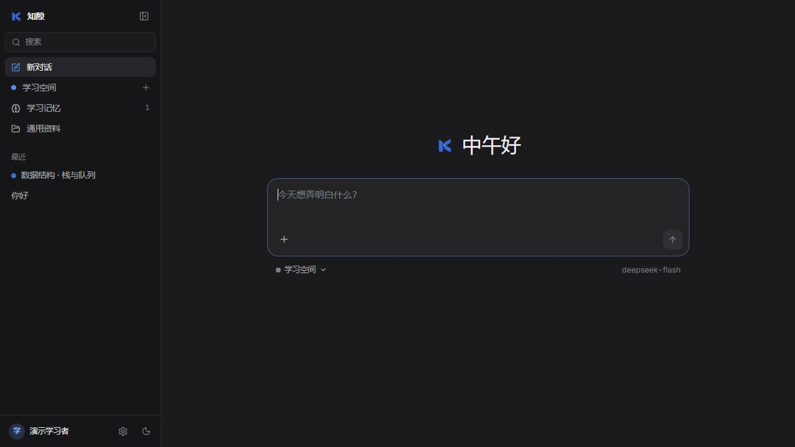
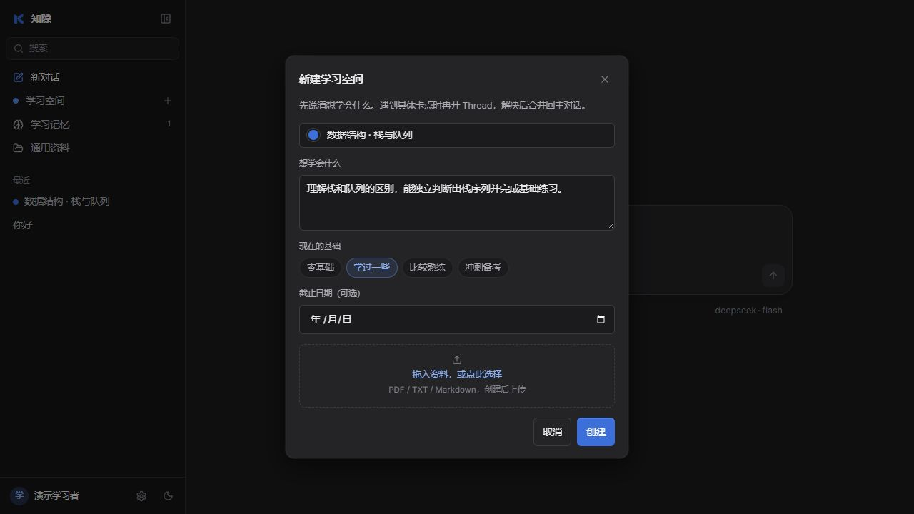
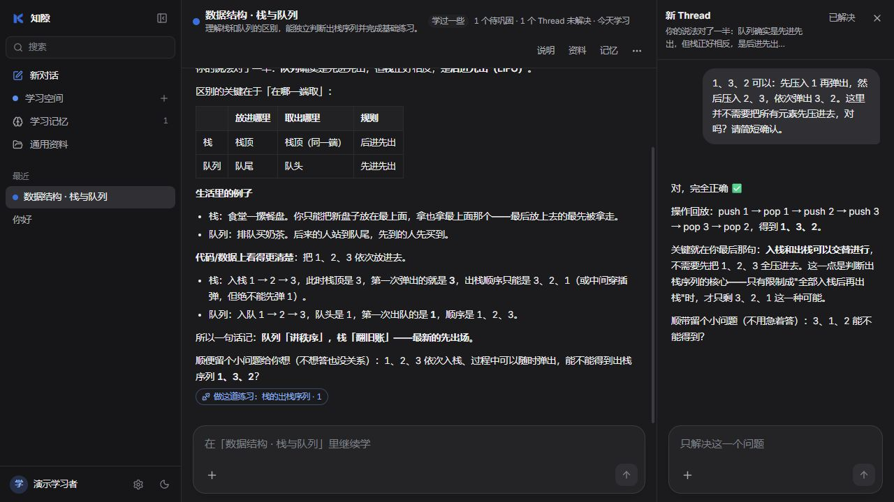
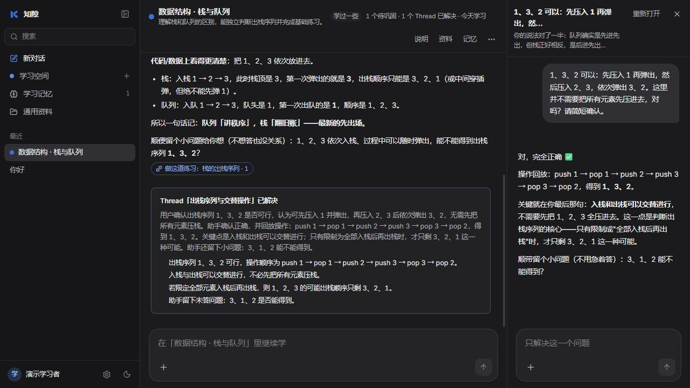
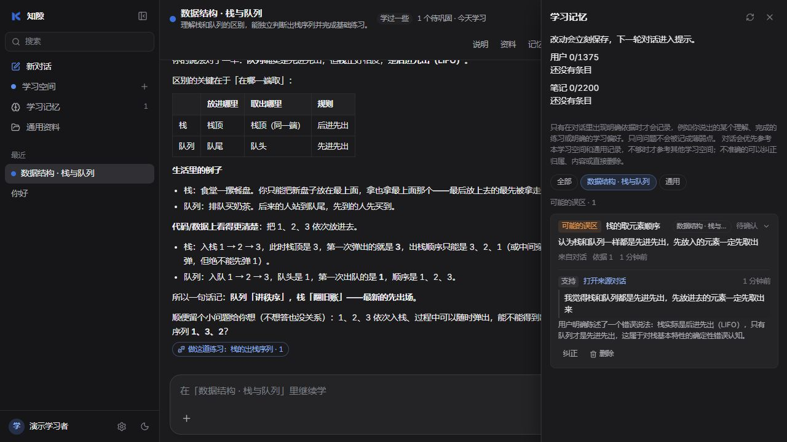

# 知隙 KnowGap

**把一次提问，接成持续的学习。**

KnowGap 是带长期记忆的 AI 学习伙伴。直接开始对话，或建立学习空间：在主对话描述需求，AI 协调学习路线，主动创建或续接 Thread 并开始执行；用户在右侧深入交互，进展与结果回到主对话。

学习记录附带用户原话证据，用户画像和环境笔记由 Agent 的记忆工具维护，历史会话则可以按需检索。

> 黑客松 MVP，面向本机演示。当前使用固定身份 `demo-student-001`，尚无登录和真实多用户隔离。

## 实际界面

以下截图于 2026-10-15 在本地运行当前版本时拍摄，学习空间中的回复来自已配置的真实模型。

### 从一句话开始

首页直接提问；需要长期推进时，再选择或新建学习空间。



### 为学习建立主线

填写目标与当前基础，按需要补充截止日期和资料。每个空间有自己的主对话、Thread、资料与学习记录。



### 把卡点放进 Thread

在主对话描述任务，AI 会创建或续接 Thread 并立即开始。相关补充会转交给已有 Thread，执行中收到的补充按顺序处理。右侧显示正在执行、等待你、空闲和已解决；点主对话中的进展卡片可以查看详情和直接参与。点“已解决”后，仍可编辑模型起草的小结并合并回主对话。

2026-10-16 更新：下方截图保留此前版本的外观；新的协调与执行流程见 [Thread 设计与验证](docs/thread-coordination.md)。



确认小结后，主线会保留可重新打开的已解决卡片。



### 看得见依据的学习记忆

记录展示知识点、状态、来源对话和用户原话。可以纠正内容、修改归属或删除。



## 当前能力

| 能力 | 当前行为 |
| --- | --- |
| 自由对话 | 流式回答，支持停止、重新生成和历史恢复；练习题为可选上下文 |
| 学习空间 | 保存目标、基础、截止日期和说明；主对话推进路线，Thread 处理卡点 |
| 学习进度 | 展示待巩固、已掌握、未解决 Thread 和最近学习情况 |
| 资料 | 上传 PDF、TXT、Markdown；按空间归属检索资料 |
| 学习记忆 | 记录误区、掌握与学习偏好，附原话证据，支持纠正、删除和归属筛选 |
| Agent 记忆 | 维护 USER 用户画像与 MEMORY 环境笔记，支持新增、精确修改、删除和可选审批 |
| 历史检索 | `session_search` 搜索已完成的历史消息，返回来源、角色和原文 |
| 工作区工具 | 读写与精确编辑文件、执行命令，在对话中展示工具结果和审批 |
| 桌面端 | Electron 启动器与 Windows 安装包构建脚本，随应用运行本机后端和静态前端 |

## 记忆怎样工作

| 层次 | 记录内容 | 写入与使用 |
| --- | --- | --- |
| 学习记录 `learner_memories` | 误区、掌握、学习偏好 | 回复后分析用户原话，校验连续引用；按话题召回，结合空间归属提供上下文 |
| 精选笔记 `agent_memory` | USER：身份、沟通方式、长期目标；MEMORY：环境、路径、工具约定 | Agent 调用 `memory` 的 `add / patch / remove`；每轮读取最新快照，修改下一轮生效 |
| 历史会话 | 已保存的对话原文 | Agent 按需调用 `session_search`，通过 SQLite FTS5 检索 |

- USER 上限 **1375 字**，MEMORY 上限 **2200 字**；条目去重，超限拒绝写入。
- 扫描规则拒绝部分疑似密钥和指令注入内容。这是模式匹配，无法保证覆盖全部情况。
- 设置中可开启“记忆写入需确认”，工具与后台复盘的笔记先进入待确认列表。
- 同一会话累计 10 个未因成功写入而重置的有效轮次时，触发后台笔记复盘；重新生成不重复计数。
- **删除笔记不等于清除对话历史。** 删除后笔记不再进入下一轮快照，原始对话仍可能被历史检索找到。
- 单纯提问不应被记作误区。原话校验约束证据来源，无法保证模型对知识点的判断始终正确；不准确的记录可以手动纠正。

## 本地启动

准备 Python（项目使用 3.10+ 语法）与兼容 Next.js 15 的 Node.js。在仓库根目录执行以下 PowerShell 命令。

### 1. 后端

```powershell
python -m venv backend/.venv
backend/.venv/Scripts/python.exe -m pip install -r backend/requirements-dev.txt
if (-not (Test-Path backend/.env)) { Copy-Item .env.example backend/.env }
```

在 `backend/.env` 填写模型配置，也可以启动后在界面“设置”中填写并测试：

```dotenv
LLM_BASE_URL=https://your-provider.example/v1
LLM_API_KEY=your-api-key
LLM_MODEL=your-model-name
LLM_TIMEOUT_SECONDS=45
```

服务地址包含提供商要求的版本前缀，不包含 `/chat/completions`。模型需支持 OpenAI 兼容的 Chat Completions 与 JSON object 输出；使用记忆和工作区工具还需支持 function calling。

密钥仅放后端，不能写入 `NEXT_PUBLIC_*`。界面保存的模型配置位于本机数据目录的 `ai-settings.json`，其中包含密钥，已被 Git 忽略。

```powershell
Set-Location backend
.venv/Scripts/python.exe -m uvicorn app.main:app --host 127.0.0.1 --port 8000
```

### 2. 前端

另开一个终端，回到仓库根目录：

```powershell
Set-Location frontend
npm install
```

创建或编辑 `frontend/.env.local`：

```dotenv
NEXT_PUBLIC_DATA_SOURCE=api
NEXT_PUBLIC_API_BASE_URL=http://127.0.0.1:8000
```

```powershell
npm run dev -- --hostname 127.0.0.1
```

- 应用：<http://127.0.0.1:3000>
- 健康检查：<http://127.0.0.1:8000/health>
- API 文档：<http://127.0.0.1:8000/docs>

未配置模型时可以查看页面和已有记录，生成回复需要完成模型设置。修改前端环境变量后需重启前端，生产模式需重新构建。

### 3. 可选：工作区与桌面端

在“设置”中填写已有文件夹路径，启用工作区工具。文件工具限制在工作区内；命令工具以该目录为起点，但没有文件系统沙箱，仍可访问目录外。命令始终逐次审批，文件写入可选择自动批准。

Windows 桌面打包（在仓库根目录运行）：

```powershell
./scripts/build-desktop.ps1
```

脚本构建静态前端，用 PyInstaller 打包后端，再用 electron-builder 生成安装包，输出到 `desktop/dist/`。Electron 启动本机后端并加载同源页面，数据保存在 Electron 用户数据目录。本轮验证使用浏览器开发服务，未验证安装包生成或安装。

## 验证与测试

常规测试使用临时数据库和模拟模型，不调用真实付费接口：

```powershell
# 在 backend/ 中
.venv/Scripts/python.exe -m pytest checks tests -q

# 在 frontend/ 中
npm run test:api
npm run lint
npx tsc --noEmit
npm run build
```

可选的真实模型记忆评估会使用当前本机模型配置，产生真实接口调用费用；使用独立临时数据库，不读写现有学习记录：

```powershell
# 在 backend/ 中
.venv/Scripts/python.exe checks/evaluate_live_memory.py
```

覆盖画像写入、跨会话召回、修改与删除、历史检索、审批、原话证据、学习记录纠正与删除、非法写入拦截和重启持久化。完整测试对话写入本机 `logs/live-memory-evaluation.json`，已被 Git 忽略。

本轮结果与限制见 [2026-10-15 记忆系统验证](docs/evaluation/2026-10-15-memory-system.md)。

2026-10-15：后端 165 项、前端接口 15 项通过，静态检查、类型检查和生产构建通过。真实模型首轮 16/19 项通过，受上游错误影响的 3 项定向复测全部通过；审批措辞与检索结果仍有待改进，详见报告。

## 代码与文档

```text
frontend/                 Next.js 15 / React 19 / TypeScript 界面
backend/app/chat/         对话、SSE、Thread、学情分析和工具循环
backend/app/memory/       SQLite、长期笔记、FTS5 检索
backend/app/agent_tools/  文件、命令、memory 与 session_search
backend/app/services/     模型设置、资料与外部搜索
backend/tests/            自动化测试
backend/checks/           核心回归与可选真实模型评估
desktop/                  Electron 启动器与打包配置
scripts/                  桌面构建脚本
docs/                     设计说明、截图与验证记录
```

浏览器开发模式默认数据路径为 `backend/data/knowgap.sqlite3`，相对 `DATABASE_PATH` 以 `backend/` 为基准；环境配置、数据库与本地日志不提交 Git。

- [自由对话与学习空间约定](docs/free-chat.md)
- [接口约定](docs/api.md)
- [记忆治理设计记录](docs/记忆治理优化.md)
- [桌面客户端与 Agent 设计记录](docs/桌面客户端与Agent.md)
- [技术决策记录](docs/decisions.md)

设计记录包含历史现状与实施计划，当前行为以代码和验证记录为准。当前没有图片输入、完整多用户认证，以及 Agent 命令的沙箱执行环境。
