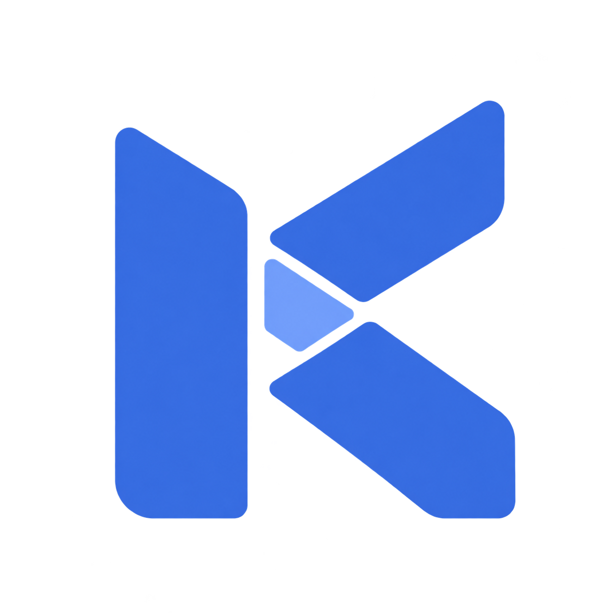
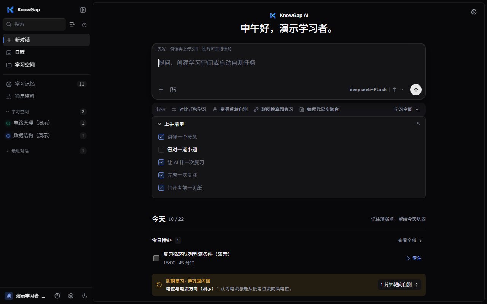
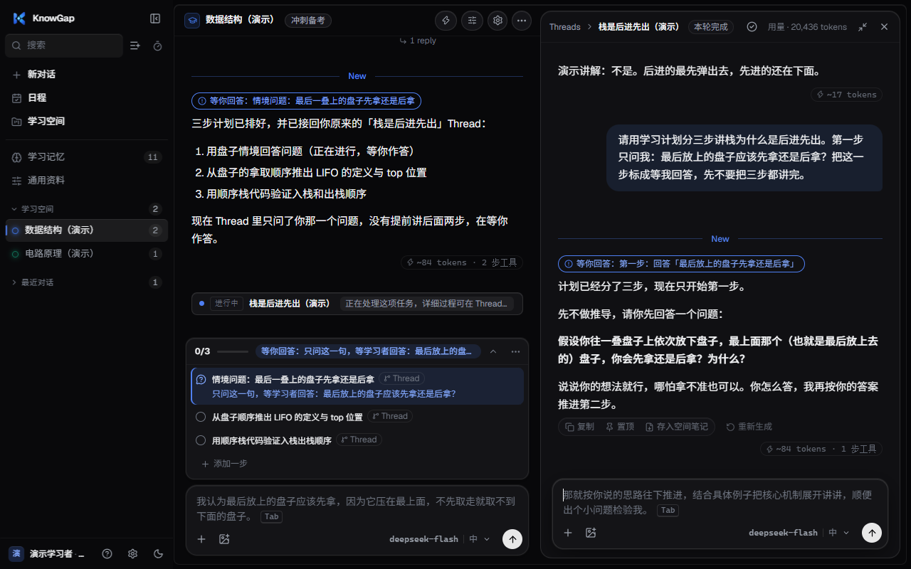
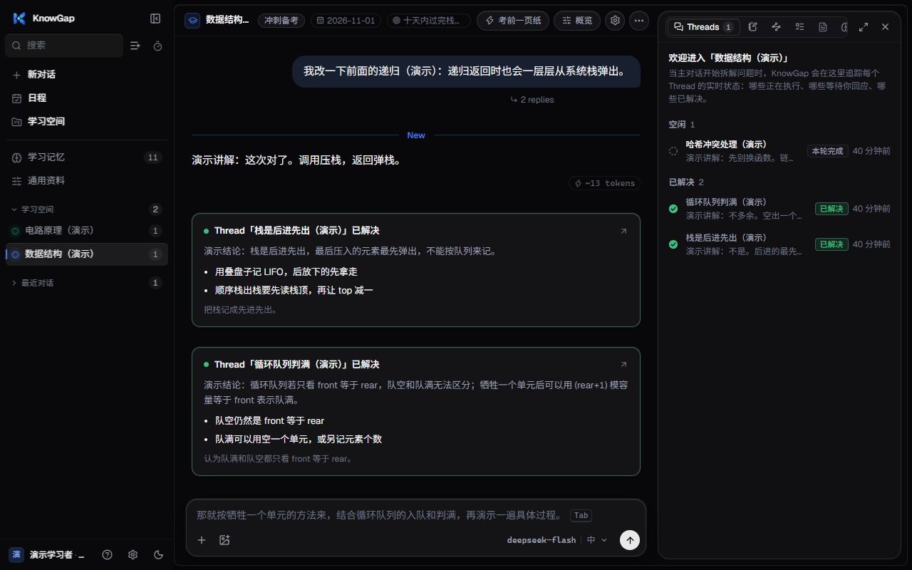
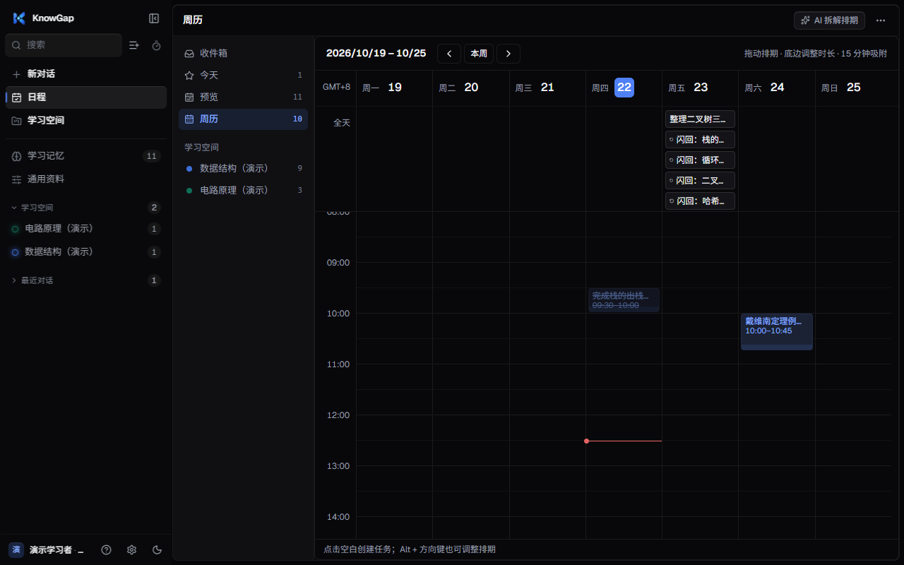
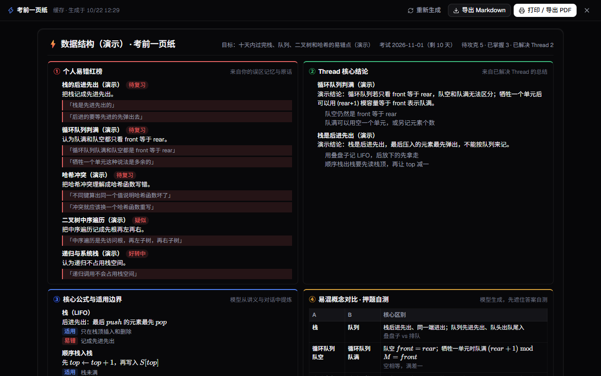
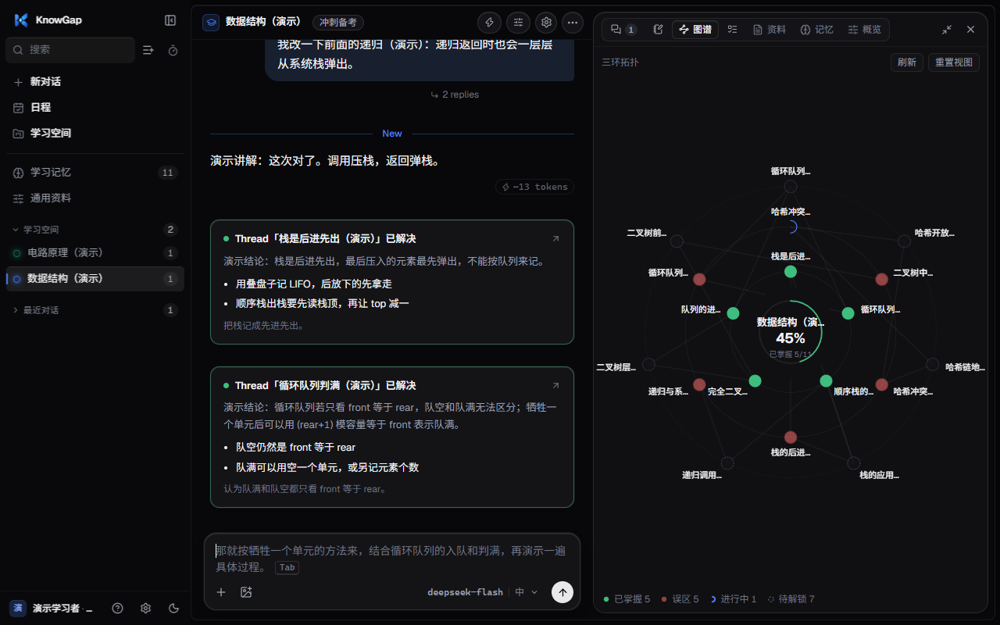
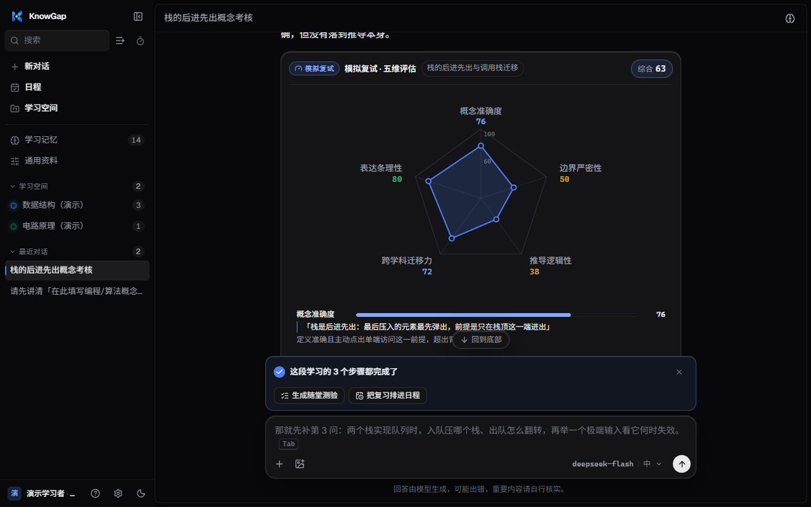

# 知隙 KnowGap

**记得你说错过什么的 AI 学习伙伴**

带着原话记下误区 · 等你答对才往下走 · 第 1、3、7 天自动回来复习

[**下载**](#下载) · [**快速开始**](#快速开始) · [**功能**](#功能) · [**常见问题**](#常见问题) · [**工作原理**](docs/how-it-works.md) · [**路线图**](#路线图)

---

## 为什么是知隙

通用聊天能把这道题讲懂，但讲完就散了：换个对话，它不记得你上次把栈说成先进先出；一问就给完整答案，你没机会自己改口；错题全靠自己想起来复习。

知隙把这些接成一个闭环，并且关键判断由服务端把关，不靠模型「听话」：

<table>
<tr>
<td width="33%" valign="top">

### 🧷 误区带着原话

记下的每一条误区，都必须能在你那条消息里逐字找到。只问「这是什么」、只说「不懂」，不会被记成误区。

</td>
<td width="33%" valign="top">

### ✋ 答对才算完成

学习计划里「等你回答」的一步，模型讲完不算数。你在之后真的作答、原话对得上，这一步才会被勾掉。

</td>
<td width="33%" valign="top">

### 🔁 复习自己找上门

没解决的误区会变成日程里的闪回任务：次日一次，完成后隔 3 天、再隔 7 天，不用你自己记得。

</td>
</tr>
</table>

## 下载

| 平台 | 安装包 | 说明 |
| --- | --- | --- |
| Windows 10 / 11 | [最新版 `KnowGap-Setup-*.exe`](https://github.com/YinLingxiao/KnowGap/releases/latest) | 支持应用内自动更新（v0.5.6 起） |
| macOS / Linux | 暂无安装包 | 可[从源码运行](docs/development.md) |

历史版本和更新日志见 [Releases](https://github.com/YinLingxiao/KnowGap/releases)。

## 快速开始

1. **安装并打开。** 运行安装包，登录页可以选「使用本机演示身份直接进入」。
2. **连上模型。** 首次进入会要求填写一个 OpenAI 兼容的模型服务（地址、密钥、模型名）。地址不要带 `/chat/completions`；记忆和工具功能需要模型支持 function calling。测试通过后自动放行。
3. **开始学。** 欢迎页会问「你最近在学什么？」，回答后会建好一个学习空间。也可以直接在首页提问，或把课件拖进来。

想先看看效果：源码运行时执行 `backend\.venv\Scripts\python.exe backend\scripts\seed_demo.py`，会导入「数据结构（演示）」「电路原理（演示）」两个带误区、支线和日程的演示空间。

## 功能

### 学习计划：边讲边推进

多步讲解拆成 1–8 步，同时只有一步在进行；需要你作答的一步会停在「等你回答」，直到你真的答了。你也可以在计划条上跳过、重置或加一步。

### 学习空间：主线与支线

每个学习空间有目标和截止日期。主线负责拆解，具体卡点开成支线单独攻克，解决后小结自动合并回主线。

### 日程与闪回复习

预览、周历两种视图；按 `Q` 一句话快录（自动识别日期、时间、`#空间`、优先级）；对话里也能让 AI 帮你排复习。支持提醒和导出 `.ics`。

### 考前复盘

- **考前一页纸**：个人易错红榜（带原话）、支线结论、核心公式、易混对比与押题自测，可导出 Markdown / PDF。
- **知识迷雾图**：已掌握 / 待攻克 / 尚未解锁的概念三环，点节点就能开支线。
- **模拟复试 `/viva`**：三问追问，结束后出五维雷达，每条评语都引用你的原话。

<table>
<tr>
<td></td>
<td></td>
<td></td>
</tr>
</table>

### 不只是文字

| 能力 | 说明 |
| --- | --- |
| 📄 课件与文档 | PDF、Word、PPT、Excel、文本解析后按页引用；支持精读、概括、转笔记、出题自测、检查作业 |
| 📝 生成与修改文件 | 让 AI 直接产出 `.docx` / `.pptx` / `.xlsx` / `.pdf`，或在你上传的文件上修改并另存 |
| 🖼️ 图片批改 | 拍照或粘贴作答，视觉模型转写、逻辑模型判错，在原图上圈出错处 |
| 💻 代码实验台 | 本机运行 Python、JavaScript、C、C++；没装环境时退回静态检查 |
| 🔎 联网真题 | 检索可溯源的真题，对不上原文的丢掉，不编年份和题号 |

### 桌面体验

关闭缩到托盘、`Alt+Space` 全局快问、单实例、应用内更新。学习记录、对话和日程都存在本机 SQLite。

> 每个机制的细节（证据怎么校验、状态怎么流转、闪回怎么排）都写在 **[工作原理](docs/how-it-works.md)** 里。

## 常见问题

<b>需要什么模型？要付费吗？</b>

知隙本身免费，但需要你自备一个 OpenAI 兼容的 Chat Completions 服务（自己的 API Key）。模型要能返回 JSON；记忆和工具功能需要 function calling。回复质量取决于你选的模型。可以在「设置 → 模型接入」里配置多个服务商和模型。

<b>我的数据存在哪里？</b>

全部在本机：`%APPDATA%\knowgap-desktop` 下的 SQLite 数据库和配置文件。调用模型时，对话内容和检索到的资料会发送给你配置的模型服务。卸载时会询问是否删除数据目录，默认保留；升级不会动它。

<b>支持 macOS / Linux 吗？</b>

目前只构建和验证了 Windows 安装包。其他系统可以按 [本地开发指南](docs/development.md) 用源码运行浏览器版。

<b>和直接用 ChatGPT / Claude 学有什么区别？</b>

通用聊天每次对话都是新的。知隙会记住你具体错在哪（带原话），下次换个对话也会按这个追问；讲解要等你作答才推进；没解决的误区会按间隔自动回到日程。详见 [工作原理](docs/how-it-works.md)。

<b>开发者工具安全吗？</b>

默认关闭。开启并指定一个工作区后，模型才能读写该目录、执行命令，命令每次都要你点批准。它没有文件系统沙箱，已知限制见 [工作原理 · 质量与验证](docs/how-it-works.md#质量与验证)。

## 路线图

- [ ] 流式卡片的字体与动效、整体 UI/UX 打磨
- [ ] 主线与支线协同体验改进
- [ ] 多模型预设，输入框内一键切换模型
- [ ] 复盘页重做：按时间范围生成学习总结
- [ ] 文件库：集中管理上传过的资料
- [ ] 编程方向：把学习能力接入 IDE 里的 Agent
- [ ] 账号与可选的云同步（本地优先）

有想法或遇到问题，欢迎提 [Issue](https://github.com/YinLingxiao/KnowGap/issues)。

## 参与开发

知隙由 Electron（桌面壳）+ Next.js 15 / React 19（前端）+ FastAPI（后端）+ SQLite 组成。

- [本地开发与构建](docs/development.md)：环境准备、启动前后端、演示数据、桌面打包
- [工作原理](docs/how-it-works.md)：机制设计、技术架构、测试与已知限制
- `docs/` 下还有更早的设计说明和接口约定，和当前代码冲突时以代码为准

## 贡献者

- [YinLingxiao](https://github.com/YinLingxiao)
- [Ccui](https://github.com/xxxxbai-ai)：资料库预览面板（PR #12）

## 许可证

[MIT](LICENSE) © 2026 YinLingxiao

如果知隙对你有帮助，欢迎点一个 ⭐

