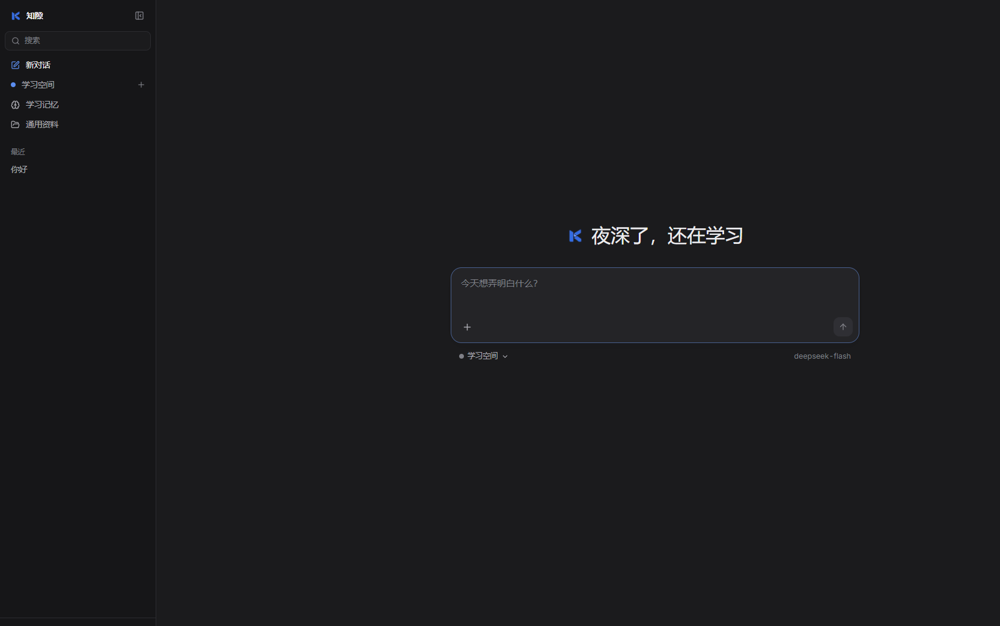
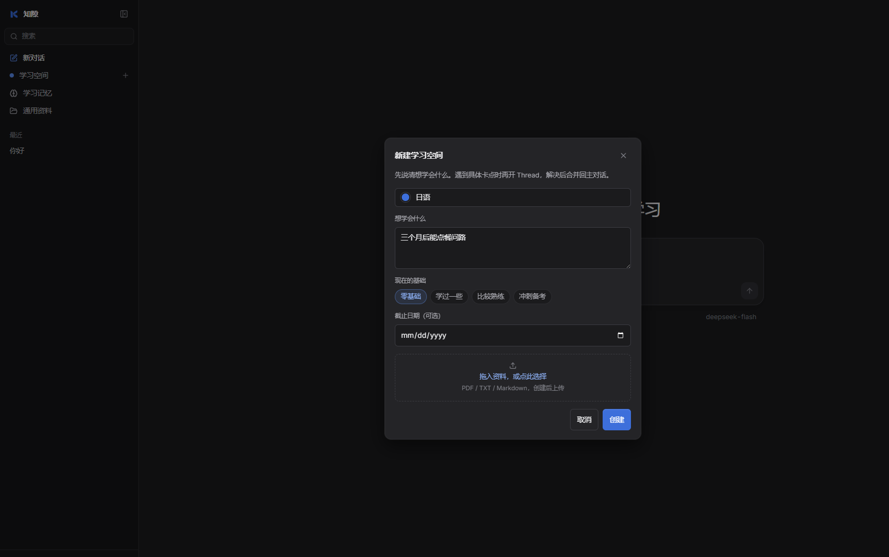
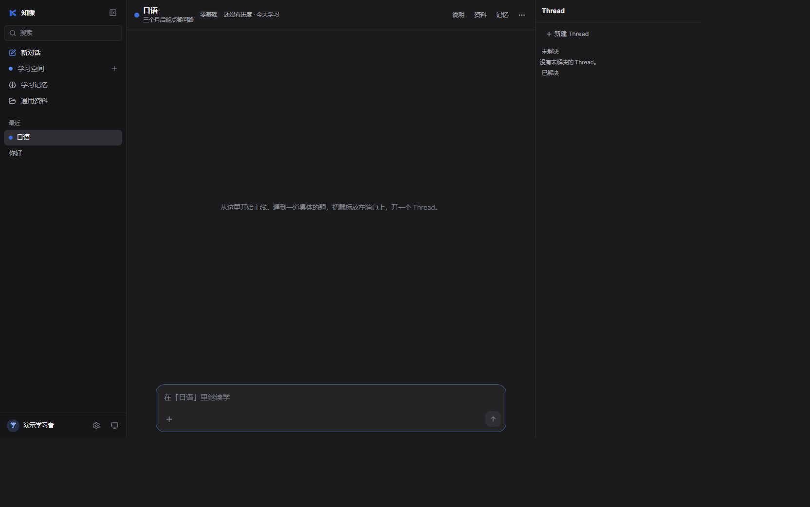

# KnowGap（知隙）

AI 学习伙伴。随便聊也能开始；要认真学一件事时，建一个**学习空间**：一条主对话走完整条路线，具体卡点用 Thread 单独解决，解决后把小结合并回主线。记下来的学习情况必须有用户原话作证据。

当前是黑客松 MVP，演示身份固定为 `demo-student-001`，没有登录和多用户隔离。

## 这个 MVP 做什么

- **自由对话。** 首页直接提问，不必先选题。练习题只是可选上下文。
- **学习空间。** 新建时填写名称、想学会什么、现在的基础（零基础 / 学过一些 / 比较熟练 / 冲刺备考）、可选截止日期和资料。模型按基础调整讲解深度，临近截止日期更重练习。
- **主对话 + Thread。** 每个空间只有一条主对话。遇到具体题目或卡点，从那条消息开一个 Thread。点「已解决」后，模型先起草小结，改完确认才作为卡片合并回主对话，后面的教学能接上。
- **学习进度。** 总览卡片显示待巩固、已掌握、未解决 Thread 和最近学习时间，数字来自有依据的学习记忆，不写「更新于」。
- **学习记忆。** 误区、掌握和学习偏好分开记。证据必须是用户原话里的连续片段；提问不能当成误区。用户可以纠正或删除。
- **资料。** 空间里的资料只在这个空间检索；未归类资料所有对话都能用。

不做：自动判断并弹出「该开 Thread」、图片输入、思考过程显示、空间置顶和图标库。

## 界面

首页可以直接问，也可以指定这次进入哪个学习空间。



新建学习空间时先说清目标和基础。名称为空不能创建。



空间页左侧是主对话，右侧是 Thread。解决后的小结回到主对话。



## 本地运行

模型密钥只放后端环境变量，不要写进 `NEXT_PUBLIC_*`，也不要提交。

```powershell
python -m venv backend/.venv
backend/.venv/Scripts/python.exe -m pip install -r backend/requirements-dev.txt
Copy-Item .env.example backend/.env
```

编辑 `backend/.env`，填写 `LLM_BASE_URL`、`LLM_API_KEY`、`LLM_MODEL`。接口需兼容 OpenAI Chat Completions，并支持 JSON object 输出。

```powershell
Set-Location backend
.venv/Scripts/python.exe -m uvicorn app.main:app --host 127.0.0.1 --port 8000
```

前端另开一个终端：

```powershell
Set-Location frontend
npm install
```

`frontend/.env.local`：

```dotenv
NEXT_PUBLIC_DATA_SOURCE=api
NEXT_PUBLIC_API_BASE_URL=http://127.0.0.1:8000
```

```powershell
npm run dev
```

打开 <http://localhost:3000>。模型也可以在界面设置里填写并测试，密钥只发到本机后端，后端不回传。

## 文档

- [自由对话与学习空间约定](docs/free-chat.md)
- [系统架构](docs/architecture.md)
- [接口约定](docs/api.md)
- [技术决策记录](docs/decisions.md)
