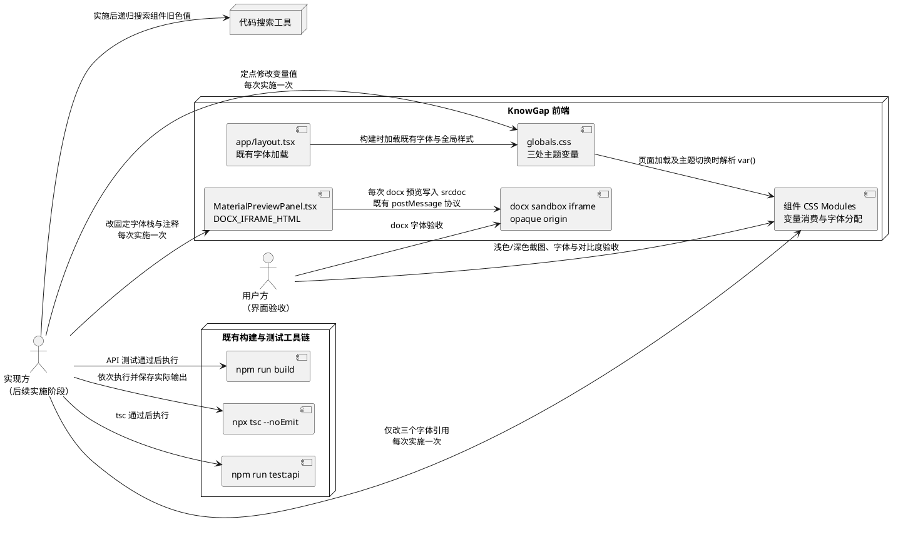
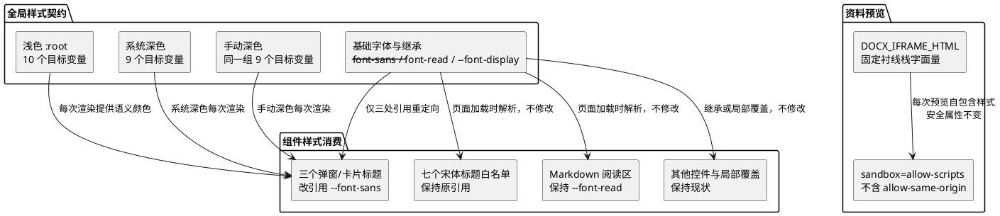
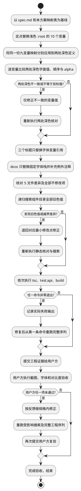
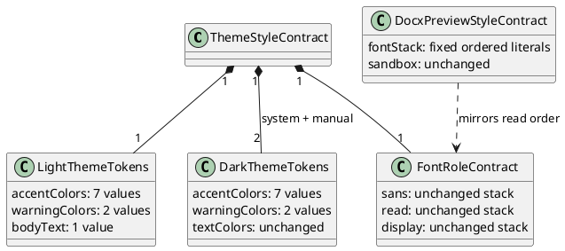

# 书卷风界面风格调整 · 技术实现方案

> 需求基线：`.codeartsdoer/specs/bookish_theme/spec.md`。本方案只描述后续实施方式，不在设计阶段修改业务代码、执行实施任务或出具界面验收结论。

# 一、需求与存量功能关系分析

## 1.1 需求功能与存量功能对比

### 1.1.1 已实现功能

| 需求功能 | 存量功能 | 代码位置 | 匹配度 |
|---------|---------|---------|--------|
| 使用既有黑体、宋体字体资源，不新增字体包 | 已打包 Geist、Source Serif 4、Noto Serif SC，并定义 `--font-sans` / `--font-serif` / `--font-display` / `--font-read` | `frontend/src/app/layout.tsx:2-8`；`frontend/src/app/globals.css:4-14` | 100% |
| 操作面默认采用黑体 | `body` 使用 `--font-sans`，按钮和表单控件继承字体 | `frontend/src/app/globals.css:249-255`、`frontend/src/app/globals.css:367-373` | 100% |
| 助手回复正文使用阅读宋体，行高保持 1.65 | Markdown 正文引用 `--font-read` 与 `--leading-read` | `frontend/src/components/chat/Markdown.module.css:1-7`；`frontend/src/app/globals.css:79-81` | 100% |
| 回复正文 Markdown 标题保持展示宋体、字重 600 | `h1` 至 `h4` 已引用 `--font-display` 且 `font-weight: 600` | `frontend/src/components/chat/Markdown.module.css:32-40` | 100% |
| 品牌名和既有页面主标题保持宋体白名单 | 认证品牌、欢迎页、对话问候、空间列表、日程、资料页主标题均已有 `--font-display`，字重均为 600 | `AuthView.module.css:44-49`；`Welcome.module.css:16-22`；`ChatApp.module.css:459-466`；`SpacesPage.module.css:52-56`；`AgendaPage.module.css:21-27`；`MaterialLibrary.module.css:66-70` | 100% |
| `data-read-font="sans"` 回退行为保持不变 | 根节点属性可将 `--font-read` 切回 `--font-sans` | `frontend/src/app/globals.css:118-119` | 100% |
| 系统深色与手动深色共用同一组语义变量 | 已存在浅色 `:root`、系统深色 `:root:not([data-theme="light"])`、手动深色 `:root[data-theme="dark"]` 三处定义 | `frontend/src/app/globals.css:1-116`、`frontend/src/app/globals.css:137-185`、`frontend/src/app/globals.css:187-232` | 100% |
| 高密度工具局部维持黑体 | TaskInspector、CheatSheet 已局部覆盖阅读与展示字体变量 | `frontend/src/components/agenda/TaskInspector.module.css:315-321`；`frontend/src/components/chat/CheatSheet.module.css:355-360` | 100% |
| 13px 空间页顶栏标题保持黑体 | `.heading h1` 使用 `--text-sm`，没有 `--font-display` 声明，继承 `body` 黑体 | `frontend/src/components/chat/SubjectPage.module.css:76-86`；`frontend/src/app/globals.css:249-255` | 100% |
| SVG 与等宽字体两个字面量例外原样保留 | PDF SVG 使用 `fontFamily="sans-serif"`；页面编辑器使用既有等宽兜底 | `frontend/src/components/MaterialLibrary.tsx:44`；`frontend/src/components/chat/SubjectPage.module.css:1726-1733` | 100% |
| docx 预览维持 opaque origin 安全隔离 | `sandbox="allow-scripts"`，不含 `allow-same-origin`；经 `srcdoc` 和 `postMessage` 渲染 | `frontend/src/components/MaterialPreviewPanel.tsx:241-276`、`frontend/src/components/MaterialPreviewPanel.tsx:286-335` | 100% |
| 三条工程验收命令可执行 | 已有构建、API 测试脚本和 TypeScript 依赖 | `frontend/package.json:5-11`、`frontend/package.json:42-49` | 100% |

判定依据：以上条目均能在现有代码中找到完整机制，后续只需保持或复用，不需要新增组件、样式变量、字体资源、接口或运行状态。行号是设计时定位信息，实施与验收以文件和选择器为稳定锚点。

### 1.1.2 需要扩展的功能

| 需求功能 | 存量功能 | 差异说明 | 扩展方向 |
|---------|---------|---------|---------|
| 浅色主题改为黛蓝、朱砂红及暖黑正文 | 浅色 `:root` 已有完整语义变量，当前强调色为亮蓝、警示色为旧红、`--text` 为 `#1c1b18` | 变量名、消费方式、透明度和派生关系不变，仅 10 个变量的字面值不符合目标 | 在 `globals.css` 浅色 `:root` 内按 2.3.2 对照表逐项定点替换；不全局替换 `#1c1b18`，因为 `--ink-solid` 必须保留 |
| 两处深色主题同步改为黛蓝和朱砂红 | 两处深色块均已有 7 个强调色变量和 2 个红色变量 | 目标色值不同；两处必须字面值一致；深色三级文字色不变，alpha 不变 | 使用同一份九变量映射分别更新两个深色块，不合并选择器、不调整级联结构；实施后逐变量交叉核对 |
| 弹窗和卡片标题改回黑体 | TaskComposer、LearningWidget、TodayPanel 三处标题当前直接引用 `--font-display` | 输入仍是相同标题元素，输出应由展示宋体改为界面黑体；字号、字重、行高、间距均不变 | 只把三个选择器的字体引用改为 `var(--font-sans)`，不改选择器及其他声明 |
| docx 阅读预览采用与 `--font-read` 同顺序的衬线栈 | `DOCX_IFRAME_HTML` 的 `body` 当前为 `font-family: sans-serif` | iframe 是 opaque origin，不能继承父页面变量；安全边界已满足，仅字体不符 | 仅替换 iframe 内联 `body` 字体栈并补充原因注释；保持 `srcdoc` 分发、脚本顺序、消息协议和 sandbox 不变 |

兼容性约束：上述扩展均为样式值或引用替换，不改变组件 DOM、React Props、CSS Module 类名、主题属性、数据流或后端契约。不得借本次调整重构两处深色定义，也不得将例外扩散到其他 SVG、代码区或预览格式。

### 1.1.3 需要新增的功能或接口

本需求**没有新增运行时业务功能、公开接口、CSS 全局变量、TypeScript 类型或持久化模型**。需要新增的只有以下非运行时交付产物：

| 分组 | 产物 | 输入 | 输出与核心逻辑 | 依赖关系 |
|------|------|------|----------------|----------|
| docx 预览 | opaque origin 字体例外说明注释 | 既有 `DOCX_IFRAME_HTML` 与 `--font-read` 字体顺序 | 说明无法继承父页面变量及保留固定字面量的原因；不引入新的消息字段 | 依赖现有沙箱模型 |
| 主题核对 | 三处主题定义一致性核对记录 | 浅色映射表、两处深色映射表 | 确认目标变量数量、字面值、alpha 和未修改项均符合基线 | 依赖 `globals.css` 最终差异 |
| 工程交付 | 命令输出与组件旧色值搜索证据 | 三条工程命令、递归搜索命令 | 保存工作目录、命令、实际输出、退出结果；无匹配与执行失败分开解释 | 依赖实施完成后的工作树 |
| 用户验收 | 独立的界面验收结论 | 用户方截图、computed font-family、Contrast 读数 | 由用户方给出通过或退回结论，实现方不得代填 | 依赖实现方交付的可验收版本 |

## 1.2 存量功能详细分析

### 1.2.1 主题变量契约与约束

- **接口契约**：上游是系统 `prefers-color-scheme` 和根节点 `data-theme`；下游是引用语义变量的组件。输出为当前主题下的计算颜色，不产生网络、存储或状态副作用。
- **业务规则**：浅色变量位于 `:root`；系统深色由媒体查询内的 `:root:not([data-theme="light"])` 命中；手动深色由 `:root[data-theme="dark"]` 命中。手动浅色通过排除条件避免落入系统深色块。
- **扩展点**：组件已通过 `var()`、`rgb()` 透明通道和 `color-mix()` 消费变量，因此只需改变量定义，不需要逐组件改色。
- **约束**：两处深色块是独立级联分支，改其中一处不会自动同步另一处；必须双向核对。`--focus-ring`、`::selection`、按钮、链接、警示等会随变量联动，属于预期影响；边框、阴影、背景、绿色、琥珀色和非目标文字色不属于可变更范围。
- **特殊兼容点**：浅色 `--text` 与 `--ink-solid` 当前都为 `#1c1b18`，但只有前者改为 `#23211c`。禁止对整个文件执行该旧色值的无差别替换。

### 1.2.2 字体继承、白名单与局部覆盖

- **默认继承**：`body` 是操作面黑体的根来源，表单元素通过 `font: inherit` 继承。侧栏、设置项及未显式声明字体的控件无需新增规则。
- **阅读分支**：`.markdown` 显式使用 `--font-read` 和 `--leading-read`；`.widgetSlot` 显式返回 `--font-sans`，防止交互卡片继承阅读宋体。
- **标题分支**：当前直接引用 `--font-display` 的组件标题由七个白名单和三个待改回黑体的位置组成。实施后，七个白名单保持原声明，三个弹窗/卡片标题改为 `--font-sans`。
- **局部优先级**：TaskInspector 与 CheatSheet 在局部作用域覆盖 `--font-read`、`--font-display`，其实际优先级高于全局默认分配，不能为了“统一宋体”而删除。
- **明确排除**：`SubjectPage.module.css` 的 `.heading h1` 是 13px 顶栏标题，不是页面主标题。其继承黑体的现状已经满足需求，整个文件不在修改清单中。
- **字面量边界**：`fontFamily="sans-serif"` 的 PDF SVG 是图标图形的一部分；`var(--font-mono, ui-monospace, monospace)` 是等宽编辑场景。两者都不得改为三个阅读/界面字体变量。其他既有 `var(--font-mono)`、`var(--font-mono-cjk)` 和 `inherit` 继续使用，不属于新增例外。

### 1.2.3 docx 隔离预览契约

- **输入**：父页面取得固定 vendor 脚本文本和文档字节，通过消息发送给 iframe；消息来源必须对应父窗口或当前 iframe。
- **输出**：iframe 内渲染 docx，并回传 `ready` 或 `error`；父页面据此维持既有错误提示。
- **安全边界**：`sandbox="allow-scripts"` 且没有 `allow-same-origin`，iframe 不能读取父页面 DOM、cookie 或 localStorage。`targetOrigin="*"` 是 opaque origin 下的既有约束，本需求不重新设计消息协议。
- **字体约束**：父页面 CSS 变量不能作为该独立文档的样式依赖。允许的唯一新增字体字面量是 2.2.2 规定的固定衬线栈，且必须由注释解释原因；不得插值用户输入或文档内容。
- **禁止扩展**：不新增 `allow-same-origin`，不移除 sandbox，不将 docx 内容移出 iframe，不新增外部脚本、字体 URL、消息字段或其他预览格式例外。

### 1.2.4 实施范围与回归约束

后续实施预计只修改以下 5 个业务文件：

1. `frontend/src/app/globals.css`；
2. `frontend/src/components/agenda/TaskComposer.module.css`；
3. `frontend/src/components/chat/LearningWidget.module.css`；
4. `frontend/src/components/home/TodayPanel.module.css`；
5. `frontend/src/components/MaterialPreviewPanel.tsx`。

`MaterialLibrary.tsx`、`SubjectPage.module.css`、七个宋体白名单文件、TaskInspector、CheatSheet、侧栏和设置弹窗均是核对对象而非修改对象。当前对 `frontend/src` 的目标旧色值检索仅命中 `globals.css`，组件目录未发现本次目标旧色值；该现状不能替代实施后的规定搜索与交付记录。
# 二、增量设计方案

## 2.1 实现模型

### 2.1.1 上下文视图



外部依赖不新增：字体仍由 `layout.tsx` 既有依赖加载，docx 脚本仍来自既有 vendor 路径。后端、API、消息队列、缓存、数据库和界面文案均不在上下文变更范围内。

### 2.1.2 服务/组件总体架构



配置项及取值策略：

| 配置/契约 | 当前来源 | 本方案策略 |
|-----------|----------|------------|
| `prefers-color-scheme` | 操作系统与浏览器 | 保留媒体查询，不改触发条件 |
| `data-theme` | 既有主题切换逻辑 | 保留 `light` / `dark` / 未设置的系统跟随行为 |
| `data-read-font="sans"` | 根节点既有回退开关 | 保留规则和优先级，不新增 docx 消息同步协议 |
| 三个字体变量 | `globals.css` 既有定义 | 字体栈不变，只调整三个组件引用 |
| docx iframe 字体栈 | `DOCX_IFRAME_HTML` 内部固定字符串 | 采用规格指定顺序；不是用户配置项，不开放动态输入 |

### 2.1.3 实现设计文档

实施按“单一对照表、最小差异、先静态核对后工程验收”的顺序推进：



关键方案决策：

| 决策 | 选择 | 理由 |
|------|------|------|
| 颜色修改层级 | 只改全局语义变量，不逐组件写死新色 | 保留浅色/深色派生、焦点环、选区和按钮的一致行为，避免遗漏 |
| 深色同步方式 | 同一映射分别修改两块，逐变量交叉比较 | 合并非目标选择器或复制整个样式块会改变级联和差异范围 |
| 字体修改层级 | 只改三个既有引用，不新增通用标题规则 | 防止卡片、顶栏和局部高密度工具被宋体规则误覆盖 |
| `SubjectPage` 处理 | 整个文件不改，尤其不碰 `.heading h1` 和等宽兜底 | 13px 顶栏已是继承黑体，等宽声明是明确例外 |
| docx 字体来源 | 使用固定衬线栈字面量，不放开同源、不引用父变量 | opaque origin 无法继承父变量；保持沙箱是最小且安全的方案 |
| 验收职责 | 工程证据与界面证据分开交付 | 命令通过不能证明截图、computed font-family 或对比度通过 |

## 2.2 接口设计

### 2.2.1 总体设计

本方案不新增函数接口。对外契约仍是既有 CSS 自定义属性、CSS Module 类名、根节点主题属性和内部 docx 预览常量，不使用字符串 Map 替代类型契约，也不引入 `any` 或类型转换。

| 接口分类 | 接口/契约 | 变更内容 | 稳定性 | 版本策略 |
|----------|-----------|----------|--------|----------|
| 主题颜色 | `--accent*`、`--red*`、浅色 `--text` | 只改值，不改名称和 CSS `<color>` 类型 | 稳定 | 原地更新，无迁移、无并行版本 |
| 字体角色 | `--font-sans`、`--font-read`、`--font-display` | 定义不变，仅三处消费引用变化 | 稳定 | 沿用既有变量，不新增别名 |
| 组件选择器 | 三个标题选择器及七个白名单选择器 | 类名和元素关系不变 | 稳定 | 不引入选择器版本 |
| 主题属性 | `data-theme`、`data-read-font` | 不变 | 稳定 | 无变更 |
| docx 内部模板 | `DOCX_IFRAME_HTML` | 改固定字体栈并加注释 | 内部稳定 | 不公开、不新增消息字段 |
| 工程命令 | `tsc`、`test:api`、`build` | 不变 | 稳定 | 沿用 `frontend/package.json` |

接口变更失败时以最终差异和三处变量对照表为回退单元，不留下半套新色值或部分标题引用。CSS 变量无业务错误码；docx 渲染失败仍走既有 `error` 状态，工程命令失败按 2.5 处理。

### 2.2.2 接口清单

#### A. 主题颜色变量

- **接口签名**：`--accent`、`--accent-hover`、`--accent-text`、`--accent-soft`、`--accent-soft-strong`、`--accent-solid`、`--accent-solid-hover`、`--red`、`--red-soft`，以及浅色 `--text`；值类型保持 CSS `<color>`。
- **业务说明**：向链接、选中态、焦点环、实心按钮、警示和正文提供统一语义颜色。
- **前置条件**：只在规格指定的三处主题定义中修改；保持变量名和 alpha。
- **后置条件**：所有既有 `var()` 消费方自动取得新色；组件颜色结构、DOM 和交互逻辑不变。
- **异常映射**：无运行时错误码。两处深色不一致或对比度被用户方判为不达标时，不视为验收通过，按 2.5 的修正流程处理。
- **既有消费示例**：组件继续使用 `color: var(--accent-text)`、`background: var(--accent-soft)`；不是新增组件写死色值的许可。

精确改前/改后值见 2.3.2，该表是实施和核对的唯一色值来源。

#### B. 字体角色变量与组件选择器

| 接口签名 | 业务说明 | 前置条件 | 后置条件 |
|----------|----------|----------|----------|
| `--font-sans` | 全部操作面及三个弹窗/卡片标题的黑体栈 | 字体栈定义不变 | 三个目标标题从宋体变为黑体，其余属性不变 |
| `--font-read` | 助手回复和既有资料阅读分支的阅读栈 | `--leading-read` 和回退规则不变 | 阅读正文行为不回归；iframe 只复制其字体顺序，不引用变量 |
| `--font-display` | 品牌、页面主标题、Markdown 标题的展示栈 | 只保留七个白名单，字重上限 600 | 清单外不新增宋体标题 |

**仅修改的三个组件级引用：**

| 文件与选择器 | 改前引用 | 改后引用 | 必须冻结的其他内容 |
|--------------|----------|----------|--------------------|
| `components/agenda/TaskComposer.module.css` 的 `.header h2` | `var(--font-display)` | `var(--font-sans)` | `margin`、字号、600 字重、颜色及弹窗结构 |
| `components/chat/LearningWidget.module.css` 的 `.widgetTitle` | `var(--font-display)` | `var(--font-sans)` | 颜色、`--text-xl`、600 字重、行高、字距、文本换行 |
| `components/home/TodayPanel.module.css` 的 `.header h2` | `var(--font-display)` | `var(--font-sans)` | `--text-xl`、600 字重、字距及面板布局 |

**保持宋体且不改字重的白名单：**

| 文件 | 选择器 | 处理 |
|------|--------|------|
| `components/auth/AuthView.module.css` | `.brandHead h1` | 原样保留 `--font-display` 与 600 |
| `components/onboarding/Welcome.module.css` | `.card h1` | 原样保留 `--font-display` 与 600 |
| `components/chat/ChatApp.module.css` | `.greeting` | 原样保留 `--font-display` 与 600 |
| `components/chat/SpacesPage.module.css` | `.header h1` | 原样保留 `--font-display` 与 600 |
| `components/agenda/AgendaPage.module.css` | `.pageTitle` | 原样保留 `--font-display` 与 600 |
| `components/MaterialLibrary.module.css` | `.title` | 原样保留 `--font-display` 与 600 |
| `components/chat/Markdown.module.css` | `.markdown h1` 至 `.markdown h4` | 原样保留 `--font-display` 与 600 |

**明确不新增的引用：**不得向 `SubjectPage.module.css` 的 `.heading h1` 添加 `--font-display` 或 `font-family: var(--font-display)`；不得为了统一而修改 `MaterialPreviewPanel.module.css`、侧栏、设置弹窗或其他未列明选择器。既有消费方式仍是 `font-family: var(--font-read)` 或 `font-family: var(--font-sans)`，没有新的函数调用接口。

#### C. docx 内部模板字体契约

- **接口签名**：`DOCX_IFRAME_HTML` 内部 `body` 的 `font-family`，值固定为 `"Source Serif 4 Variable", "Source Serif 4", "Noto Serif SC Variable", "Songti SC", "STSong", Georgia, serif`。
- **业务说明**：字体顺序与父页面 `--font-read` 展开后的 `--font-serif` 完全一致，使 docx 阅读预览优先使用既有衬线字体并具有系统回退。
- **前置条件**：仅修改 `MaterialPreviewPanel.tsx` 的该内联样式及相邻解释注释；字体栈是固定字面量，不拼接任何外部输入。
- **后置条件**：iframe 内正文按该顺序解析字体；父页面变量、主题属性、`data-read-font` 和消息协议均未改变。
- **安全边界**：`sandbox="allow-scripts"` 原样保留，不添加 `allow-same-origin`；不改变 `srcDoc`、脚本获取与执行顺序、消息来源检查、`targetOrigin`、渲染配置和错误提示。
- **异常映射**：字体不可用由字体栈自然回退，不新增异常类型；docx 解析或渲染失败仍回传既有 `docxPreview: "error"`。
- **维护要求**：注释说明 opaque origin 不能继承父页面 CSS 变量，故该处是规格许可的固定字面量例外，并提示字体顺序需与 `--font-read` 对应栈人工保持一致。

## 2.3 数据模型

### 2.3.1 设计目标

本需求没有业务实体、持久化表、缓存结构或数据迁移。这里的“模型”仅表示样式契约的取值集合，目标是：

1. 用单一映射表消除浅色、系统深色、手动深色之间的理解偏差；
2. 保证目标变量数量准确，RGB 通道改变而 alpha 不变；
3. 保证未列明变量、字体栈、行高和布局值完全不变；
4. 支持后续差异审查与问题回退，不生成新的运行时状态。

### 2.3.2 模型实现

以下类图是只读契约模型，**不表示需要创建 TypeScript 类或新增数据对象**：



#### A. 浅色 `:root` 精确替换表

| 变量 | 改前 | 改后 | 一致性要求 |
|------|------|------|------------|
| `--accent` | `#2f5fd0` | `#2b4c7e` | 新基准黛蓝 |
| `--accent-hover` | `#2550b8` | `#23406b` | 同色相加深 |
| `--accent-text` | `#2550b8` | `#2b4c7e` | 与 `--accent` 相同 |
| `--accent-soft` | `rgb(47 95 208 / 9%)` | `rgb(43 76 126 / 9%)` | 仅换 RGB，9% 不变 |
| `--accent-soft-strong` | `rgb(47 95 208 / 16%)` | `rgb(43 76 126 / 16%)` | 仅换 RGB，16% 不变 |
| `--accent-solid` | `#2f5fd0` | `#2b4c7e` | 与 `--accent` 相同 |
| `--accent-solid-hover` | `#2550b8` | `#23406b` | 与 `--accent-hover` 相同 |
| `--red` | `#c0392f` | `#b5412f` | 新基准朱砂红 |
| `--red-soft` | `rgb(192 57 47 / 9%)` | `rgb(181 65 47 / 9%)` | 仅换 RGB，9% 不变 |
| `--text` | `#1c1b18` | `#23211c` | 只改此声明，不改 `--ink-solid` |

#### B. 两处深色定义的同步替换表

下表必须同时应用于 `@media (prefers-color-scheme: dark)` 内的 `:root:not([data-theme="light"])` 和 `:root[data-theme="dark"]`：

| 变量 | 两处改前 | 两处改后 | 一致性要求 |
|------|----------|----------|------------|
| `--accent` | `#6d93e8` | `#8aa6d6` | 两块字面值完全相同 |
| `--accent-hover` | `#86a6ee` | `#9db8e4` | 两块字面值完全相同 |
| `--accent-text` | `#8fb0f2` | `#9db8e4` | 与深色 `--accent-hover` 相同 |
| `--accent-soft` | `rgb(109 147 232 / 13%)` | `rgb(138 166 214 / 13%)` | 仅换 RGB，13% 不变 |
| `--accent-soft-strong` | `rgb(109 147 232 / 22%)` | `rgb(138 166 214 / 22%)` | 仅换 RGB，22% 不变 |
| `--accent-solid` | `#4770d0` | `#46639c` | 两块字面值完全相同 |
| `--accent-solid-hover` | `#3f67c6` | `#3a5386` | 两块字面值完全相同 |
| `--red` | `#e0705f` | `#d4786a` | 两块字面值完全相同 |
| `--red-soft` | `rgb(224 112 95 / 13%)` | `rgb(212 120 106 / 13%)` | 仅换 RGB，13% 不变 |

#### C. 同步修改与一致性核对方法

1. **单一来源**：实施时只从上述两张表取值，不根据截图或近似色另行猜测。
2. **定点修改**：先完成浅色 10 项，再将深色 9 项按相同顺序分别应用到两个深色块；不批量替换整个文件，不合并两个深色选择器。
3. **逐行三方比较**：对深色每个变量记录“目标值、系统深色值、手动深色值”，三者必须一致。比较只允许忽略缩进和换行排版，不做 hex/rgb 转换、不四舍五入、不归一化 alpha。
4. **出现次数核对**：每个目标变量在各自主题块只定义一次；深色九项各有两个目标定义，浅色十项各有一个目标定义。
5. **差异范围核对**：审查 `globals.css` 最终差异，除上述变量值外不得出现声明、选择器、注释语义的非必要变化；不得新增全局变量。
6. **alpha 专项核对**：浅色保持 9% / 16% / 9%，深色保持 13% / 22% / 13%，不得以等效小数或新的 rgba 写法替代。
7. **未修改项核对**：下表值必须原样保留，尤其是 `--ink-solid: #1c1b18`，避免被浅色 `--text` 的旧值替换误伤。

| 未修改契约 | 必须保持的值或行为 |
|------------|--------------------|
| 深色 `--text` / `--text-secondary` / `--text-tertiary` | `#ecebe6` / `#a3a097` / `#86837b` |
| 浅色 `--ink-solid` | `#1c1b18` |
| `--on-accent` | `#ffffff` |
| `--bg` | 浅色 `#fbfaf7`，深色 `#1a1917` |
| `--border` / `--border-subtle` / `--border-strong` | 三处现有值均不变 |
| `--shadow-card` / `--shadow-elevated` / `--shadow-popover` | 三处现有值均不变 |
| `--font-sans` / `--font-serif` / `--font-display` / `--font-read` | 字体栈和别名关系不变 |
| `--leading-read` | `1.65` |
| `data-read-font="sans"` | `--font-read` 回退到 `--font-sans` |

## 2.4 不修改项与回归风险控制

### 2.4.1 不修改项清单

| 范围 | 明确禁止或保持事项 |
|------|--------------------|
| 布局与结构 | 不改布局、间距、尺寸、字号阶梯、组件 DOM、TSX 结构、侧栏刚完成的布局或交互 |
| 空间页顶栏 | `SubjectPage.module.css:76` 的 `.heading h1` 保持 13px 和继承黑体，不新增宋体引用 |
| 两个既有字面量例外 | `MaterialLibrary.tsx:44` 的 `fontFamily="sans-serif"` 与 `SubjectPage.module.css:1730` 的 `var(--font-mono, ui-monospace, monospace)` 原样保留 |
| 白名单与局部覆盖 | 七个宋体白名单不改；TaskInspector、CheatSheet 局部黑体覆盖不删 |
| 既有粗体角标 | CheatSheet `.qIndex`、MaterialLibrary 徽章、TaskMenu 小标记的 700 字重不改 |
| 其他控件与代码区 | 侧栏、设置弹窗、表单、标签、既有 `var(--font-mono)` / `var(--font-mono-cjk)` / `inherit` 不做额外统一 |
| 色彩边界 | 不改边框、分割线、阴影、背景、绿色、琥珀色、深色三级文字色，不新增冷灰、纸纹或装饰 |
| 字体资源 | 不新增字体包、字体文件、图片或外部字体请求，不改既有字体栈 |
| docx 安全 | 不改 sandbox、同源策略、消息协议、脚本来源、eval 分发、渲染配置和错误处理 |
| 工程与业务契约 | 不改依赖版本、后端、API、React Props、i18n 文案及中英文消息文件 |
| 例外数量 | 不扩展其他字体族字面量例外，不把 docx 例外复制到 PDF、XLSX、CSV、Markdown 等分支 |

### 2.4.2 风险登记与控制

| 风险 | 触发方式 | 预防/发现 | 修正与回退 |
|------|----------|-----------|------------|
| 两处深色表现分叉 | 只改系统深色或手动深色之一 | 九变量三方比较和最终差异审查 | 以 2.3.2 深色表为准补齐，重新核对 |
| 误改 `--ink-solid` 或其他同旧值变量 | 对 `#1c1b18` 做全局替换 | 只编辑 `--text` 单个声明，检查未修改项 | 恢复 `--ink-solid: #1c1b18` |
| 顶栏或卡片意外变宋体 | 新增宽泛 `h1/h2` 规则或扩展白名单 | 只改三个指定选择器；复核 `SubjectPage` 零差异 | 删除越界规则，恢复继承黑体 |
| 白名单标题被改黑或变粗 | 为“统一”修改既有声明 | 七个白名单不做编辑，字重保持 600 | 恢复原变量和字重 |
| 布局或紧凑窗口回归 | 同时调整字号、行高、间距或结构 | 差异只允许变量值、三个字体引用和 docx 字体/注释 | 回退越界差异，不用布局补偿字体变化 |
| 阅读回退失效 | 改动 `data-read-font` 或字体变量别名 | 保留 `:root[data-read-font="sans"]` 和 `--leading-read` | 恢复原规则后重新提交用户方字体验收 |
| docx 隔离被削弱 | 为获取父变量而添加同源权限或外部资源 | 安全属性静态差异核对，固定字体栈不插值 | 立即恢复既有 sandbox 和消息边界，不交付 |
| 旧色值残留 | 组件内存在不区分大小写或不同 alpha 的旧 RGB | 按 2.5.2 全模式递归搜索，而非只看 diff | 清理后重新搜索，并重跑完整工程序列 |
| 工程检查退化 | 只记录“通过”或失败后未重跑 | 保存三条命令实际输出与退出结果 | 修复后从第一条重跑，失败和最终成功记录均保留 |
| 对比度未达 WCAG AA 目标 | 用户方实测小于 4.5:1 | 用户方提供具体变量、主题和读数 | 实现方仅在同色相的明度 ±5% 内调整相关变量；两处深色继续同步，重跑工程验证并由用户复测 |

## 2.5 验证步骤与交付证据

### 2.5.1 职责划分

| 验证项 | 执行主体 | 证据 | 不可替代关系 |
|--------|----------|------|--------------|
| 三处变量值与不修改项静态核对 | 实现方 | 最终差异、深色九变量对照结果 | 不能替代用户截图和对比度实测 |
| 组件旧色值递归搜索 | 实现方 | 搜索范围、模式、命令、实际输出和结果解释 | 不能以目检替代 |
| `npx tsc --noEmit` | 实现方 | 完整实际输出、退出码 0 | 不能由 build 结果替代 |
| `npm run test:api` | 实现方 | 完整实际输出、退出码 0 | 不能由 tsc 结果替代 |
| `npm run build` | 实现方 | 完整实际输出、退出码 0 | 不能代替界面验收 |
| 浅色/深色共 10 张截图 | 用户方 | 五个指定界面 × 两主题 | 实现方不得代做或代判 |
| computed font-family 与阅读回退 | 用户方 | 控件、白名单、顶栏、docx 等检查结论 | 工程命令通过不代表字体正确 |
| Contrast 实测 | 用户方 | 浅色/深色各一组读数及 WCAG AA 结论 | 规格中的估算值不是实测证据 |

实现方不执行或贴出截图、字体、对比度“实测通过”结论；用户方证据与实现方工程证据在交付说明中分栏记录。

### 2.5.2 实现方旧色值搜索

- **执行时机**：业务修改和静态核对完成后，工程命令之前；若后续再改组件，必须重新搜索。
- **最小范围**：从仓库根目录递归搜索 `frontend/src/components`，覆盖 CSS、TS、TSX、JS、JSX；不是只搜本次修改文件，也不是只搜 Git 差异。
- **匹配方式**：不区分大小写；RGB 模式允许任意空白并不限定 alpha，避免遗漏格式变体。
- **旧值集合**：至少包含四个明确色值，并覆盖本次全部旧值：`#2f5fd0`、`#2550b8`、`#6d93e8`、`#c0392f`、`#86a6ee`、`#8fb0f2`、`#4770d0`、`#3f67c6`、`#e0705f`、`#1c1b18`，以及 RGB 通道 `47 95 208`、`192 57 47`、`109 147 232`、`224 112 95`。

建议记录以下单条命令及其原样输出：

```bash
rg -n -i --glob '*.{css,scss,ts,tsx,js,jsx}' '(#2f5fd0|#2550b8|#6d93e8|#c0392f|#86a6ee|#8fb0f2|#4770d0|#3f67c6|#e0705f|#1c1b18|rgb\(\s*47\s+95\s+208|rgb\(\s*192\s+57\s+47|rgb\(\s*109\s+147\s+232|rgb\(\s*224\s+112\s+95)' frontend/src/components
```

- **通过标准**：无匹配行，即组件中上述旧色值为 0 处。`rg` 无匹配时通常以退出码 1 表示“未找到”，应与搜索工具执行错误区分并如实记录，不能伪造成退出码 0。
- **globals.css 边界**：组件零匹配标准不直接套用到 `globals.css`，因为 `--ink-solid: #1c1b18` 是规格要求保留的非目标变量；全局文件由 2.3.2 的变量级对照表核验，而不是简单要求所有旧字符串消失。
- **残留处理**：发现任一匹配即不通过，清理后重新搜索；若影响业务文件，再重跑 2.5.3 的完整工程序列。

### 2.5.3 实现方工程验收

后续实施完成后，在 `frontend/` 工作目录依次执行：

1. `npx tsc --noEmit`；
2. `npm run test:api`；
3. `npm run build`。

执行与记录规则：

- 三条命令都必须实际执行并最终退出码为 0，顺序不可颠倒，不以“理论上不影响”跳过任何一条。
- 交付说明逐条贴出**完整实际输出**、工作目录和退出结果，不得只写“通过”，不得使用示例输出代替真实输出。
- 任一命令失败时保留实际失败输出，修复后从第一条开始重跑完整序列；最终交付同时可追溯失败原因、修复说明和最终成功输出。
- 本设计阶段不提前执行这些命令，不生成虚构验收结果，也不因此开始编码。

### 2.5.4 用户方界面验收步骤

1. **截图**：在浅色、深色主题下分别截取侧栏、对话页、学习空间页、设置弹窗、资料页，共 10 张；逐张确认强调色不是旧亮蓝，警示色符合朱砂红，边框与布局无意外变化。
2. **字体分区**：使用开发者工具检查按钮、输入框、菜单、侧栏、标签、设置项和弹窗表单均为黑体；三个改回黑体的标题重点复核。
3. **白名单与顶栏**：只核对七个白名单为展示宋体且字重不超过 600；特别检查 `SubjectPage` 的 13px `.heading h1` 为黑体，不能因标签是 `h1` 被判为页面主标题。
4. **阅读与回退**：检查回复正文和资料阅读区为宋体且行高 1.65，验证 `data-read-font="sans"` 既有回退；检查 docx 预览字体及两个字面量例外仍符合规格。
5. **对比度**：浅色和深色各抽查正文、次要文字、强调色文字与背景，实心按钮检查白字；记录开发者工具 Contrast 实际读数，目标均不小于 4.5:1。
6. **结论**：任一项不通过即给出具体主题、页面、选择器和实测结果，由实现方按规格修正后重新提交用户方复验；实现方不得自行宣告该项通过。

### 2.5.5 最终交付证据目录

后续实施交付应包含以下材料，缺一项则不进入最终完成状态：

1. **变更清单**：仅 1.2.4 所述五个业务文件及其最小差异说明；若有额外文件，必须先对照规格解释并纠正范围。
2. **颜色核对表**：浅色十项、两处深色九项的目标值/实际值，以及 alpha、未修改项和 `--ink-solid` 专项结论。
3. **字体核对表**：三个修改选择器、七个白名单、13px 顶栏不修改结论、两个字面量例外原样保留结论。
4. **docx 安全说明**：固定字体栈、例外注释、sandbox 与消息协议未变；不附任何扩大安全权限的改动。
5. **搜索证据**：2.5.2 的实际命令、范围、原样输出和“0 处匹配”结论；无匹配退出码须正确解释。
6. **工程证据**：三条命令各自完整实际输出和最终退出码 0；如有失败，附失败与修复记录。
7. **用户方证据**：10 张截图、字体检查结论、对比度读数与最终确认，明确标记由用户方提供。

## 2.6 阶段边界

本方案确认前不修改业务代码；方案确认后也应进入独立的任务规划与实施阶段，而不是从本文直接跳入编码。本设计文档不包含任务拆解，不启动开发服务器，不执行实施命令，也不生成截图、字体或对比度验收结论。