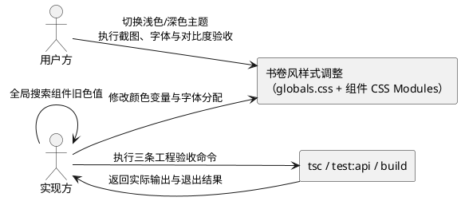
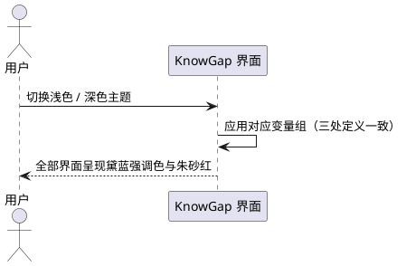
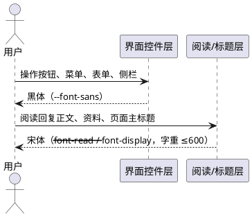
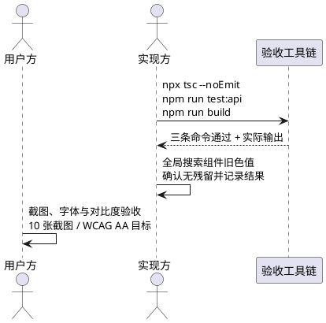

# 书卷风界面风格调整 · 需求规格

# **1. 组件定位**

## **1.1 核心职责**
本组件负责将 KnowGap 前端全局视觉风格从「简洁科技风」调整为「书卷风」，通过修改全局颜色变量与字体分配规则，实现沉稳黛蓝强调色与「操作用黑体、阅读用宋体」的字体分层。

## **1.2 核心输入**
1. 用户需求文档：来自产品方的风格调整说明，包含目标色值区间、字体分配原则与验收标准。
2. 现有全局样式：来自 `frontend/src/app/globals.css` 的 CSS 变量定义（浅色 `:root`、深色 `prefers-color-scheme: dark` 与 `[data-theme="dark"]` 两处）。
3. 现有组件样式：来自各组件 CSS Modules 中对 `font-family` 的显式声明。

## **1.3 核心输出**
1. 修改后的 `globals.css`：浅色与深色（两处）变量同步更新。
2. 修改后的组件 CSS Modules：字体变量引用修正，弹窗/卡片标题回到黑体；空间页顶栏的 13px 标题保持黑体，既有页面主标题维持宋体白名单。
3. 修改后的 `MaterialPreviewPanel.tsx`：docx 预览 iframe 内写字体栈调整。

## **1.4 职责边界**
1. 不负责任何布局、间距、组件结构调整；侧栏布局刚调整完，明确不动。
2. 不新增字体包，仅使用已打包的思源宋体（@fontsource-variable/noto-serif-sc）与 Source Serif 4。
3. 不新增全局 CSS 变量，不新增纸纹背景等装饰。
4. 不修改分割线与边框的暖灰色系，不引入冷灰。
5. 不涉及后端与接口变更，不涉及界面文案变更。

# **2. 领域术语**

**黛蓝**
: 本次调整后的强调色色相，浅色主题以 #2b4c7e 为基准的沉稳蓝色。
: 备注：替换原亮蓝 #2f5fd0。

**朱砂红**
: 本次调整后的警示红色相，浅色主题以 #b5412f 为基准。
: 备注：替换原 #c0392f。

**黑体（--font-sans）**
: 界面控件专用无衬线字体栈，覆盖按钮、输入框、菜单、侧栏、标签、设置项、弹窗表单等所有操作面。

**宋体阅读（--font-read）**
: 长文阅读专用衬线字体栈，覆盖助手回复正文与资料阅读区，行高保持 --leading-read。

**宋体标题（--font-display）**
: 展示级标题专用衬线字体栈，仅用于品牌名、页面主标题、回复正文内 Markdown 标题，字重上限 600。

**三处主题定义**
: 指 `globals.css` 中浅色 `:root` 一处与深色两处（`@media (prefers-color-scheme: dark)` 内的 `:root:not([data-theme="light"])`、`:root[data-theme="dark"]`），三处必须同步修改且两处深色保持一致。

# **3. 角色与边界**

## **3.1 核心角色**
1. 用户方（含终端用户与验收人员）：在浅色/深色主题下使用侧栏、对话页、学习空间页、设置弹窗、资料页，负责截图、字体和对比度等界面验收并给出结论。
2. 实现方（前端开发者）：依据本规格修改变量与字体引用，只负责执行三条工程验收命令并贴出实际输出，以及全局搜索组件旧色值；不代替用户方执行截图、字体或对比度验收。

## **3.2 外部系统**
1. 构建与测试工具链：TypeScript 编译器（npx tsc --noEmit）、API 测试（npm run test:api）、生产构建（npm run build），作为实现方的工程验收关卡。
2. 代码搜索工具：供实现方全局搜索组件中的旧色值，确认本次替换后无残留。

## **3.3 交互上下文**

# **4. DFX约束**

## **4.1 性能**
1. 不引入新字体文件、新图片资源，页面加载体积不得增加。

## **4.2 可靠性**
1. 浅色、深色两处深色定义必须逐变量一致，禁止出现系统主题与手动主题表现分叉。
2. 实现方必须依次执行 npx tsc --noEmit、npm run test:api、npm run build，三条命令必须全部通过，并在交付说明中逐条贴出实际输出。

## **4.3 安全性**
1. docx 预览 iframe 维持现有 sandbox 策略不变，仅修改其内联样式字体栈。

## **4.4 可维护性**
1. 组件内禁止写死未获豁免的字体族名称，一律引用 --font-sans / --font-read / --font-display 变量；仅允许以下三类既有例外，不得扩展其他例外：
   a. `components/MaterialLibrary.tsx:44` 的 SVG 图标属性 `fontFamily="sans-serif"` 保持现状不变。
   b. `components/chat/SubjectPage.module.css:1730` 的 `var(--font-mono, ui-monospace, monospace)` 等宽字体兜底保持现状不变。
   c. `MaterialPreviewPanel.tsx` 的 docx opaque origin 隔离 iframe 无法继承父页面变量，允许按 5.2.3 使用内联衬线字体栈，并必须加注释说明；sandbox 策略不变。
2. 颜色派生继续使用 rgb() 透明度与 color-mix()，不写死新 rgba 色值到组件层。

## **4.5 兼容性**
1. WCAG AA 设计目标保持不变：正文文字对背景对比度 ≥ 4.5:1，次要文字、强调色文字同样 ≥ 4.5:1；对比度实测与验收结论由用户方完成，不免除实现方满足该设计目标的责任。
2. 既有 `data-read-font="sans"` 回退开关行为保持不变。

# **5. 核心能力**

## **5.1 强调色与警示色调整**

### **5.1.1 业务规则**

本节验收条件中的界面目检与对比度实测均由用户方执行；实现方只提供 5.3.1 约定的工程命令输出与组件旧色值搜索结果。

浅色 `:root` 变量改动（改前 → 改后）：

1. **--accent**：#2f5fd0 → #2b4c7e
   a. 验收条件：浅色主题查看链接、选中态、焦点环 → 呈现黛蓝而非亮蓝。
2. **--accent-hover**：#2550b8 → #23406b（加深一级）
   a. 验收条件：悬停强调色元素 → 颜色加深且与 --accent 同色相。
3. **--accent-text**：#2550b8 → #2b4c7e
   a. 验收条件：浅色底上强调色文字 → 对 --bg（#fbfaf7）对比度 ≥ 4.5:1（估算约 8.3:1）。
4. **--accent-soft**：rgb(47 95 208 / 9%) → rgb(43 76 126 / 9%)
   a. 验收条件：浅底强调色衬底 → 色相与 --accent 一致，透明度不变。
5. **--accent-soft-strong**：rgb(47 95 208 / 16%) → rgb(43 76 126 / 16%)
   a. 验收条件：选中态/文本选区衬底 → 色相一致，透明度不变。
6. **--accent-solid**：#2f5fd0 → #2b4c7e；**--accent-solid-hover**：#2550b8 → #23406b
   a. 验收条件：实心主按钮 → 黛蓝底白字，白字对比度 ≥ 4.5:1。
7. **--red**：#c0392f → #b5412f；**--red-soft**：rgb(192 57 47 / 9%) → rgb(181 65 47 / 9%)
   a. 验收条件：误区/危险提示 → 偏朱砂红，对 --bg 对比度 ≥ 4.5:1（估算约 5.3:1）。
8. **--text**：#1c1b18 → #23211c
   a. 验收条件：正文 → 偏暖非纯黑，对 --bg 对比度 ≥ 4.5:1。
9. **禁止项**：禁止修改 --border / --border-subtle / --border-strong 及阴影色系；禁止新增冷灰。
   a. 验收条件：对比修改前后边框与分割线 → 色值不变。

深色两处（`prefers-color-scheme: dark` 与 `[data-theme="dark"]`）同步改动，两处色值必须完全一致：

1. **--accent**：#6d93e8 → #8aa6d6（同色相提亮黛蓝）
   a. 验收条件：深色底（--bg #1a1917）上强调色 → 对比度 ≥ 4.5:1（估算约 7.1:1）。
2. **--accent-hover**：#86a6ee → #9db8e4（深色下 hover 提亮）
   a. 验收条件：悬停 → 明度提升、色相不变。
3. **--accent-text**：#8fb0f2 → #9db8e4
   a. 验收条件：深色底强调色文字 → 对比度 ≥ 4.5:1。
4. **--accent-soft**：rgb(109 147 232 / 13%) → rgb(138 166 214 / 13%)；**--accent-soft-strong**：rgb(109 147 232 / 22%) → rgb(138 166 214 / 22%)
   a. 验收条件：深色衬底 → 色相一致，透明度不变。
5. **--accent-solid**：#4770d0 → #46639c；**--accent-solid-hover**：#3f67c6 → #3a5386
   a. 验收条件：深色实心按钮白字（--on-accent #ffffff）→ 对比度 ≥ 4.5:1（估算约 6:1）。
6. **--red**：#e0705f → #d4786a（朱砂红提亮版）；**--red-soft**：rgb(224 112 95 / 13%) → rgb(212 120 106 / 13%)
   a. 验收条件：深色底警示红 → 对比度 ≥ 4.5:1（估算约 5.6:1）。
7. **--text / --text-secondary / --text-tertiary**：维持现状（#ecebe6 / #a3a097 / #86837b）
   a. 验收条件：深色正文 → 对比度不回归。

### **5.1.2 交互流程**

### **5.1.3 异常场景**
1. **对比度不达标**
   a. 触发条件：用户方使用开发者工具抽查某文字/背景组合，实测对比度 < 4.5:1。
   b. 系统行为：实现方微调该变量明度（±5% 内），保持色相不变，并重新提交用户方验收。
   c. 用户感知：用户方暂不通过该项验收，待复测达到 WCAG AA 目标后确认。
2. **两处深色定义不一致**
   a. 触发条件：系统主题深色与手动 `[data-theme="dark"]` 渲染结果不同。
   b. 系统行为：以变量对照表逐行核对两处，消除差异。
   c. 用户感知：不适用（验收前拦截）。

## **5.2 字体分配调整**

### **5.2.1 业务规则**

本节涉及逐界面目检与 computed font-family 检查的字体验收均由用户方执行；实现方的交付验收职责仅按 5.3.1 的工程验收与旧色值搜索执行。

1. **黑体覆盖全部界面控件**：按钮、输入框、菜单、侧栏（含空间名称与对话标题）、标签、设置项、弹窗表单一律 --font-sans。
   a. 验收条件：用户方逐界面检查控件 → 渲染字体为无衬线黑体。
2. **宋体阅读仅限阅读区**：助手回复正文、资料阅读区使用 --font-read，行高保持 --leading-read。
   a. 验收条件：用户方检查回复正文与资料正文 → 宋体且行高 1.65；`data-read-font="sans"` 开关仍可切回黑体。
3. **宋体标题白名单**：仅品牌名、页面主标题、回复正文 Markdown 标题使用 --font-display，字重 600，禁止 ≥700；13px 顶栏标题不属于页面主标题。
   a. 验收条件：用户方核对下列「保持宋体」清单 → 清单外不得出现宋体标题；卡片标题、弹窗标题与 SubjectPage 顶栏标题必须为黑体。
4. **字体字面量例外与禁止项**：禁止在组件中写死未获豁免的字体族名，禁止调整任何布局、间距、字号阶梯。仅允许以下三类既有例外，不得扩展其他例外：
   a. `components/MaterialLibrary.tsx:44` 的 SVG 图标属性 `fontFamily="sans-serif"` 保持现状不变。
   b. `components/chat/SubjectPage.module.css:1730` 的 `var(--font-mono, ui-monospace, monospace)` 等宽字体兜底保持现状不变。
   c. docx 隔离 iframe 例外保留，仅按 5.2.3 调整其内联阅读字体栈并补充注释，sandbox 策略不变。
   d. 验收条件：审查组件中的 `font-family` / `fontFamily` 声明 → 除 `globals.css` 变量定义与上述三类例外外，不得出现其他字体族字面量；前两类例外必须保持原样。

保持宋体（--font-display，字重已是 600，不改）：

| 文件 | 选择器 | 用途 |
| --- | --- | --- |
| components/auth/AuthView.module.css | .brandHead h1 | 品牌名 |
| components/onboarding/Welcome.module.css | 主标题 | 欢迎页主标题 |
| components/chat/ChatApp.module.css | .greeting | 对话页问候主标题 |
| components/chat/SpacesPage.module.css | .header h1 | 空间列表页主标题 |
| components/agenda/AgendaPage.module.css | 主标题 | 日程页主标题 |
| components/MaterialLibrary.module.css | .title | 资料页主标题 |
| components/chat/Markdown.module.css | .markdown h1–h4 | 回复正文 Markdown 标题 |

改回黑体（--font-display → --font-sans，其余属性不动）：

| 文件 | 选择器 | 用途 |
| --- | --- | --- |
| components/agenda/TaskComposer.module.css:46 | .header h2 | 新建任务弹窗标题 |
| components/chat/LearningWidget.module.css:124 | .widgetTitle | 对话内学习卡片标题 |
| components/home/TodayPanel.module.css:32 | .header h2 | 首页「今日」面板标题（卡片级） |

无需修改（已是黑体、局部已覆盖或属于明确例外）：

1. 侧栏 ConversationSidebar、设置弹窗 Settings：无显式 font-family，继承 body 的 --font-sans。
2. TaskInspector、CheatSheet：已局部覆盖 --font-display: var(--font-sans)，保持现状。
3. 字重 700 的现存三处（CheatSheet .qIndex、MaterialLibrary 徽章、TaskMenu 小标记）均为黑体角标，不属于宋体标题，不动。
4. `components/chat/SubjectPage.module.css:76` 的 `.heading h1` 是 13px 顶栏标题，不是页面主标题，必须保持黑体，不得为其添加 `--font-display` 或 `font-family: var(--font-display)`。

### **5.2.2 交互流程**

### **5.2.3 异常场景**
1. **docx 预览 iframe 无法引用 CSS 变量**
   a. 触发条件：MaterialPreviewPanel.tsx 的 DOCX_IFRAME_HTML 为 opaque origin，继承不到父页面变量，当前写死 `font-family: sans-serif`。
   b. 系统行为：将 iframe 内字体栈改为与 --font-read 同顺序的衬线栈字面量（"Source Serif 4 Variable", "Source Serif 4", "Noto Serif SC Variable", "Songti SC", "STSong", Georgia, serif），并加注释说明无法使用变量的原因；sandbox 策略不变。
   c. 用户感知：docx 预览正文呈现宋体，与资料阅读区一致。
2. **宋体标题过粗**
   a. 触发条件：任何宋体标题字重 ≥700。
   b. 系统行为：降为 600。
   c. 用户感知：标题笔画清晰不糊。

## **5.3 验收确认**

### **5.3.1 业务规则**
1. **验收职责划分**：用户方负责截图、字体和对比度等界面验收；实现方只负责本条第 5、6 项的工程验收与组件旧色值全局搜索，不代替用户方出具截图、字体或对比度实测结论。4.5 的 WCAG AA 设计目标不因此降低。
   a. 验收条件：交付记录分别列明用户方验收结论与实现方验收证据 → 不混用执行主体，不以工程命令通过替代界面验收。

用户方验收：

2. **截图验收**：用户方在浅色、深色主题下分别对侧栏、对话页、学习空间页、设置弹窗、资料页截图，共 10 张，界面不得出现亮蓝色。
   a. 验收条件：用户方逐张目检 → 强调色均为黛蓝系。
3. **字体验收**：用户方确认控件全黑体，宋体仅出现在 5.2 白名单位置，SubjectPage 的 13px 顶栏标题保持黑体。
   a. 验收条件：用户方使用开发者工具逐区检查 computed font-family → 符合 5.2 分配表与例外清单。
4. **对比度验收**：用户方抽查正文、次要文字、强调色文字对背景 ≥ 4.5:1（浅色与深色各抽一组）。
   a. 验收条件：用户方读取开发者工具 Contrast 读数 → 全部 ≥ 4.5:1，满足 WCAG AA 目标。

实现方验收：

5. **工程验收**：实现方必须执行 npx tsc --noEmit、npm run test:api、npm run build，三条命令全部通过，并在交付说明中逐条贴出实际输出结果。
   a. 验收条件：三条命令退出码均为 0，且实际输出完整可追溯。
6. **组件旧色值全局搜索**：实现方必须对组件目录执行一次不区分大小写的全局搜索，搜索范围至少覆盖 `frontend/src/components`，至少包含 `#2f5fd0`、`#2550b8`、`#6d93e8`、`#c0392f` 以及本次改动涉及的其他旧色值，并在交付说明中记录搜索命令与结果。
   a. 验收条件：搜索结果 → 组件中上述旧色值均为 0 处匹配，无旧色值残留。

### **5.3.2 交互流程**

### **5.3.3 异常场景**
1. **构建或测试失败**
   a. 触发条件：任一工程验收命令非零退出。
   b. 系统行为：实现方修复后重跑，不进入交付。
   c. 用户感知：交付物中如实贴出失败与修复记录，最终三条命令均须通过。
2. **组件旧色值残留**
   a. 触发条件：实现方全局搜索发现任一目标旧色值仍存在于组件中。
   b. 系统行为：实现方清理残留后重新搜索，并重跑受影响的工程验收命令。
   c. 用户感知：交付说明展示最终无残留的搜索结果，不以目检替代搜索。
3. **用户方界面验收未通过**
   a. 触发条件：用户方截图、字体或对比度验收任一项不符合本规格。
   b. 系统行为：实现方按对应规则修正后重新提交，由用户方复验；实现方不得自行宣告该项通过。
   c. 用户感知：用户方确认复验通过后方可完成整体验收。

# **6. 数据约束**

## **6.1 颜色变量改动清单**
1. **改动范围**：仅限 5.1.1 列出的 --accent 系 7 个变量、--red 系 2 个变量、浅色 --text，共 10 个变量；深色 --text 系不动。
2. **透明度规则**：--accent-soft / --accent-soft-strong / --red-soft 仅替换 RGB 通道，alpha 保持原值（浅色 9%/16%/9%，深色 13%/22%/13%）。
3. **一致性规则**：两处深色定义的同一变量必须字面值完全相同。
4. **估算对比度**：浅色 --accent 对 --bg ≈ 8.3:1；深色 --accent 对 --bg ≈ 7.1:1；浅色 --red 对 --bg ≈ 5.3:1；深色 --red 对 --bg ≈ 5.6:1；深色 --accent-solid 白字 ≈ 6:1。上述数值仅为设计估算，WCAG AA 目标保持不变；实施完成后由用户方使用开发者工具实测，若未达标，实现方仅可在 ±5% 明度内微调并重新提交用户方验收。

## **6.2 字体分配清单**
1. **--font-sans**：字体栈不变（Geist Variable / Inter / PingFang SC / Microsoft YaHei 等），仅调整引用位置。
2. **--font-read / --font-display**：字体栈不变（Source Serif 4 Variable + Noto Serif SC Variable 等），仅按 5.2 的「保持宋体」白名单与「改回黑体」清单调整引用，不得扩展至顶栏标题或其他未列明位置。
3. **字重约束**：宋体标题统一 600；现存三处黑体 700 角标不属于本规格范围。
4. **行高约束**：阅读正文继续使用 --leading-read（1.65），不得修改。