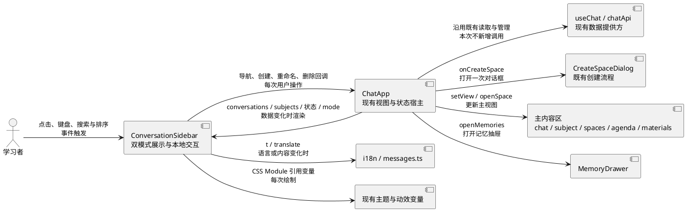
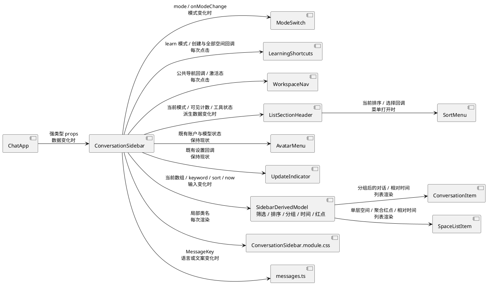
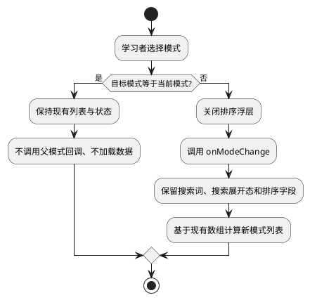
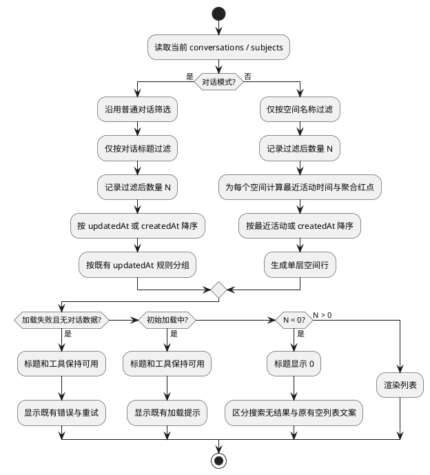
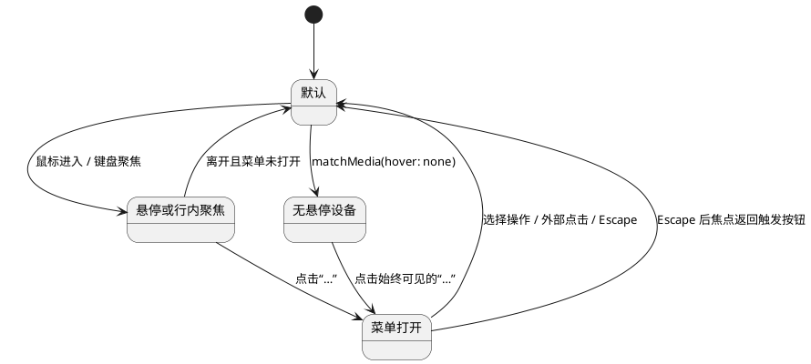
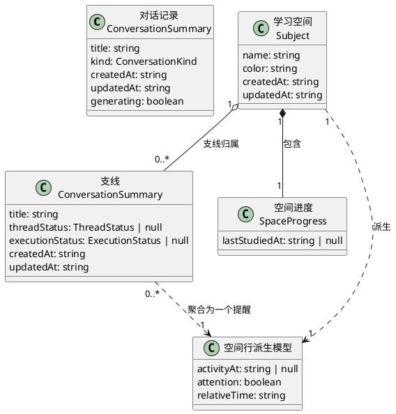

# 一、需求与存量功能关系分析

## 1.1 需求功能与存量功能对比

> **本轮实现微调（2026-11-18）**：以 `spec.md` 文首修订说明为最高优先级。上一版主体布局已经落地，本轮仅完成三项局部调整：删除学习模式顶部“新建学习空间”按钮；细化对话时间分组名；把工作台与列表标题行间距校准为 10px 且不加分隔线。业务代码仅允许修改 `ConversationSidebar.tsx` 与 `ConversationSidebar.module.css`，不修改 `ChatApp.tsx`、`i18n/messages.ts`、`globals.css` 或其它文件，不新增依赖。本文其余涉及上一阶段四文件改造、两行学习入口、创建排序分组或旧验证命令的表述，是已落地架构的历史基线；与本轮微调冲突时均以本节、2.7 和 2.8 为准。本轮只编写实现设计，不执行业务代码修改或构建。

本设计以 `.codeartsdoer/specs/sidebar_layout/spec.md` 为唯一需求基线。当前代码已完成上一版双模式侧栏主体改造；本轮是在既有 React 组件上的展示层增量微调，不新增路由、后端接口、数据请求、全局状态、持久化偏好或第三方依赖。本轮业务修改范围严格限定为：

- `frontend/src/components/chat/ConversationSidebar.tsx`：只删除学习快捷区中的一个按钮节点。
- `frontend/src/components/chat/ConversationSidebar.module.css`：只调整工作台—列表区间距与对话时间分组样式。

下列文件仅作为契约和兼容性证据读取，本轮不得修改：`frontend/src/components/chat/ChatApp.tsx`、`frontend/src/lib/i18n/messages.ts`、`frontend/src/lib/chat/types.ts`、`frontend/src/lib/chat/api.ts`、`frontend/src/lib/i18n/index.ts`、`frontend/src/components/chat/ChatApp.module.css`、`frontend/src/app/globals.css`、依赖清单及锁文件。

### 1.1.1 已实现功能

| 需求功能 | 存量功能 | 代码位置 | 匹配度 |
|---------|---------|---------|--------|
| 对话与学习双模式状态 | 已有 `SidebarMode = "chat" \| "learn"`，侧栏缺省为对话模式；父组件保存并恢复用户模式 | `ConversationSidebar.tsx:24,67-69,570-574`；`ChatApp.tsx:58-69,139-142,218-245` | 75% |
| 普通对话列表归属 | 已筛选普通 `chat`、排除所属空间的记录并排除指定引导对话 | `ConversationSidebar.tsx:592-601` | 100% |
| 对话时间分组 | 已有今天、昨天、本周、本月、更早五组及固定组序，按本地日历日和最近更新时间分组 | `ConversationSidebar.tsx:26-35,74-92,604-617` | 100% |
| 对话重命名、删除和失败恢复 | 行内状态覆盖查看、菜单、重命名、删除确认；只有成功回调才结束操作，失败保留列表项并恢复可操作状态 | `ConversationSidebar.tsx:129-291`；`ChatApp.tsx:555-556` | 100% |
| 对话生成中圆点 | `generatingIds` 已传递到普通对话行并显示独立状态圆点 | `ConversationSidebar.tsx:256-275,795-803`；`ChatApp.tsx:544` | 100% |
| 列表加载与错误反馈 | 已复用 `errorText`、重新加载回调及初始加载空态 | `ConversationSidebar.tsx:664-672`；`ChatApp.tsx:557` | 100% |
| 全部学习空间主视图 | 已有 `View` 的 `spaces` 分支、激活状态和打开回调，点击后关闭窄窗口抽屉 | `ChatApp.tsx:79,225-233,537-553,622-631` | 100% |
| 学习空间创建流程 | 已有统一 `CreateSpaceDialog`，创建成功后才进入空间；失败由既有流程处理 | `ChatApp.tsx:551,1012-1035` | 100% |
| 单空间导航 | 已有 `onOpenSubject` 回调，复用 `openSpace` 并关闭窄窗口覆盖层 | `ChatApp.tsx:236-238,549` | 100% |
| 底部按钮的创建行为 | 已根据模式选择 `onCreateSpace` 或 `onNewChat`，未建立第二套创建逻辑 | `ConversationSidebar.tsx:840-849` | 100% |
| 侧栏收起与窄窗口抽屉 | 父组件管理 `sidebarOpen`、`narrow`、遮罩、`inert` 和关闭行为；抽屉宽度为 `min(280px, 86vw)` | `ChatApp.tsx:121-122,157-166,214-216,523-579`；`ChatApp.module.css:1-69` | 100% |
| 头像菜单、主题、帮助、设置和更新提示 | `AvatarMenu` 与 `UpdateIndicator` 已独立封装，含焦点、Escape、外部点击和滚动关闭处理 | `ConversationSidebar.tsx:361-568,851-861` | 100% |
| 中英文资源类型约束 | 中文键为源，`en: Record<MessageKey, string>` 保证中英文键集合在编译期一致，插值支持数字 | `messages.ts:8,658-663`；`lib/i18n/index.ts:9,49-58` | 100% |

### 1.1.2 需要扩展的功能

#### 本轮三项微调的现状对照

| 需求功能 | 已落地功能与代码位置 | 差异说明 | 本轮扩展方向 |
|---------|---------|---------|---------|
| 学习模式只保留“全部学习空间” | `ConversationSidebar.tsx:794-810` 在 `.learningShortcuts` 内依次渲染新建按钮与全部空间按钮；底部 `ConversationSidebar.tsx:942-950` 已按学习模式调用同一 `onCreateSpace` | 顶部与底部各有一个新建入口，顶部重复；全部空间导航与底部创建能力本身已满足需求 | 只删除 `ConversationSidebar.tsx:796-799` 的顶部 `<button>` 整节点，保留 `.learningShortcuts` 容器和 `800-808` 的全部空间按钮；`Plus` 仍被底部按钮使用，不删除导入、属性或文案键 |
| 时间分组名独立样式、左对齐、每组上方 8px | `ConversationSidebar.tsx:901-919` 为每组渲染 `section.group > h3.groupHead + ul.list`；`ConversationSidebar.module.css:302-325` 设置分组与吸顶样式 | 当前组名为 `var(--text-xs)`（已核对 `globals.css:70` 为 12px）、500 字重并带字间距；首组无上方间距，后续组仅有 `.group + .group { margin-top: 2px; }` | 保留 `.groupHead` 的 `margin: 0 -8px`，将水平内边距改为 `0 8px 0 16px` 以对齐对话标题；组名使用 11px、400 字重与正常字间距；通过 `.group` 的 8px padding 和移除旧 2px 规则实现每组上方统一 8px，不改 `.listTitle` 和 `.sectionTitle` |
| 工作台与列表标题行约 10px 纯间距 | 工作台末行位于 `ConversationSidebar.tsx:811-837`；滚动区始于 `840`；`.scroll` 在 `ConversationSidebar.module.css:214-220` 设置 `margin-top: 4px`，`.workspace` 在 `95-97` 设置 `margin-top: 2px` 但无下外边距 | 当前从工作台最后一行底边到列表标题上边框的名义垂直距离为 `.scroll` 上外边距 4px；`.topArea` 的列向 `gap: 4px` 只作用于其内部子项，工作台末行底边与 `.topArea` 底边重合，不应重复计入；尚无分隔线 | 仅把 `.scroll` 的 `margin-top` 从 4px 调为 10px，保持 `.topArea` 的内部 gap、`.workspace` 无下外边距及 `.listHeader` 的 `height: 24px` 不变，得到工作台末行底边至列表标题行顶部 `0 + 10 = 10px`；首组前的标题下间距另按 2.7.4 归零以避免与首组 8px 叠加；不添加边框或伪元素 |

上述数值均按当前全局 `box-sizing: border-box` 及 flex 布局计算。工作台与滚动区是 `.sidebar` 的两个相邻 flex item，flex item 的外边距不折叠；`.topArea` 的内部 gap 不参与其父级外部间距。因此唯一的区间是 `.scroll` 的 10px 上外边距，不能再把内部 4px gap 加一次。若实现时改动其中任一现有项，必须重新测量而不能仍沿用该结论。设计选择修改 `.scroll`，而非给 `.workspace` 增加下外边距，是因为间距职责属于固定导航与滚动列表之间的容器衔接，且不需要触碰工作台的内部样式。

#### 上一版主体功能的扩展记录

以下表格记录上一版从旧侧栏到当前双模式侧栏的设计依据；其中“学习模式上方入口”一行已被本轮“只保留全部学习空间”覆盖，不得据旧表述恢复顶部新建按钮。

| 需求功能 | 存量功能 | 差异说明 | 扩展方向 |
|---------|---------|---------|---------|
| 顶部模式切换器 | `ModeSwitch` 支持点击、左右方向键和 `aria-selected` | 当前只有文字；选中项带描边式 `box-shadow`，不符合浅底无描边要求 | 保留 ARIA 与键盘切换，增加对话/书本图标；选中态只保留背景和主文字色，焦点环统一由 `:focus-visible` 提供 |
| 双模式工作台 | 日程、资料、记忆回调均已存在 | 当前与搜索、添加任务共同组成裸图标快捷行，无“工作台”标题和文字行 | 将三个入口改为图标加文字的列表行；移除快捷行，但不动日程页及全局添加任务机制 |
| 学习模式上方入口 | 父组件已有新建空间、全部空间回调及 `spacesActive` | 侧栏尚未渲染这两个上方入口，`spacesActive` 当前未消费 | 在学习模式、工作台上方增加两行；新建行调用同一创建回调，全部空间行复用 `onOpenSpaces` 并呈现激活态 |
| 列表标题与计数 | 当前仅在有结果时显示对话排序工具，学习列表无统一工具区 | 空态和错误态会连同工具区一起消失；没有按搜索结果显示 N | 将标题行移到加载、错误、空态分支之外，以过滤后的数组长度作为唯一计数来源 |
| 两种模式排序 | 对话支持最近活动/创建时间切换；空间仅按最近学习或更新时间排序 | 对话是独立排序行且点击直接轮换；空间不支持创建时间排序；缺少小菜单和当前项标识 | 统一排序字段与降序比较器，增加仅含两项的排序菜单；对话组内顺序随排序字段变化，组归属规则不变 |
| 标题下搜索 | 已有搜索展开、自动聚焦、清空和 Escape 处理 | 搜索位于顶部快捷区；学习模式会被支线标题命中并强制展开空间 | 搜索移到列表标题下；对话只匹配标题、空间只匹配名称；保留原键盘和空搜索关闭行为 |
| 对话行相对时间 | 行尾当前仅有生成圆点与悬停“…”按钮 | 没有最近活动相对时间；按钮通过 `display` 切换，无法同时满足时间替换和行宽稳定 | 增加统一相对时间；以固定行尾网格/叠加区域切换时间和“…”按钮，保留生成圆点、重命名、删除和无悬停设备入口 |
| 单层学习空间 | `SpaceSection` 展示空间、展开按钮和子支线列表 | 当前维护 `expandedSpaces`，搜索会展开空间；当前空间有左侧竖条 | 用单层 `SpaceListItem` 替代 `SpaceSection`，空间行只负责打开空间；删除展开状态、子列表与左竖条 |
| 待处理支线聚合红点 | 空间行已按 `waiting` 或 `failed` 计算布尔提醒 | 当前未排除 `threadStatus === "resolved"`，可能产生误导；支线行另有独立提醒 | 只根据所属空间的支线记录派生一个布尔值，同时满足非已解决和执行状态等待/失败才显示红点 |
| 空间最近活动时间 | 最近活动排序使用 `progress?.lastStudiedAt ?? updatedAt` | 没有行尾时间；无创建时间排序与无效值处理 | 抽取统一活动时间取值和格式化逻辑，空值回退、无效值不展示，排序时无效值置后 |
| 半透明灰色胶囊按钮 | 底部按钮已随模式切换文案和行为 | 当前为 34px 高、普通圆角、高饱和主色背景和亮度滤镜 | 改为 36px 高、999px 圆角、主文字色 7%/11%/14% `color-mix`，按下缩放 0.98，沿用既有时长和曲线变量 |
| 双语文案 | 既有模式、排序、搜索等键完整 | 缺工作台、列表计数、全部空间和目标相对时间文案；旧空间展开文案仍被引用 | 新增和修改必要键，删除废弃键；英文单数与复数由不同强类型键处理 |

### 1.1.3 需要新增的功能或接口

#### A. 侧栏内部展示组件

| 功能点 | 输入 | 输出 | 核心逻辑与依赖 |
|---------|------|------|----------------|
| 学习模式快捷导航 | `spacesActive`、既有创建/全部空间回调 | 两行导航入口 | 仅在 `learn` 模式渲染；不直接写数据，依赖 `ChatApp` 已有回调 |
| 工作台分区 | 日程、资料、记忆回调及既有激活状态 | 三行固定导航 | 两种模式共用同一结构；复用现有图标与回调 |
| 列表分区标题行 | 当前模式、过滤后条数、排序和搜索状态 | 标题 N、排序按钮、搜索按钮 | 始终先于列表状态分支渲染；新增内部 `ListSectionHeader`，不增加对外属性 |
| 排序小菜单 | 当前 `SortField`、选择回调 | 最近活动/创建时间两个 `menuitemradio` | 复用侧栏浮层和焦点管理惯例；外部点击或 Escape 不改变排序 |
| 单层空间行 | `Subject`、活动时间和聚合提醒布尔值 | 可打开的空间行、至多一个红点、相对时间 | 替代 `SpaceSection`；只调用 `onOpenSubject` |
| 行尾稳定状态区 | 相对时间、菜单状态、生成状态 | 对话行尾时间或“…”按钮 | 时间与操作按钮共用布局区域，生成圆点独立保留；无新增业务依赖 |

#### B. 纯派生逻辑

| 功能点 | 输入 | 输出 | 核心逻辑与依赖 |
|---------|------|------|----------------|
| 空间最近活动时间取值 | `Subject` | 可解析时间字符串或空值 | 沿用 `lastStudiedAt ?? updatedAt`；不读取支线标题，不发请求 |
| 待处理支线聚合 | 当前 `conversations` | `Map<string, boolean>` 或等价值集合 | 仅处理有所属空间的 `thread`；排除已解决，匹配 `waiting`/`failed`；按空间隔离 |
| 安全时间比较 | 两个可空时间值 | 降序比较结果 | 有效值从新到旧，无效值置后，相等时保持原相对顺序；不修改源数组 |
| 侧栏相对时间格式化 | 时间值、同一时刻快照、语言 | 本地化文本或空字符串 | 在 `ConversationSidebar.tsx` 内实现纯函数；使用现有 `translate` 和新增强类型文案键，不能修改 `labels.ts` |
| 低频时间刷新 | 当前组件生命周期 | 全列表共享的当前时间快照 | 组件内单一定时器按分钟刷新，卸载清理；不为每行建立定时器，不触发数据重载 |

#### C. 样式与文案

- 在 CSS Module 内新增工作台、学习快捷入口、列表标题、排序菜单、行尾时间/操作叠加区及胶囊按钮样式；不新增全局变量。
- 在 `messages.ts` 中同时添加中英文键，并同步删除空间展开、空间收起、空支线及本次快捷行移除后不再引用的键。
- 不新增 HTTP API、事件总线事件、浏览器存储键或跨组件业务服务。

## 1.2 存量功能详细分析

### 1.2.1 侧栏组件接口契约

`ConversationSidebar` 是受控展示组件，列表、加载、错误、当前项和生成状态全部由父组件传入。其核心约束如下：

1. **输入数据**：`conversations: ConversationSummary[]`、`subjects: Subject[]` 均为当前已加载数组；排序必须复制后执行，不能原地修改父组件数据。
2. **读取状态**：`loading` 与 `error` 控制既有加载/错误分支；`onRetry` 是唯一重试入口。本需求不得把加载失败改写成“搜索无结果”。
3. **导航回调**：`onOpen`、`onOpenSubject`、`onOpenSpaces`、`onOpenAgenda`、`onOpenMaterials`、`onOpenMemory` 均为无返回值命令；导航结果由 `ChatApp` 负责。
4. **管理回调**：`onRename` 和 `onDelete` 返回 `Promise<boolean>`。`ConversationItem` 依靠布尔结果决定是否退出编辑/确认状态，这一契约不得改变。
5. **创建回调**：`onNewChat` 与 `onCreateSpace` 只发起既有流程。尤其 `onCreateSpace` 的语义是打开对话框，而非直接创建空间，因此上方入口和底部按钮可安全复用。
6. **模式属性**：`mode` 和 `onModeChange` 当前为可选，缺省行为是对话模式；本次保持该兼容策略，不将模式提升为新的全局状态。
7. **待删除属性**：`onOpenThread` 只服务侧栏子支线直达，单层化后从 `SidebarProps` 与 `ChatApp` 的侧栏属性传递中成对移除。

### 1.2.2 数据字段与运行时兼容

- `ConversationSummary.kind` 类型为 `chat/main/thread`，但现有代码仍以 `item.kind ?? "chat"` 兼容旧数据，本设计保留这一防御性语义。
- 普通对话筛选继续要求 `(kind ?? "chat") === "chat" && !subjectId`，并保留对指定引导标题的排除，防止学习空间主线或支线混入对话记录。
- `ConversationSummary.executionStatus` 可缺省或为 `null`；只有严格的 `waiting`、`failed` 可触发提醒，其它状态及缺省均不触发。
- `ConversationSummary.threadStatus` 可空。提醒计算先限定 `kind === "thread"`，再排除明确的 `resolved`，延续既有线程未解决语义，避免普通对话的空状态被误判。
- `Subject.progress` 在静态类型上必填，API 映射也会构造完整对象；现有侧栏使用可选链防御旧数据，本设计继续允许运行时缺省。
- `Subject.progress.lastStudiedAt` 类型为 `string | null`。空值时回退到 `Subject.updatedAt`；若最终值不可解析，相对时间为空且排序置后，不渲染 `NaN`、负数或技术错误文本。
- `createdAt`、`updatedAt` 静态类型为字符串，但时间解析与比较函数仍以 `string | null | undefined` 为边界输入，集中处理异常数据，不通过类型断言掩盖问题。

### 1.2.3 父组件导航与状态约束

1. `ChatApp.setView` 在打开 `subject` 或 `spaces` 时切到学习模式，在打开 `chat` 时切回对话模式；资料、日程和记忆入口保持当前模式。这是现有模式联动规则，本次不改动。
2. `sidebarMode` 已使用现有存储键按用户保存。需求禁止新增持久化偏好，因此搜索词、排序方式、搜索展开状态和排序菜单状态只保留为侧栏本地状态。
3. `closeOverlays` 只在窄窗口关闭抽屉。全部空间、单空间、对话、资料、日程等既有回调已正确处理该行为，新入口必须复用而非另写窗口判断。
4. `ChatApp` 中日程页与空间页仍有自己的支线入口。仅删除传给 `ConversationSidebar` 的 `onOpenThread`，不得删除 `AgendaPage` 的同名属性或空间面板逻辑。
5. 全局添加任务弹窗仍由 `TaskComposer` 和日程模块维护。移除侧栏裸快捷图标时，只删除本文件的按钮、事件导入和文案，不删除 `COMPOSE_TASK_EVENT` 定义及其它调用方。

### 1.2.4 样式与交互约束

- 侧栏是 `"use client"` 组件，菜单可使用 `createPortal` 和浏览器事件；所有监听器、定时器必须按现有模式清理。
- `.scroll` 负责列表纵向滚动，底部创建区和头像底栏不随列表滚动。标题行应位于滚动内容内的固定工具区域或滚动区前的列表区头部，但不能被空态分支卸载。
- 现有对话与头像浮层使用 `position: fixed`、视口边界约束和 Escape 焦点恢复。排序菜单应复用这一交互惯例，避免被滚动容器或窄窗口抽屉裁剪。
- `.sidebar button:focus-visible` 已提供键盘焦点环。本次不能通过点击后强制 `blur()` 消除焦点，应仅用 CSS 区分鼠标焦点与键盘焦点。
- 现有变量已覆盖侧栏背景、主文字、次级文字、悬停/选中背景、时长和曲线；`color-mix` 已在模块中使用，可在局部按钮样式中继续采用。
- 全局减少动态效果规则会压缩动画与过渡时长。本次只引用现有变量，不覆盖全局 `prefers-reduced-motion` 或 `data-motion` 规则。
- 窄窗口抽屉最窄由 `86vw` 决定，按钮和行尾必须使用 `min-width: 0`、不收缩状态图标及单行省略策略，不能依赖桌面固定宽度。

### 1.2.5 不在本次变更中的能力

- 不修改 `globals.css`、`ChatApp.module.css`、全局配色、全局设计变量或其它页面布局。
- 不修改 `lib/labels.ts` 的通用相对时间；其现有“分钟/当天 clock/日期”语义与本需求不同，且被资料、记忆等页面共享。
- 不修改 `chatApi`、数据映射、后端模型或支线面板，不通过 `Subject.progress.openThreads` 代替待处理状态判定，因为该计数不包含本需求所需的执行状态与解决状态组合。
- 不重构头像菜单、更新提示、主题切换、帮助或设置，仅验证新布局未破坏其现有行为。
- 不顺带清理与本次需求无关的历史未引用文案，避免扩大回归面。

# 二、增量设计方案

## 2.1 实现模型

### 2.1.1 上下文视图



**边界说明**：

- 上游唯一业务宿主仍为 `ChatApp`，通信方式是强类型 React 属性和回调；没有新增跨进程协议。
- 下游写操作仍由 `chat` 既有方法和 `CreateSpaceDialog` 承担，侧栏不直接调用 API。
- 搜索、排序、计数、相对时间和红点均在当前内存数据上同步派生；模式切换不触发全量加载。
- 主题、语言和窄窗口状态来自现有环境。CSS Module 只消费变量，不向全局写入变量。

### 2.1.2 服务/组件总体架构



#### 组件职责

| 单元 | 职责 | 不负责 |
|------|------|--------|
| `ChatApp` | 保持视图、模式、创建对话框、收起/抽屉及业务回调；删除侧栏 `onOpenThread` 传递 | 不接管搜索、排序和行内菜单状态 |
| `ConversationSidebar` | 组合固定导航与列表区，持有本地工具状态，计算当前模式的派生列表 | 不直接请求后端、不修改业务数据 |
| `ModeSwitch` | 图标加文字、选中态、左右键切换、键盘焦点 | 不自行持久化模式 |
| `LearningShortcuts` | 学习模式下提供新建空间和全部空间 | 不直接创建空间实体 |
| `WorkspaceNav` | 两种模式统一展示日程、资料、记忆三行 | 不恢复添加任务等裸快捷按钮 |
| `ListSectionHeader` / `SortMenu` | 始终展示标题 N 与工具；管理两项排序菜单和焦点返回 | 不持久化排序，不改变源数组 |
| `ConversationItem` | 保留打开、重命名、删除、生成圆点；增加稳定的时间/操作行尾 | 不再承担侧栏子支线变体 |
| `SpaceListItem` | 单层打开空间，展示色彩环、名称、聚合红点、相对时间和浅底选中态 | 不展开支线、不显示空支线提示、不提供空间管理新操作 |
| `AvatarMenu` / `UpdateIndicator` | 完整保留现有能力 | 本次不做结构重构 |

#### 四个限定文件的修改分工

| 文件 | 增量修改 | 明确不变 |
|------|----------|----------|
| `ConversationSidebar.tsx` | 组件结构、派生列表、排序菜单、相对时间、聚合红点、废弃展开逻辑清理 | 重命名/删除契约、普通对话筛选、分组规则、头像菜单和错误反馈 |
| `ConversationSidebar.module.css` | 新布局、无描边选中态、行尾稳定区、空间浅底、胶囊按钮及无悬停适配 | 全局变量、其它组件选择器、全局配色 |
| `ChatApp.tsx` | 删除只供侧栏支线直达的 `onOpenThread` 属性块；必要时整理因此失效的局部注释 | 所有导航与创建回调、模式持久化、日程和空间页的支线入口、抽屉行为 |
| `messages.ts` | 新增/调整侧栏双语文案，同步删除废弃键 | 非侧栏文案、通用时间格式及其它页面语义 |

### 2.1.3 实现设计文档

#### A. 状态归属与事件流

| 状态 | 归属与类型 | 更新事件 | 设计约束 |
|------|------------|----------|----------|
| `sidebarMode` | `ChatApp` 中的 `SidebarMode` | 模式切换、`setView` 联动、用户恢复 | 沿用现有存储键；重复选择当前模式不调用父回调、不重新加载 |
| `view` / `sidebarOpen` / `narrow` | `ChatApp` 既有状态 | 导航、窗口媒体查询、收起/遮罩 | 不新增侧栏属性，不改变现有联动 |
| `query` | 侧栏本地 `string` | 输入、清空、Escape、关闭搜索 | 仅内存保存；使用去首尾空白并小写化后的关键词过滤 |
| `searchOpen` | 侧栏本地 `boolean` | 搜索按钮、空输入失焦、Escape | 非空查询时搜索区保持可见，避免隐藏有效过滤条件 |
| `sort` | 侧栏本地 `SortField` | 选择最近活动或创建时间 | 两种模式共用当前选择；默认 `updated`，不持久化 |
| `sortOpen` | 侧栏本地 `boolean` | 排序按钮、选择、外部点击、Escape、模式变化 | 未重新选择就关闭时不得改变 `sort`；关闭后焦点回触发按钮 |
| `now` | 侧栏本地时间快照 | 首次渲染及单一定时器按分钟更新 | 所有行共用同一快照；组件卸载清理，不产生网络请求 |
| 行内 `mode` | `ConversationItem` 的查看/菜单/重命名/确认 | 行内管理操作 | 完整保留既有成功、失败与焦点逻辑 |
| 头像菜单状态 | `AvatarMenu` 既有状态 | 既有事件 | 本次不修改 |

模式切换时保留 `query`、`searchOpen` 和 `sort`，立即按新模式重新过滤与计数；这样与现有共享工具状态一致，也不会引入额外初始化。瞬态排序菜单在内部或外部模式变化时关闭，避免浮层指向已变化的列表标题。



#### B. 搜索、排序、分组与计数流程

1. 先从源数组形成模式专属候选集：对话沿用普通对话筛选；空间使用全部 `subjects`。
2. 对话只以 `title`、空间只以 `name` 匹配关键词。支线标题不参与空间是否显示的判定。
3. 计数直接取过滤后的数组长度，且在加载、错误、空列表和搜索无结果时都渲染标题行；初始无数据或过滤为空时 N 为 0。
4. 排序统一使用安全时间比较器：最近活动对话取 `updatedAt`，空间取 `lastStudiedAt ?? updatedAt`；创建时间均取 `createdAt`。
5. 对话先按当前排序字段排序，再按既有 `updatedAt` 分组。固定组序不变，各组内部保持当前排序结果；创建时间排序不会改变组归属。
6. 空间形成单层数组，不携带 `threads`、`forceOpen` 或展开状态。
7. 排序菜单选择后关闭并恢复焦点；外部点击、滚动、窗口尺寸变化或 Escape 只关闭菜单，不提交新排序。
8. 搜索输入展开后自动聚焦；清空恢复完整结果；Escape 同时清空和关闭；空输入失焦沿用现有自动关闭。



#### C. 对话行尾状态机



- **默认**：标题单行省略，生成中圆点按原条件显示，行尾展示有效相对时间；无效时间只显示空白占位。
- **悬停、行内聚焦、菜单打开**：相对时间视觉隐藏但保留布局尺寸，“…”按钮在同一区域显示并可点击。
- **无悬停设备**：始终优先展示可操作的“…”按钮，相对时间不挤占操作入口。
- **重命名/删除确认**：继续走原独立行状态，不叠加新的时间区域。
- **布局稳定性**：时间和按钮使用同一网格区域或绝对叠加，不以 `display: none` 改变行尾宽度；标题 flex 收缩规则不变。

#### D. 空间提醒与导航分支

空间红点是每一行的一个布尔派生结果，而不是支线条目或计数：

- 只扫描 `(kind ?? "chat") === "thread"` 且具有 `subjectId` 的记录。
- `threadStatus === "resolved"` 直接排除，即使执行状态为 `waiting` 或 `failed` 也不提醒。
- 未解决记录仅在 `executionStatus === "waiting" || executionStatus === "failed"` 时将其所属空间标记为真。
- 同一空间多条命中仍只写入同一个布尔值；只渲染该行自身所属空间的结果。
- 空间点击始终调用 `onOpenSubject(subject.id)`，不再切换展开状态。待处理支线由现有空间页支线面板继续承接。
- 红点、相对时间和空间名称各自有固定布局职责；红点不随支线数量复制，时间文本不得覆盖红点。

#### E. 样式变量与布局策略

| 区域 | 局部样式方案 | 复用变量/规则 | 选择理由 |
|------|--------------|---------------|----------|
| 模式容器 |  flex 双等分，保留紧凑间距；可去掉选中描边式阴影 | `--bg-hover`、`--radius-sm` | 保持现有尺寸体系，避免蓝色边框成为选中依据 |
| 当前模式 | 浅底、主文字、无 border/box-shadow 描边 | `--bg-elevated`、`--text` | 浅深主题均随变量自适应 |
| 模式图标与文字 | 横向居中、固定图标尺寸、文字不隐藏 | 当前文字色与字号变量 | 双模式含义清晰，中英文均可识别 |
| 焦点 | 仅 `:focus-visible` 显示既有焦点环；鼠标 `:focus:not(:focus-visible)` 不出现描边 | `--accent`、现有 outline 规则 | 不以点击后 `blur()` 牺牲键盘能力 |
| 工作台/学习快捷行 | 32px 左右的既有行高体系，图标与文字并列，整行可点击 | `--text-secondary`、`--bg-hover`、`--bg-active` | 与对话行形成一致导航层级 |
| 列表标题行 | 左侧标题与 N，右侧两个等尺寸图标按钮；工具区不随空态消失 | `--text-tertiary`、`--radius-sm` | 排序与搜索收拢到唯一标题行 |
| 搜索区 | 位于标题行正下方，保留原输入和清空控件尺寸 | 既有 `searchField` 系列样式 | 复用成熟交互，只调整所属位置 |
| 对话行尾 | 时间不换行、低强调；操作按钮同区域叠加；状态图标不收缩 | `--text-tertiary`、`--bg-active` | 避免悬停时标题宽度跳动 |
| 空间行 | 保留色彩环，浅底选中；删除 `spaceRowActive::before` | `--bg-active`、`--text` | 满足单层和无左竖条要求 |
| 支线红点 | 每行最多一个 6px 左右既有红点，保留可访问名称 | `--red`、既有 `attentionDot` | 沿用既有提醒语义和主题适配 |
| 底部创建区 | 以负边距抵消侧栏原有 8px 内边距，再提供左右各 12px 的实际间距 | 现有侧栏 padding 体系 | 从侧栏边缘到按钮的实测距离准确为 12px |
| 底部按钮 | `height: 36px`、`border-radius: 999px`、`width: 100%`、14px 文字、无高对比边框 | `--text`、`--t-hover`、`--ease-out` | 完整胶囊和低强调视觉，无全局新增变量 |

底部按钮颜色仅在当前 CSS Module 中定义：

- 默认：`color-mix(in srgb, var(--text) 7%, transparent)`。
- 悬停：主文字色比例调整为 11%。
- 按下：比例调整为 14%，同时 `transform: scale(0.98)`。
- 图标与文字均使用 `var(--text)`；对话模式使用编辑线条图标，学习模式使用加号图标。
- 过渡同时覆盖背景色和 transform，使用既有时长与曲线，不再使用 `filter: brightness()`。
- 如实现保留边框，只能使用同主文字色 10% 的 `color-mix`；首选无明显边框，避免多重视觉层级。

#### F. 响应式、主题与减少动态效果

1. **普通桌面**：沿用 `--sidebar-w`，不修改父网格；新增固定导航和列表区保持 `min-height: 0`，列表独立滚动。
2. **窄窗口**：父组件继续在 `max-width: 860px` 使用 `min(280px, 86vw)` 抽屉；模块内不新增冲突断点。按钮宽度以容器为基准，12px 间距和 36px 高度保持不变。
3. **收起/重开**：继续使用父组件的网格列宽、`inert` 和位移动画；本地搜索与排序状态不借收起动作写入存储，重开呈现当前模式。
4. **长文案**：列表标题、空间名、对话名均单行省略；行尾红点、时间、生成圆点和“…”按钮不收缩。底部按钮文字不允许换行，极窄宽度下保持图标和居中布局。
5. **浅/深主题**：只引用现有背景和文字变量；底部按钮通过主文字色混合自动适应，不写死灰色 RGBA。
6. **无悬停设备**：用现有 `(hover: none)` 策略保证“…”按钮始终可访问。
7. **减少动态效果**：不覆盖全局规则；颜色、选中态和按下状态在动画近乎关闭时仍可辨识。

#### G. 异常与一致性处理

| 场景 | 处理策略 |
|------|----------|
| 重复选择当前模式 | 不调用父回调、不重建数据、不改变搜索和列表 |
| 创建空间失败 | 两个入口均只打开同一既有对话框，失败反馈和重试完全由既有流程负责 |
| 列表读取失败 | 标题和工具保留，列表区域沿用既有错误/重试，不显示搜索无结果替代错误 |
| 搜索无结果 | 保留关键词、搜索框和计数 0，可修改、清空或 Escape |
| 无效/未来时间 | 无效值不显示相对时间；排序置后；负差值按“刚刚”处理 |
| 重命名或删除失败 | 保持原布尔回调与恢复逻辑，不在侧栏提前改写源数组 |
| 已解决支线处于等待/失败 | 明确排除，不显示红点 |
| 空间已删除或不可访问 | 继续由 `ChatApp` 的空间缺失分支处理，侧栏不展示子支线内容 |
| 菜单中途关闭 | 不改变未确认的排序；Escape 恢复排序按钮焦点 |
| 定时器或监听器卸载 | 在 effect 清理函数中统一释放，避免隐藏侧栏后持续持有回调 |

本设计不涉及数据库事务或跨接口一致性。唯一需要保证的一致性是同一次渲染中的“过滤结果—计数—列表”来自同一派生数组，以及“空间—红点”来自同一空间标识。

## 2.2 接口设计

### 2.2.1 总体设计

本需求没有 REST、RPC 或全局事件接口变更。接口分为 `ChatApp` 与侧栏之间的稳定 React 属性契约，以及侧栏文件内部的展示组件和纯函数契约。

| 接口 | 类型 | 变更策略 | 稳定性 |
|------|------|----------|--------|
| `SidebarMode` | `"chat" \| "learn"` 联合类型 | 完全保留，不增加第三种模式 | 稳定 |
| `SidebarProps` | `ConversationSidebar` 对外属性 | 保留现有数据/回调，只移除侧栏不再使用的 `onOpenThread` | 稳定，内部同步变更 |
| 导航与创建回调 | `() => void` 或带强类型标识的参数 | 复用现有 `ChatApp` 实现，不增加可选业务分支 | 稳定 |
| `onRename` / `onDelete` | 返回 `Promise<boolean>` | 不改变成功判定和失败恢复 | 稳定 |
| `ListSectionHeader` / `SortMenu` | 文件内部组件属性 | 随侧栏内部重构新增，不导出为公共组件 | 稳定（内部） |
| `ConversationItem` / `SpaceListItem` | 文件内部行组件属性 | 对话行增加时间，空间行改为单层；删除支线变体 | 稳定（内部） |
| 相对时间和聚合函数 | 文件内部纯函数 | 输入显式可空，输出确定，不使用类型断言逃避校验 | 稳定（内部） |
| 侧栏 `onOpenThread` | 原可选回调 | 从 `SidebarProps` 和 `ChatApp` 的侧栏调用处同步删除 | 废弃（仅侧栏） |

**版本策略**：这些接口只在同一前端代码库内使用，通过一次 TypeScript 变更同步修改提供方与消费方，由 `npx tsc --noEmit` 检查遗漏；不引入运行时接口版本号。后端 API 和数据模型版本不变。

### 2.2.2 接口清单

#### A. `ConversationSidebar` 对外契约

```ts
interface SidebarProps {
  conversations: ConversationSummary[];
  subjects: Subject[];
  loading: boolean;
  error: ApiError | null;
  activeId: string | null;
  activeSubjectId: string | null;
  generatingIds: string[];
  modelIssue: boolean;
  materialsActive: boolean;
  onNewChat: () => void;
  onOpen: (id: string) => void;
  onOpenSubject: (id: string) => void;
  onOpenSpaces: () => void;
  onCreateSpace: () => void;
  spacesActive: boolean;
  onOpenAgenda: () => void;
  agendaActive: boolean;
  onRename: (id: string, title: string) => Promise<boolean>;
  onDelete: (id: string) => Promise<boolean>;
  onRetry: () => void;
  onOpenMemory: () => void;
  onOpenMaterials: () => void;
  onOpenSettings: (tab?: SettingsTab) => void;
  onOpenHelp: () => void;
  helpOpen: boolean;
  onCollapse: () => void;
  displayName?: string;
  avatarText?: string;
  mode?: SidebarMode;
  onModeChange?: (mode: SidebarMode) => void;
}
```

- **业务说明**：提供双模式侧栏所需的全部数据和命令；`spacesActive` 开始用于“全部学习空间”行，`onOpenThread` 不再存在。
- **前置条件**：数组和状态来自当前学习者的既有 `useChat` 数据；父组件继续保证数据访问范围。
- **后置条件**：侧栏只发起回调，不直接改变后端数据；父组件根据既有结果更新视图或列表。
- **异常映射**：不新增错误码。`error` 继续通过 `errorText` 本地化；业务失败继续由原有 toast/对话框反馈。
- **兼容要求**：`mode` 缺省仍按对话模式处理；可选显示名和头像文本继续使用原回退文案。

现有 `ChatApp` 调用方式保持，以下为本需求直接复用的实际回调片段，不再追加 `onOpenThread`：

```tsx
onOpenSpaces={() => { setView({ type: "spaces" }); closeOverlays(); }}
onCreateSpace={() => setSpaceDialog({ select: false })}
onOpenSubject={(id) => { openSpace(id); closeOverlays(); }}
onModeChange={setSidebarMode}
```

#### B. 列表标题与排序内部契约

```ts
type SortField = "updated" | "created";

interface ListSectionHeaderProps {
  mode: SidebarMode;
  count: number;
  sort: SortField;
  sortOpen: boolean;
  searchActive: boolean;
  onToggleSort: () => void;
  onCloseSort: (restoreFocus?: boolean) => void;
  onSortChange: (sort: SortField) => void;
  onToggleSearch: () => void;
}

interface SortMenuProps {
  triggerRef: RefObject<HTMLButtonElement | null>;
  sort: SortField;
  onSelect: (sort: SortField) => void;
  onClose: (restoreFocus?: boolean) => void;
}
```

- **业务说明**：标题行接收已过滤条数，不自行重复过滤；排序菜单只提交两种合法字段。
- **前置条件**：`count` 必须等于当前实际列出的条目数且为非负整数；触发按钮提供可访问名称和展开状态。
- **后置条件**：选择排序后只改变本地 `sort` 并关闭菜单；取消菜单不改变排序。
- **异常映射**：无业务异常。菜单定位需在视口边界内回退，Escape 和外部点击属于正常关闭路径。
- **可访问性**：菜单项采用 `menuitemradio`/`aria-checked` 或等价语义，当前项同时有非颜色标识；支持方向键、Home、End、Escape。

#### C. 行组件内部契约

```ts
interface ConversationItemProps {
  conversation: ConversationSummary;
  active: boolean;
  generating: boolean;
  relativeTime: string;
  onOpen: () => void;
  onRename: (title: string) => Promise<boolean>;
  onDelete: () => Promise<boolean>;
}

interface SpaceListItemProps {
  subject: Subject;
  active: boolean;
  attention: boolean;
  relativeTime: string;
  onOpen: () => void;
}
```

- **对话行**：`relativeTime` 为空字符串时不渲染时间文本，但保留行尾操作区域；`generating` 独立控制圆点。原有 `variant`、`attention` 不再用于侧栏支线行。
- **空间行**：`attention` 已由上层聚合，行组件只显示零或一个红点；`onOpen` 永远进入空间，不切换展开状态。
- **前置条件**：标题/名称用于既有 `title` 提示，时间已统一格式化，回调已绑定正确对象。
- **后置条件**：打开导航或发起管理回调；行组件不自行删除、重命名源数据。
- **异常映射**：无效时间在调用前转为空字符串；管理失败继续按原布尔结果恢复，不新增局部错误文案。

#### D. 数据派生纯函数契约

```ts
function spaceActivityAt(subject: Subject): string | null;
function buildSpaceAttention(
  conversations: readonly ConversationSummary[],
): ReadonlyMap<string, boolean>;
function compareTimeDesc(
  left: string | null | undefined,
  right: string | null | undefined,
): number;
function formatSidebarRelativeTime(
  iso: string | null | undefined,
  now: Date,
  lang: Language,
): string;
```

- `spaceActivityAt`：实现既有 `lastStudiedAt ?? updatedAt` 语义，不读取 `createdAt` 作为最近活动兜底。
- `buildSpaceAttention`：按空间聚合待处理支线；输出的值只表示是否提醒，不暴露支线标题或数量。
- `compareTimeDesc`：有效时间降序，无效时间置后，相等返回 0；调用方在复制数组上排序并保持稳定性。
- `formatSidebarRelativeTime`：同一时间、语言和 `now` 下对话与空间结果一致；无效输入返回空字符串。
- **异常映射**：解析失败是正常数据兼容分支，不抛出到渲染层；不向用户展示技术错误文本。

## 2.3 数据模型

### 2.3.1 设计目标

1. **领域对齐**：对话记录、学习空间、支线、最近活动和待处理状态沿用 `spec.md` 术语，不建立侧栏专用持久化实体。
2. **单一数据源**：继续直接使用 `ConversationSummary[]` 与 `Subject[]`；红点、相对时间和行模型均为可重建派生值。
3. **性能与容量**：一次遍历对话建立空间提醒映射，一次遍历空间形成单层列表；搜索和排序为当前数据量级的内存操作，不增加网络请求或全量重载。
4. **不可变性**：所有排序在副本上进行，映射只保存布尔聚合，不修改原对话、空间或进度对象。
5. **空值兼容**：时间边界函数显式接受空值和无效字符串；旧数据的 `kind`、`progress` 防御性回退保持。
6. **可访问性与隐私**：提醒只暴露既有“有待处理支线”状态，不在侧栏新增支线内容，不扩大数据访问范围。

### 2.3.2 模型实现



#### 字段消费与空值规则

| 数据 | 消费位置 | 空值/异常处理 |
|------|----------|---------------|
| 对话 `title` | 对话行、标题搜索、重命名 | 保持现有值和 60 字重命名限制；长文本单行省略 |
| 对话 `kind` / `subjectId` | 普通对话筛选、支线识别 | 保留 `kind ?? "chat"`；只有无空间普通对话进入对话模式 |
| 对话 `createdAt` | 创建时间降序 | 无效值排在有效值之后；不修改原字符串 |
| 对话 `updatedAt` | 最近活动排序、时间分组、相对时间 | 无效值不生成时间文本，分组继续落入既有“更早”兜底 |
| `generatingIds` | 对话生成中圆点 | 独立于时间和“…”按钮，不被行尾状态替换 |
| 空间 `name` | 空间行和名称搜索 | 不再拼接支线标题作为搜索文本 |
| 空间 `createdAt` | 创建时间降序 | 与对话使用同一安全比较器 |
| 空间 `progress.lastStudiedAt` | 最近活动首选值 | `null`/运行时缺省回退到 `updatedAt`；非空但无效时不伪造时间 |
| 空间 `updatedAt` | 最近活动回退值 | 最终仍无效则相对时间为空、排序置后 |
| 支线 `threadStatus` | 红点解决状态过滤 | 仅对 `thread` 判定；明确 `resolved` 排除 |
| 支线 `executionStatus` | 红点执行状态过滤 | 缺省、`null`、`queued`、`working`、`idle`、`cancelled` 均不触发 |
| 支线 `subjectId` | 空间隔离聚合 | 缺失则不参与空间提醒；不会跨空间复制状态 |

#### 相对时间确定性规则

所有计算使用本地日历日和同一个 `now` 快照。`diff = now - activityTime`，小时、日和周采用完整时长向下取整；日历天差通过本地年月日转换为日历序号后计算，避免夏令时直接以本地毫秒日长造成误差。

| 判定顺序 | 条件 | 中文 | 英文 |
|---------|------|------|------|
| 1 | 时间不可解析或为空 | 空字符串 | 空字符串 |
| 2 | `diff < 1 小时`，包含负差值 | 刚刚 | Just now |
| 3 | 与 `now` 为同一本地日历日，且已满 1 小时 | N 小时前 | 1 hour ago / N hours ago |
| 4 | 活动日期是 `now` 前一本地日历日 | 昨天 | Yesterday |
| 5 | 早于昨天且 `diff < 7 个完整日` | 实际相隔日历天数 N 天前 | 1 day ago / N days ago |
| 6 | `diff >= 7 个完整日` | `floor(diff / 7 日)` 周前 | 1 week ago / N weeks ago |

- 第 3 步的小时数至少为 1；第 5 步因已排除今天和昨天，日历天数至少为 2。
- 英文数量为 1 时选择单数键，其余选择复数键；中文两个键文案相同以保持强类型键集合一致。
- 未来时间统一将负差值归入“刚刚”，不会出现负数文本；排序仍按真实时间戳执行。
- 不为每一行单独获取略有差异的当前时间，避免同一列表同一时刻出现不同档位。

#### 生命周期与持久化

- 行模型在每次相关属性、关键词、排序、语言或时间快照变化时重新派生，组件卸载即销毁。
- `expandedSpaces` 及其副作用随单层化删除，不再存在空间展开生命周期。
- 只有既有 `sidebarMode` 继续由 `ChatApp` 持久化；搜索、排序、相对时间和红点不写入 `localStorage`。

## 2.4 国际化与废弃代码清理

### 2.4.1 新增及调整文案键

以下键必须在 `zh` 和 `en` 中成对维护；占位符统一使用现有 `{count}` 插值。

| 键 | 中文 | 英文 | 用途 |
|----|------|------|------|
| `sidebar.workspace` | 工作台 | Workspace | 两模式公共分区标题 |
| `sidebar.workspaceMaterials` | 资料 | Materials | 工作台资料行，使用明确短文案 |
| `sidebar.workspaceMemories` | 记忆 | Memories | 工作台记忆行，使用明确短文案 |
| `sidebar.allSpaces` | 全部学习空间 | All learning spaces | 学习模式上方入口 |
| `sidebar.chatListTitle` | 对话记录 {count} | Conversations {count} | 对话标题及实时计数 |
| `sidebar.spaceListTitle` | 学习空间 {count} | Learning spaces {count} | 空间标题及实时计数 |
| `sidebar.sortMenuAria` | 选择排序方式 | Choose sort order | 排序菜单可访问名称 |
| `sidebar.searchChatPlaceholder` | 搜索对话 | Search conversations | 对话模式搜索框 |
| `sidebar.searchSpacePlaceholder` | 搜索学习空间 | Search learning spaces | 学习模式搜索框 |
| `sidebar.timeJustNow` | 刚刚 | Just now | 不足一小时及负差值 |
| `sidebar.timeHour` | {count} 小时前 | {count} hour ago | 英文单数小时 |
| `sidebar.timeHours` | {count} 小时前 | {count} hours ago | 英文复数小时 |
| `sidebar.timeYesterday` | 昨天 | Yesterday | 前一本地日历日 |
| `sidebar.timeDay` | {count} 天前 | {count} day ago | 英文单数日 |
| `sidebar.timeDays` | {count} 天前 | {count} days ago | 英文复数日 |
| `sidebar.timeWeek` | {count} 周前 | {count} week ago | 英文单数周 |
| `sidebar.timeWeeks` | {count} 周前 | {count} weeks ago | 英文复数周 |

继续复用 `sidebar.modeChat`、`sidebar.modeLearn`、`sidebar.newChat`、`sidebar.newSpace`、`sidebar.agenda`、`sidebar.sortRecent`、`sidebar.sortCreated`、`sidebar.sortAria`、`sidebar.search`、`sidebar.searchAria`、`sidebar.clearSearch`、`sidebar.noMatches`、`sidebar.empty`、`sidebar.noSpaces` 和 `sidebar.threadAttention`。可将 `sidebar.threadAttention` 双语语义校准为“有待处理支线 / Threads need attention”，使其同时覆盖等待和失败；不新增数量文案。

新增侧栏时间键而不修改 `time.justNow` 等通用键，原因是通用英文为“just now”且通用时间格式包含分钟、当天时钟和日期，直接修改会波及资料与记忆页面。

### 2.4.2 双语删除清单

| 删除键 | 删除依据 | 删除前检查 |
|--------|----------|------------|
| `sidebar.expandSpace` | 空间展开按钮删除 | 全仓引用只剩资源定义 |
| `sidebar.collapseSpace` | 空间收起按钮删除 | 全仓引用只剩资源定义 |
| `sidebar.noThreads` | 侧栏不再展示空支线提示 | 不影响空间页 `space.noOpenThreads` |
| `sidebar.quickActions` | 裸快捷图标行删除 | 全仓引用只剩资源定义 |
| `sidebar.addTask` | 侧栏添加任务裸按钮随快捷行删除 | 不影响日程模块的添加任务文案和事件 |

`sidebar.recent`、`sidebar.groupLearning`、`sidebar.groupMemory` 等既有历史未引用键不属于本次布局造成的废弃内容，本次不顺带删除。`sidebar.spaces` 仍被 `SubjectPicker` 使用，必须保留。

### 2.4.3 TypeScript 与 CSS 清理范围

1. 删除 `SpaceSection` 的展开按钮、子支线列表、空支线提示、`forceOpen` 和 `threads` 传递，以单层空间行替代。
2. 删除 `expandedSpaces`、`activeSubjectId` 自动展开 effect、`toggleSpace`、`openThread` 及 `SidebarProps.onOpenThread`。
3. 删除 `ChatApp.tsx` 仅传给侧栏的 `onOpenThread` 属性块；保留日程页支线回调、空间页面板存储键和 `API_BASE_URL` 的其它使用。
4. 删除侧栏中的 `COMPOSE_TASK_EVENT` 导入和添加任务按钮；事件定义、`TaskComposer`、日程快捷入口不动。
5. 清理侧栏因结构移除而不再使用的 `ListPlus`、展开箭头等图标导入；新增模式、全部空间、底部编辑和菜单当前项图标均从现有 `lucide-react` 导入，不增加依赖。
6. `ConversationItem` 删除只服务子支线的 `thread` 变体和 `attention` 属性；普通对话的生成圆点与菜单逻辑保留。
7. CSS 删除或替换失效的 `quickRow/quickButton`、`listToolbar/sortButton`、`threadItem`、`expandButton/expandChevron`、`threadList` 等类；删除 `spaceRowActive::before`，保留仍被引用的空间、菜单、头像和更新样式。
8. 不以“清理”为由改动 `AvatarMenu` 动画、删除确认、通用菜单浮层或其它页面代码。

## 2.5 验证方案

### 2.5.1 自动检查

实现完成后在 `frontend/` 目录依次执行，三项均为交付门槛：

| 命令 | 主要验证点 | 通过标准 |
|------|------------|----------|
| `npx tsc --noEmit` | 中英文 `MessageKey` 一致、删除属性无残留、组件属性与回调类型、图标导出、无可空类型误用 | 退出码 0，无 TypeScript 错误 |
| `npm run test:api` | 既有 Node API 测试不回归，确认侧栏变更未影响数据契约 | 所有既有测试通过 |
| `npm run build` | Next.js 生产构建、CSS Module、客户端组件和静态类型集成 | 构建成功，无新增错误 |

这三项是后续实现阶段的验证计划，本设计阶段不执行、不生成构建产物。若出现失败，应区分本次变更与已有基线问题并修复本次引入项，不能通过跳过脚本或放宽类型来通过。

### 2.5.2 功能回归矩阵

| 领域 | 必测场景 | 预期结果 |
|------|----------|----------|
| 模式 | 点击对话/学习、重复点击当前项、左右方向键 | 图标文字完整；浅底无描边；重复选择不加载；键盘切换正常 |
| 焦点 | 鼠标点击模式后观察，再用 Tab 聚焦 | 鼠标无蓝色焦点框，键盘有清晰焦点环，焦点不被强制移除 |
| 工作台 | 两种模式检查日程/资料/记忆；点击当前及非当前入口 | 均为图标加文字三行；导航、资料激活态和窄窗口关闭保持 |
| 学习入口 | 检查学习模式工作台上方顺序，点击全部空间和新建空间 | 新建、全部空间依次出现；对话模式无这两行；打开 spaces 或同一创建对话框 |
| 创建行为 | 分别从上方和底部新建空间，模拟取消和失败 | 每次只打开一个既有流程，不直接产生重复空间，失败反馈不变 |
| 标题计数 | 初始空列表、有数据、搜索有结果/无结果、加载失败 | 标题与工具始终存在，N 与当前实际结果一致，错误不被无结果文案替代 |
| 排序菜单 | 两项选择、当前项标识、外部点击、Escape、再次打开 | 仅两种排序；取消不改顺序；Escape 关闭且焦点回排序按钮 |
| 对话排序分组 | 最近活动/创建时间各执行一次，并结合搜索 | 降序正确；五个既有时间组及组序保留，创建排序不改变组归属 |
| 空间排序搜索 | 两种排序、只匹配支线标题的关键词、匹配空间名称 | 空间排序正确；支线标题不再使命中空间；计数同步 |
| 对话行 | 默认、悬停、Tab、菜单打开、无悬停设备、长标题 | 时间与“…”替换且行宽稳定；长标题省略；键盘和触摸均可管理 |
| 对话管理 | 打开、生成中、重命名成功/失败、删除确认/失败 | 原行为、圆点和失败恢复全部保留 |
| 空间行 | 当前空间、长名称、有效/无效时间、点击进入 | 单层浅底无左竖条；时间合法；进入空间而非展开 |
| 红点 | 未解决等待/失败、已解决等待/失败、其它执行态、多条命中 | 仅前一类显示一个红点；已解决和其它状态无红点；多条不重复 |
| 提醒可达性 | 点击带红点的空间并打开既有支线面板 | 触发提醒的支线仍可访问；日程支线入口不变 |
| 底部按钮 | 两模式、默认/悬停/按下、浅/深主题 | 36px、999px、左右 12px、14px；7%/11%/14% 主文字色混合；0.98 按下 |
| 环境兼容 | 收起/重开、860px 附近窗口、极窄抽屉、头像菜单、更新提示 | 无溢出和遮挡；既有抽屉、焦点、菜单与更新行为保持 |
| 其它辅助能力 | 模型异常、主题、帮助、设置、记忆、减少动态效果 | 既有反馈不回归；减少动效时仍有清晰状态 |

### 2.5.3 相对时间边界验证

以固定 `now` 构造数据，对话和空间共用同一组样例：

1. 空字符串、空值、非法日期：不显示时间，不抛错。
2. 30 分钟前及略晚于当前：均为“刚刚 / Just now”。
3. 当天 1 小时、2 小时前：英文分别使用 `1 hour ago`、`2 hours ago`。
4. 前一本地日历日：无论当天已过多长时间均显示“昨天 / Yesterday”。
5. 早于昨天且不足 7 个完整日：按日历天数显示，英文 1/复数形式自然。
6. 满 7 天、14 天：分别进入 1 周、2 周档位。
7. 跨月份、跨年份及本地夏令时边界：日历分组和相对时间不出现负值或差一天。
8. 同一时刻将相同时间用于对话和空间：文本完全一致，语言切换后立即全部更新。

### 2.5.4 视觉与范围检查

- 在浅色/深色、中文/英文四种组合下检查，不以单一组合作为验收依据。
- 用浏览器计算样式确认底部按钮高度、圆角、实际左右间距和混合色来源，确认没有写死灰色 RGBA。
- 悬停前后测量对话标题和行尾区域宽度，确认无横向跳动；英文 `N weeks ago` 也不挤压红点或按钮。
- 检查网络面板，模式切换、搜索、排序、菜单和时间刷新均不新增请求。
- 最终变更清单只包含四个限定业务文件及规格文档；确认 `globals.css`、全局配色、依赖清单和锁文件无变化。

## 2.6 已从代码确认及实现时复核事项

### 2.6.1 已确认，无需新增产品决策

| 技术细节 | 代码结论 | 设计处理 |
|----------|----------|----------|
| 全部空间与创建流程是否存在 | `ChatApp` 已提供 `onOpenSpaces`、`onCreateSpace`、`spacesActive` 和统一对话框 | 只补侧栏入口，不新增父状态或业务流程 |
| 模式是否已持久化 | `ChatApp` 已按用户读写 `knowgap.sidebar.mode.v1` | 保留现有偏好，不新增排序/搜索存储 |
| 空间最近活动兜底 | 既有排序和 API 模型使用 `lastStudiedAt ?? updatedAt` | 原语义抽取复用，非法值集中处理 |
| 红点为什么不能只用空间进度 | `openThreads` 不含等待/失败与已解决的组合判定 | 继续使用当前对话数组中的支线字段聚合 |
| 通用时间函数能否直接复用 | `lib/labels.ts` 语义为分钟、当天时钟和日期，且被其它页面使用 | 在限定侧栏文件内新增目标格式函数，不改共享函数 |
| 窄窗口和收起由谁控制 | `ChatApp` 与 `ChatApp.module.css` 已完整实现 | 只传递既有回调，不修改外壳 CSS |
| 支线直达能否全部删除 | 日程页、空间页仍有独立入口 | 只删除侧栏属性与渲染，不影响其它入口 |
| 添加任务能力是否依赖侧栏按钮 | `TaskComposer` 和日程模块仍监听/派发既有事件 | 仅移除需求明确删除的裸快捷按钮，不删除事件机制 |
| 浮层是否会被抽屉裁剪 | 既有菜单通过 portal 到 `document.body`，层级高于侧栏抽屉 | 排序菜单沿用相同定位与关闭惯例 |
| 验证命令是否存在于项目 | `frontend/package.json` 有 `build`、`test:api`，TypeScript 为开发依赖 | 在 `frontend/` 执行三项既定命令，不新增脚本 |

### 2.6.2 实现时需通过代码和浏览器复核

1. **图标可用性**：从当前 `lucide-react` 版本选择消息、书本、编辑线条、全部空间和勾选图标，以 `npx tsc --noEmit` 确认导出名称；若名称差异只替换为已安装等价图标，不新增依赖。
2. **浮层边界**：在实际 244px 桌面侧栏和 `min(280px, 86vw)` 抽屉中检查排序菜单的位置、滚动关闭及 Escape 焦点返回，避免只看静态 DOM。
3. **稳定行尾宽度**：以中英文最长相对时间检查叠加区，必要时只调整模块内最小宽度和网格轨道，不能恢复同时显示时间与“…”。
4. **减少动态效果**：确认全局 `data-motion="reduced"` 与 `prefers-reduced-motion` 对新增过渡同样生效，不在模块中以更高优先级反向覆盖。
5. **运行时旧数据**：使用缺 `kind`、缺 `progress`、`lastStudiedAt: null`、非法时间和缺 `executionStatus` 的样例复核防御性分支，静态类型不得通过 `any` 或非空断言绕过。
6. **文案引用**：删除键之前再次做全仓文本引用检查，确保没有其它页面复用；尤其只删除 `sidebar.noThreads`，不能误删空间页的 `space.noOpenThreads`。
7. **测试覆盖边界**：当前 `test:api` 不是侧栏 UI 自动化套件，因此不能替代上述浏览器回归；本需求范围也不新增测试依赖或测试文件。

以上事项属于上一版主体改造的实现验证记录。本轮新增微调以以下 2.7、2.8 为直接实施依据；两项均不构成本设计的阻塞问题，也不需要改变需求基线或扩大文件范围。

## 2.7 本轮三项微调的精确实现设计

### 2.7.1 学习模式顶部 JSX 删除边界

本轮只需要在 `ConversationSidebar.tsx` 的 `mode === "learn"` 条件分支中修改现有 `.learningShortcuts` 内容。删除对象是 `onClick={props.onCreateSpace}`、包含 `<Plus size={15} aria-hidden />` 和 `t("sidebar.newSpace")` 的第一个 `button.navRow` 完整节点；当前代码定位为 `ConversationSidebar.tsx:796-799`。不得误删紧随其后的全部空间按钮，其保留内容如下，仅用于界定 DOM 边界，不要求改写：

```tsx
<button
  type="button"
  className={cx(styles.navRow, props.spacesActive && styles.navRowActive)}
  onClick={props.onOpenSpaces}
  aria-current={props.spacesActive ? "page" : undefined}
>
  <LayoutGrid size={15} aria-hidden />
  <span>{t("sidebar.allSpaces")}</span>
</button>
```

调整后 DOM 顺序固定为：`ModeSwitch` → 学习模式下仅含一个按钮的 `.learningShortcuts` → `.workspace`。删除顶部按钮后，原两行之间的 `.learningShortcuts { gap: 1px; }` 不再产生可见间隙，容器高度由 57px 自然降为 28px；其 `margin-top: 2px` 和导航行 `height: 28px` 保持。对话模式仍不渲染 `.learningShortcuts`，工作台 JSX、排序、搜索和列表映射均不动。

必须保留以下复用关系：

- `SidebarProps.onCreateSpace` 继续由底部 `button.primaryAction` 在学习模式下消费；`ChatApp.tsx:551` 仍只负责打开 `CreateSpaceDialog`，本轮不修改。
- `Plus` 仍被底部学习模式按钮使用，不能从 `lucide-react` 导入列表删除。
- `sidebar.newSpace` 仍被底部按钮使用，且也被 `SubjectPicker` 复用；不得修改或删除中英文资源。
- `LayoutGrid`、`spacesActive`、`onOpenSpaces` 和 `aria-current` 全部保留，全部空间导航及窄窗口关闭抽屉行为不变。
- 删除的是一个重复入口，不是创建能力。底部按钮每次点击只打开一次既有创建对话框，成功、取消和失败反馈完全不变。

本轮不为该删除引入新组件、新条件属性或新状态，也不清理 `.learningShortcuts`：它仍承担“全部学习空间”与工作台之间的布局容器职责，删除容器会无必要地改变纵向布局。

### 2.7.2 工作台至列表标题行的 10px 纯间距

相关 CSS 选择器及职责如下：

| 选择器 | 当前声明 | 本轮处理 | 设计理由 |
|--------|----------|----------|----------|
| `.sidebar` | 纵向 flex；`padding: 8px 8px 0` | 不变 | 保持侧栏尺寸和底部固定区域 |
| `.topArea` | 纵向 flex；内部 `gap: 4px`；`margin-top: 2px` | 不变 | 该 gap 只分隔模式、学习入口与工作台，不属于工作台外部间距 |
| `.workspace` | `margin-top: 2px`；无下外边距 | 不变 | 最后一个工作台行底边即 `.topArea` 内容底边 |
| `.scroll` | `margin: 4px -8px 0` | 仅改为 `margin: 10px -8px 0` | 这是工作台与列表区之间唯一需要新增的垂直距离 |
| `.listHeader` | `height: 24px`；`margin-bottom: 2px`；`padding-left: 8px` | 高度、内边距及标题内容不变；仅下外边距改为 0 | 让首组与标题之间的间距由首组统一的 8px padding 独立承担，避免叠加为 10px；学习列表保持紧凑衔接 |
| `.listTitle`、`.listCount`、`.listTools` | 既有字号、颜色、尺寸 | 完全不变 | 防止把“分组名调整”误扩散到列表分区标题 |

精确计算为：`.workspace` 下外边距 0 + `.topArea` 外部额外间距 0 + `.scroll` 上外边距 10 = **10px**。不能再把 `.topArea` 内部 4px gap 加入该算式。使用现有浏览器 `border-box` 规则，`.scroll` 的左右负外边距和左右 8px 内边距均不变，列表内容宽度不会变化。

本方案不新增 `.workspace::after`、`.listHeader::before`、`border-top`、`box-shadow` 或其它分隔线。尤其不得使用 `--border-subtle` 在两者之间画线；现有 `.footer` 的边框不属于该区间，不作处理。

学习模式删除一行 28px 后，工作台位置上移，但工作台至列表标题的间距仍恒为 10px；对话模式只增加 `.scroll` 上外边距 6px。减少的固定区域空间由 `.scroll { flex: 1; min-height: 0; }` 自动吸收，底部创建区和头像底栏不被推挤。

### 2.7.3 分组名左对齐及独立视觉层级

分组 DOM 继续使用 `section.group`、具有 `aria-labelledby` 对应关系的 `h3.groupHead` 和 `ul.list`。不需要给标题额外包一层，也不需要改变 React key、五个分组名称或组序。

**水平对齐计算**（以滚动容器内容左边缘 `X = 0` 为基准）：

1. `.scroll` 的内容起点扣除自身 `padding-left: 8px` 后，分组盒位于 `X = 8`。
2. `.groupHead` 的 `margin-left: -8px` 将盒左缘拉回 `X = 0`；`padding-left: 8px` 使组名文字起点为 `X = 8`。
3. 普通对话 `li.item` 起点为 `X = 8`；`button.itemButton` 的 `padding-left: 8px` 使 `span.itemTitle` 的文字起点为 `X = 16`。
4. 因此组名还需相对现状向右补偿 **8px**。最小改法是只把 `.groupHead` 的左内边距改为 16px，并继续保留 `margin: 0 -8px`。此时组名文字为 `0 + 16 = 16px`，与对话标题 `8 + 8 = 16px` 完全一致。
5. 右内边距维持 8px；负外边距维持左右 -8px。背景仍覆盖滚动区全宽，不能为了让文字对齐而删除负外边距，否则吸顶时会在两侧露出滚过的行。

`.groupHead` 的目标声明为：保留 `position: sticky; top: 0; z-index: 2; display: flex; align-items: center; height: 22px; margin: 0 -8px; background: var(--bg-sidebar)`，将水平内边距设为 `padding: 0 8px 0 16px`，文字设为 `color: var(--text-tertiary); font-size: 11px; font-weight: 400; letter-spacing: normal`。颜色变量虽然与现状同名，但必须保留显式声明；真正变化是字号由 `--text-xs` 的 12px 变为 11px、字重由 500 降为 400、取消 `0.04em` 字间距。这里按需求使用字面量 `11px`，不新增全局字号变量，也不把分区标题的 `--text-xs` 改成 11px。

分组名只改变展示样式：`GROUP_ORDER`、`GROUP_MESSAGE`、`chatGroupOf`、`chatSortTime`、搜索过滤和组内比较器均不变。`sidebar.groupToday/groupYesterday/groupWeek/groupMonth/groupEarlier` 中英文键继续复用。

### 2.7.4 每组分组名上方 8px 的布局实现与 sticky 约束

首组与后续组都必须有 8px 上方间距，且不能把旧的 `.group + .group { margin-top: 2px; }` 与新增间距叠加。采用**分组标题外侧的区域间距**方案，不直接在 sticky 元素上增加 `margin-top`：

- `.group` 统一使用 `padding-top: 8px`，替代当前 `padding-top: 0`；首组没有 `:first-child` 例外。
- 删除 `.group + .group` 的旧 `margin-top: 2px` 规则；不得保留 2px 后再加 8px 形成 10px。
- `.listHeader` 的 `margin-bottom` 从 2px 调整为 0，把首组与分区标题之间的原间距统一交由首组的 8px padding 表达。首组组名上方总间距严格为 `0 + 8 = 8px`，而不是 `2 + 8 = 10px`；`.listHeader` 的 24px 高度及 `.listTitle` 样式均不变。
- `.groupHead` 继续保持 `height: 22px; margin: 0 -8px; top: 0`，不增加 `padding-top`、`margin-top` 或高度补偿；其盒内 `padding: 0 8px 0 16px` 只负责水平对齐。
- 首组区域由原 `2px listHeader margin + 0 group padding` 改为 `0 + 8px group padding`，净增加 6px；后续组由原 `2px sibling margin + 0 group padding` 改为 `0 + 8px group padding`，同样净增加 6px。每组的组名上沿与其前一内容之间均为 8px，旧 2px 不会被重复计算。
- `.group` 是具有 padding 的 section 盒，不与兄弟元素发生外边距折叠；上一组 `ul.list` 没有下外边距，因此后续组名与上一组最后一个对话行之间的空白也为 8px。不能再新增组间 margin 或空占位节点。

**sticky 测量口径**：组名初始位置的“上方 8px”由 `.group` 的 padding 提供；当 `.groupHead` 吸附到 `.scroll` 的 `top: 0` 时，sticky 的约束盒仍包含该 padding，不能把 padding 转移到标题上。正常流中 8px 位于组名上方；吸顶后标题高度仍为 22px、顶部仍为滚动区内容顶点，文本基线不额外下移，也不新增透明遮罩条。

实现后必须在浏览器验证两点：第一，各组初始渲染的组名上沿与上一内容之间为 8px，首组不例外；第二，向下滚动至组名吸顶时，`getBoundingClientRect().top` 与滚动容器内容顶边一致，背景不透明且左右不露出行内容。若浏览器实测将分组 padding 与 sticky 的相对位置呈现为标题持续下沉，则只能调整 `.group`/`.groupHead` 的局部盒模型，不允许改 `top` 为 8px、不得把标题下移 8px，也不得改变滚动容器。

`.list` 保持 `margin-top: 0`、行间距 `gap: 1px`，`.itemButton` 和 `.itemEnd` 的 32px 高度不变。本轮不为补偿间距而压缩对话行、列表标题、底部按钮或滚动区，避免引入与需求无关的视觉变化。

### 2.7.5 760px 窗口与滚动可达性设计

垂直尺寸基线为：列表标题行 24px、首组与分区标题之间统一为 8px、每组名 22px、每条对话行 32px、相邻行 1px。按一个分组、8 条连续对话计算，从列表标题顶部到第 8 行底部的内容为：

`24 + 0（标题原下间距移出）+ 8（首组统一上方间距）+ 22 + 8 × 32 + 7 × 1 = 315px`。

这是**首屏内容高度核算**，不是窗口剩余高度的断言。760px 窗口仍需扣除品牌区、模式切换、工作台、底部创建区和头像区，浏览器验收必须以实际 `.scroll` 客户区高度为准。本轮对话模式相较当前新增滚动区上间距 6px，首组原 2px 间距变为 8px、净增加 6px，合计首屏增加 12px；学习模式删除顶部 28px 行后反而释放固定空间。上述增量很小，但不能仅靠理论值宣称至少 8 条已满足。

实现验收按以下不变口径执行：100% 缩放、760px 高窗口、中文和英文、搜索关闭、至少 8 条当前过滤结果且为同一“今天”分组的普通对话。第 8 条完整行的底边必须位于 `.scroll` 可视底边之内，且不被底部创建区遮挡；第 8 条之后的分组和记录通过原有纵向滚动访问。若真实产品外壳的可用高度不足，不得通过删除已确认的首组 8px、压缩 32px 对话行或改变工作台/列表标题现状来伪造通过，应在限定 CSS 内复核既有外壳尺寸并如实记录实际结果。

滚动机制不做任何结构性修改：`.scroll` 继续 `flex: 1; min-height: 0; overflow-y: auto`，底部 `.actionBar` 与 `.footer` 仍在滚动区之外；不设置固定列表高度，不将溢出移到 `.sidebar`，不增加新的滚动容器。分组增多时只增加正常文档流高度，排序、搜索导致的条数变化和空态/错误态仍复用原分支。

## 2.8 本轮实施范围与验收设计

### 2.8.1 限定文件差异清单

| 文件 | 允许且必要的差异 | 明确禁止的顺带修改 |
|------|------------------|--------------------|
| `ConversationSidebar.tsx` | 删除学习快捷区顶部新建空间的单个按钮节点 | 不改 `SidebarProps`、状态、派生数组、分组、排序、搜索、空间导航、创建回调、底部按钮、图标导入和任何文案引用 |
| `ConversationSidebar.module.css` | `.scroll` 上外边距改为 10px；`.listHeader` 下外边距归零；`.group` 每组上间距改为 8px；移除旧组间 2px；`.groupHead` 左内边距 16px、11px、400 字重、正常字间距 | 不改 `.listTitle`、`.sectionTitle`、`.itemButton`、滚动行为、sticky 的 `top/z-index/background`、全局颜色和其它组件样式 |
| 其它所有文件 | 无差异 | 特别不得修改 `ChatApp.tsx`、`messages.ts`、`globals.css`、`ChatApp.module.css`、`package.json`、锁文件、共享时间函数或测试配置 |

实现前应核对工作区已有修改，只在本轮两个文件上追加最小差异；不得覆盖或回退用户已有改动。无需更新 `tasks.md`，本阶段只交付设计文档。

### 2.8.2 功能回归矩阵

| 场景 | 操作与测量 | 通过标准 |
|------|------------|----------|
| 对话模式 | 检查学习快捷区是否出现 | 不出现“全部学习空间”或顶部新建入口；工作台和对话列表不变 |
| 学习模式入口 | 检查模式切换器与工作台之间 | 只有一行“全部学习空间”，没有顶部“新建学习空间”；行高 28px，点击仍打开 `spaces` 视图 |
| 学习模式创建 | 点击底部“新建学习空间” | 只打开既有创建对话框；取消、成功、失败行为与之前一致；顶部无第二入口 |
| 工作台间距 | 两种模式测量工作台最后一行底边至 `.listHeader` 顶边 | 为 10px，允许浏览器亚像素舍入造成的微小测量差；区间无分隔线、伪元素或新增边框 |
| 分区标题 | 对比 `.sectionTitle`、`.listTitle`、`.listCount` 计算样式 | 字号、颜色、字重、行高与本轮前一致；仅 `.listHeader` 下外边距按首组 8px 方案归零，工作台上方 10px 间距不受影响 |
| 首组与后续组 | 对话列表准备今天、昨天、本周等多个非空组，分别测量组名上方区域 | 每组都有 8px 间距；首组不例外；旧 2px 不叠加；组序和组内排序不变 |
| 分组名视觉 | 读取 `.groupHead` 计算样式 | `--text-tertiary`、11px、400、正常字间距；与列表分区标题可明确区分 |
| 水平对齐 | 比较 `.groupHead` 文本起点与普通 `.itemTitle` 文本起点 | 两者均为滚动区内容坐标 `X = 16px`；滚动区左右无横向偏移或溢出 |
| sticky | 缓慢滚动经过每个组名，再反向滚动 | 标题吸附顶部、文本不额外下移、背景覆盖全宽且不透明；后续组名正常替换，无遮挡残留 |
| 搜索与空态 | 搜索有结果/无结果、清空、Escape，触发加载与错误态 | 原计数、搜索范围、空态、错误与重试不变；无分组时不渲染多余的 8px 分组空白 |
| 对话管理 | 打开、悬停/聚焦、重命名成功/失败、删除确认/失败、生成中状态 | 原交互与反馈全部不变，行尾时间与“…”切换无横向跳动 |
| 空间列表 | 排序、名称搜索、打开单个空间、红点、相对时间 | 行为与本轮前一致；空间列表不应用对话分组名样式 |
| 760px 对话列表 | 中英文、100% 缩放、搜索关闭、同组至少 8 条数据 | 至少 8 条完整对话行可见；更多内容可滚动；底部创建区和头像区不遮挡列表 |
| 环境兼容 | 浅/深主题、侧栏收起/重开、860px 附近窗口、极窄抽屉、键盘导航 | 无横向溢出、文字遮挡或不可达操作；既有焦点环、抽屉和底部胶囊外观不变 |

### 2.8.3 自动检查及结果记录

后续实现完成并人工复核差异后，在 `frontend/` 目录依次运行本轮规定的两项命令：

| 命令 | 通过标准 | 失败处理 |
|------|----------|----------|
| `npx tsc --noEmit` | 退出码 0、无 TypeScript 错误 | 若 JSX 删除导致导入、属性或 JSX 结构错误，只允许在两个限定文件内修复；不得用 `any`、断言或跳过检查规避 |
| `npm run build` | Next.js 生产构建成功、无新增 CSS Module 或客户端组件错误 | 区分现有基线问题与本轮回归；修复本轮引入项后重跑，不修改构建脚本、依赖或其它业务文件 |

本轮交付记录必须贴出两项命令的**实际执行结果、退出码和必要摘要**，不能以设计中的通过标准代替真实结果。`npm run test:api` 是上一版完整改造的验证项，不是用户本轮要求的必跑项；如主动运行，应记录真实结果，但不得因测试或构建问题扩大允许修改的文件范围。

设计阶段不执行上述命令、不启动开发服务器、不生成构建产物。浏览器测量与功能矩阵属于后续实现阶段验收计划。