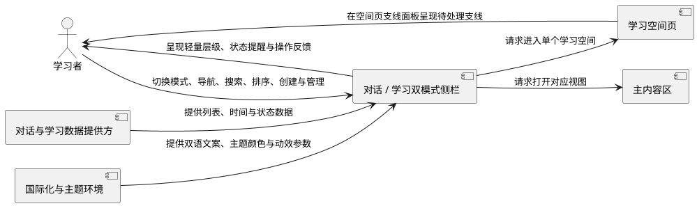
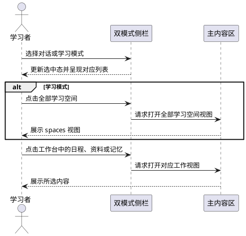
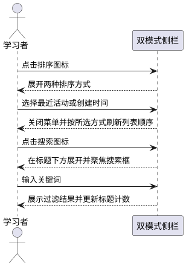
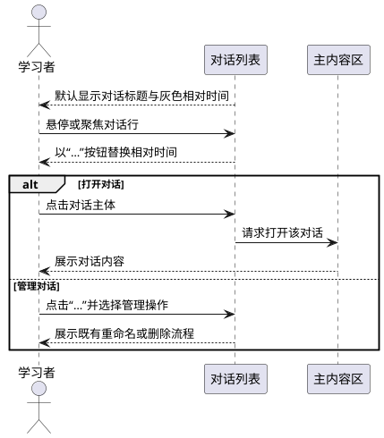
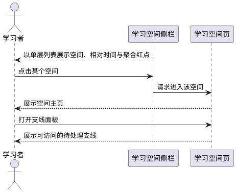
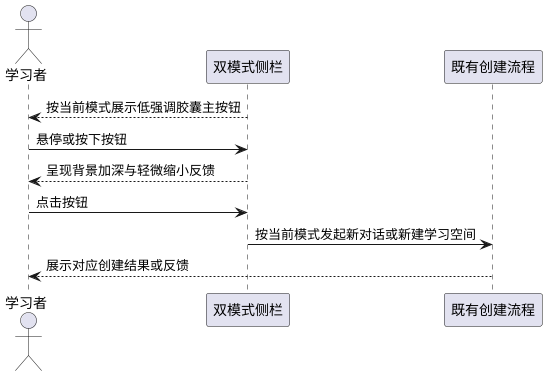
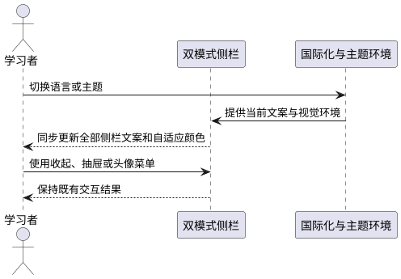

# 修订说明：本轮补充微调（2026-11-18）

上一轮验收通过后，用户提出三处补充微调。本轮仅更新需求规格文档，不修改业务代码。以下条款中与被标注条款冲突的旧表述，一律以本轮标注为准。

1. **学习模式顶部入口精简**：删除学习模式顶部的「新建学习空间」入口行，仅保留「全部学习空间」；新建学习空间能力由底部胶囊按钮统一承担。覆盖 5.1.1 原第 6、8 条，并同步更新 4.5 第 4 条、5.4.3 第 1 条中的对应表述。
2. **对话时间分组名样式独立**：分组名（今天 / 昨天 / 本周…）左侧与对话标题文字对齐，使用 `--text-tertiary`、11px，上方留 8px 间距，与列表分区标题样式明确区分；分区标题保持现状。对应 5.2.1 新增第 11 条。
3. **工作台与列表标题行之间的分隔**：在「约 10px 垂直间距」与「一条 `--border-subtle` 细分隔线」两个候选中，推荐采用约 10px 垂直间距、不加分隔线，推荐选择及理由记录于 5.1.1 新增第 9 条。

**本轮实现边界**：本轮微调的业务代码仅允许修改 `ConversationSidebar.tsx` 与 `ConversationSidebar.module.css`，不得修改 `ChatApp.tsx`、`i18n/messages.ts`、`globals.css` 或其它任何文件。本轮不新增、修改或删除任何中英文文案键。本轮交付前必须通过 `npx tsc --noEmit` 和 `npm run build` 两项检查。

# **1. 组件定位**

## **1.1 核心职责**
本组件负责整理对话与学习双模式侧栏的导航层级和视觉表现，实现清晰、轻量且不损失既有能力的学习入口。

## **1.2 核心输入**
1. **学习者的模式切换操作**：在“对话”和“学习”两种侧栏模式之间切换。
2. **学习者的导航操作**：打开日程、资料、记忆、学习空间列表、单个学习空间或对话。
3. **学习者的列表管理操作**：切换排序方式、输入搜索关键词、重命名或删除对话。
4. **学习者的创建操作**：发起新对话或新建学习空间。
5. **对话与学习空间数据**：包括标题、创建时间、最近活动时间、生成状态、空间当前选中状态及支线待处理状态。
6. **界面环境状态**：包括中英文语言、浅色或深色主题、侧栏收起状态及窄窗口抽屉状态。

## **1.3 核心输出**
1. **模式化侧栏界面**：按当前模式呈现对应入口、列表标题、列表内容、状态标识和底部主按钮。
2. **导航请求**：向主内容区请求打开对话、学习空间、全部学习空间、日程、资料或记忆视图。
3. **创建请求**：向现有创建流程请求新建对话或学习空间。
4. **列表管理结果**：呈现排序、搜索、重命名、删除及其既有成功或失败反馈。
5. **状态提醒**：呈现对话生成中圆点和空间行上的待处理支线红点。
6. **可访问性反馈**：为键盘聚焦、菜单展开、当前选中项和状态图标提供可感知的界面状态。

## **1.4 职责边界**
1. 不修改对话、学习空间、支线、日程、资料或记忆的业务数据及其后端接口。
2. 不在学习模式侧栏内展示或管理单条支线；支线的查看和处理统一由空间页承担。
3. 不修改全局样式文件、全局配色、全局设计变量或其他页面的布局。
4. 不删除重命名、删除、生成中提示、支线提醒、侧栏收起、窄窗口抽屉和头像菜单能力。
5. 不新增独立业务服务、数据迁移、持久化偏好或新的全局变量。
6. 变更范围仅限侧栏展示与交互、其所在页面的侧栏属性传递，以及中英文界面文案。
7. 本轮补充微调（见文首修订说明）的实现变更仅限侧栏组件自身及其局部样式，即仅允许修改 `ConversationSidebar.tsx` 与 `ConversationSidebar.module.css`；不得改动 `ChatApp.tsx`、`i18n/messages.ts`、`globals.css` 或其它任何文件，不得借本轮微调扩大改动范围。

# **2. 领域术语**

**对话模式**
: 以普通对话记录为主要列表内容的侧栏模式。

**学习模式**
: 以学习空间为主要列表内容的侧栏模式。

**工作台**
: 在两种模式下均展示的固定导航分区，包含日程、资料和记忆三个带图标及文字的入口。

**全部学习空间**
: 展示所有学习空间的主内容视图，而非侧栏中的学习空间列表。

**列表分区标题行**
: 位于当前列表上方，包含列表名称、当前条数、排序入口和搜索入口的标题区域。

**相对时间**
: 根据当前时间与对象最近活动时间之差生成的简短本地化时间描述。

**待处理支线**
: 尚未解决且执行状态为等待用户处理或处理失败的支线。

**支线提醒红点**
: 聚合显示在学习空间行右侧、表示该空间至少存在一条待处理支线的红色状态标识。
: 备注：同一空间无论有多少条待处理支线，最多显示一个红点。

**半透明灰色胶囊按钮**
: 位于侧栏底部、由主文字色混合形成低强调背景的新建操作按钮。

# **3. 角色与边界**

## **3.1 核心角色**
学习者：切换侧栏模式，浏览和检索内容，进入各工作视图，创建对话或学习空间，并处理侧栏中的既有管理操作。

## **3.2 外部系统**
主内容区：接收侧栏导航结果并展示对话、空间、全部学习空间、日程、资料或记忆视图。

学习空间页：承接单个空间的详细内容，并在支线面板中展示该空间的待处理支线。

对话与学习数据提供方：提供侧栏列表所需的对话、空间、时间和状态数据。

国际化与主题环境：提供中英文文案、浅色或深色主题颜色以及现有动效参数。

## **3.3 交互上下文**

# **4. DFX约束**

## **4.1 性能**
1. 本次仅调整现有侧栏的布局、样式和前端交互，不得引入额外网络请求或全量数据重载。
2. 排序、搜索、模式切换和菜单展开必须仅基于当前已提供的数据完成，具体毫秒级性能指标为待定。
3. 行尾相对时间与悬停操作按钮切换时，列表不得出现可见的横向跳动。

## **4.2 可靠性**
1. 本次调整不得改变对话重命名、删除、打开和空间创建等既有操作的成功判定及失败反馈。
2. 空间列表移除支线层级后，所有待处理支线仍必须能够通过对应空间页的支线面板访问。
3. 搜索无结果、列表为空或时间数据无效时，侧栏必须保持可继续操作，不得出现空白页或阻断导航。

## **4.3 安全性**
1. 不得扩大现有数据访问范围，不得展示当前学习者无权访问的对话、空间或支线内容。
2. 不得新增敏感信息采集、持久化或传输。
3. 键盘与鼠标操作必须具有等价的核心导航能力，焦点不得因鼠标点击而长期被困在模式切换器上。

## **4.4 可维护性**
1. 所有新增界面文案必须同时提供简体中文和英文，并通过现有翻译机制读取。
2. 所有因支线层级移除而废止的展开、收起和空支线文案必须从中英文资源中同步删除。
3. 相对时间的各个时间单位及数量表达必须同时支持中英文，英文数量为一时必须使用自然单数表达。
4. 底部按钮必须复用现有主文字色及动效变量，不得写死灰色 rgba，不得新增全局变量。
5. 交付前必须通过 `npx tsc --noEmit`、`npm run test:api` 和 `npm run build` 三项检查。
6. 本轮补充微调（见文首修订说明）交付前必须通过 `npx tsc --noEmit` 和 `npm run build` 两项检查；本轮不涉及文案资源、数据契约或接口变更，不得借检查之名扩大改动范围。

## **4.5 兼容性**
1. 必须同时支持浅色主题、深色主题、中文和英文，不得只针对其中一种组合调整视觉。
2. 必须保持侧栏收起和窄窗口抽屉行为，底部按钮在这些环境中不得变形、溢出或丧失可操作性。
3. 必须保留现有对话筛选规则、对话时间分组、加载与错误反馈、头像菜单及更新提示。
4. 除明确移除的独立排序行、裸快捷图标行、空间支线层级以及本轮补充移除的学习模式顶部新建学习空间入口行外，其余现有功能不得因布局调整而回归。
5. 全局样式与全局配色必须保持原状。

# **5. 核心能力**

## **5.1 双模式切换与工作台导航**

### **5.1.1 业务规则**
1. **模式切换器内容**：顶部必须提供“对话”和“学习”两个选项，分别配备消息对话图标和书本图标，图标与文字共同表达模式含义。
a. 验收条件：The 侧栏 shall 在顶部同时显示带对应图标的“对话”和“学习”两个切换选项。

2. **选中态**：当前模式必须使用浅色背景和深色主文字进行强调，禁止依赖描边或蓝色边框表达选中状态。
a. 验收条件：While 任一侧栏模式被选中，the 侧栏 shall 以浅底和主文字色突出该选项且不显示选中描边。

3. **鼠标点击焦点**：鼠标点击模式选项后不得残留蓝色焦点描边。
a. 验收条件：When 学习者使用鼠标点击模式选项，the 侧栏 shall 完成模式切换且不在该选项上显示蓝色焦点框。

4. **键盘焦点**：焦点可见样式必须仅在键盘等需要显示焦点的输入方式下呈现。
a. 验收条件：When 学习者使用 Tab 键聚焦模式选项，the 侧栏 shall 显示清晰的焦点环。

5. **工作台分区**：两种模式必须显示同一“工作台”分区，分区内仅以带图标和文字的列表行提供日程、资料、记忆三个入口，不得继续显示原裸图标快捷行。
a. 验收条件：While 侧栏处于对话模式或学习模式，the 侧栏 shall 显示包含日程、资料和记忆三行的工作台分区。

6. **学习模式快捷入口（本轮覆盖）**：学习模式必须在工作台上方仅提供“全部学习空间”一行入口，不得再显示顶部“新建学习空间”入口行；对话模式不得显示该行。新建学习空间能力由底部胶囊按钮统一承担。本规则覆盖原“在工作台上方依次提供新建学习空间和全部学习空间两行入口”的表述。
a. 验收条件：While 侧栏处于学习模式，the 侧栏 shall 在工作台上方仅显示全部学习空间入口，且不显示顶部新建学习空间入口行。

7. **全部学习空间导航**：全部学习空间入口必须打开现有的全部学习空间视图。
a. 验收条件：When 学习者点击全部学习空间，the 侧栏 shall 请求主内容区打开 spaces 视图。

8. **新建学习空间入口唯一性（本轮覆盖）**：侧栏内的新建学习空间操作必须统一由底部胶囊按钮承担，并调用与现有一致的创建流程；顶部不再提供第二个新建入口。本规则废止原“学习模式上方的新建学习空间入口”相关表述，底部按钮的创建行为仍按 5.5 执行。本调整仅删除入口行，不新增、修改或删除任何中英文文案键。
a. 验收条件：When 学习者在侧栏发起新建学习空间，the 侧栏 shall 仅通过底部胶囊按钮打开现有学习空间创建流程，且顶部不存在新建学习空间入口。

9. **工作台与列表分区标题行的分隔（本轮新增）**：工作台分区与下方列表分区标题行之间必须保留约 10px 的垂直间距，不得新增分隔线。本规则在「约 10px 间距」与「一条 `--border-subtle` 细分隔线」两个候选中选择间距方案，推荐理由：侧栏已包含工作台标题、列表分区标题和时间分组名等多层低强调文本，再增加一条水平分隔线会带来额外视觉噪声；纯间距方案更干净，在浅色与深色主题下均无需额外边框适配，不引入新视觉元素或全局变量，且实现仅涉及局部间距调整，符合本轮最小改动边界。
a. 验收条件：The 侧栏 shall 在工作台分区与列表分区标题行之间呈现约 10px 的垂直间距，且两者之间不存在分隔线。

### **5.1.2 交互流程**

### **5.1.3 异常场景**
1. **重复选择当前模式**
a. 触发条件：学习者点击已经选中的模式。
b. 系统行为：保持当前模式和列表内容，不重复初始化数据。
c. 用户感知：界面保持稳定，无额外错误提示。

2. **创建学习空间失败**
a. 触发条件：现有创建流程未能成功创建学习空间。
b. 系统行为：沿用现有创建流程的失败处理，不在侧栏伪造新空间。
c. 用户感知：显示现有失败反馈，侧栏仍可继续操作。

3. **工作台对应当前视图**
a. 触发条件：学习者点击已经处于激活状态的工作台入口。
b. 系统行为：保持对应当前视图，不生成重复导航层级。
c. 用户感知：当前入口保持既有激活态，无内容闪烁。

## **5.2 列表分区标题、排序与搜索**

### **5.2.1 业务规则**
1. **分区标题与计数**：对话模式必须显示“对话记录 N”，学习模式必须显示“学习空间 N”；N 必须等于当前搜索条件下实际列出的条数。
a. 验收条件：When 列表内容或搜索条件发生变化，the 侧栏 shall 更新对应标题和 N 使其与当前可见结果条数一致。

2. **空列表标题**：即使当前列表为空或搜索无结果，分区标题、排序入口和搜索入口仍必须可用，N 显示为 0。
a. 验收条件：While 当前列表结果为空，the 侧栏 shall 显示计数为 0 的分区标题及排序、搜索入口。

3. **标题行工具**：排序和搜索必须以两个小图标按钮放置在分区标题行右侧，禁止保留独立一行的“最近活动”排序按钮。
a. 验收条件：The 侧栏 shall 仅在列表分区标题行右侧提供排序和搜索图标，且不显示独立排序行。

4. **排序菜单**：点击排序图标必须展开小菜单，菜单仅提供“最近活动”和“创建时间”两种排序方式，并标识当前选项。
a. 验收条件：When 学习者点击排序图标，the 侧栏 shall 展开包含最近活动和创建时间的菜单并标识当前排序方式。

5. **最近活动排序**：两种模式选择最近活动时，必须按对象最近活动时间从新到旧排列。
a. 验收条件：When 学习者选择最近活动，the 侧栏 shall 将最近活动较新的对话或学习空间排列在前。

6. **创建时间排序**：两种模式选择创建时间时，必须按对象创建时间从新到旧排列。
a. 验收条件：When 学习者选择创建时间，the 侧栏 shall 将创建时间较新的对话或学习空间排列在前。

7. **搜索展开**：点击搜索图标必须在分区标题行下方展开搜索框并聚焦输入位置。
a. 验收条件：When 学习者点击搜索图标，the 侧栏 shall 在标题行下方展开搜索框并允许立即输入。

8. **搜索范围**：对话模式必须按对话标题过滤；学习模式必须按学习空间名称过滤，不得再因支线标题命中而显示空间。
a. 验收条件：When 学习者输入关键词，the 侧栏 shall 仅显示符合当前模式搜索范围的结果并同步更新计数。

9. **搜索关闭与清空**：清空关键词或关闭空搜索框后必须恢复完整列表；按 Escape 必须关闭搜索并清除过滤条件。
a. 验收条件：When 学习者清除搜索或按 Escape 关闭搜索，the 侧栏 shall 恢复未过滤列表并更新计数。

10. **既有分组兼容**：对话列表现有的今天、昨天、本周、本月和更早分组必须保留，排序变化在既有分组规则下生效。
a. 验收条件：While 对话模式存在可分组的搜索结果，the 侧栏 shall 保留现有时间分组且不恢复独立排序行。

11. **时间分组名对齐与样式（本轮新增）**：对话列表中今天、昨天、本周、本月、更早各分组名的左侧必须与对话标题文字的左侧对齐；分组名必须使用 `--text-tertiary` 颜色和 11px 字号，且每组分组名上方保留 8px 间距，使其与列表分区标题的现有样式明确区分；列表分区标题保持现状，不得随本轮调整改变其字号、颜色或间距。本规则为纯展示层调整，不改变分组规则、组序和组内排序。
a. 验收条件：While 对话列表显示时间分组，the 侧栏 shall 使分组名左侧与对话标题文字对齐、以 `--text-tertiary` 和 11px 呈现并在分组名上方保留 8px 间距，且列表分区标题样式保持不变。

### **5.2.2 交互流程**

### **5.2.3 异常场景**
1. **搜索无匹配结果**
a. 触发条件：当前模式下没有符合关键词的对话或空间。
b. 系统行为：保留标题行和搜索条件，列表计数更新为 0。
c. 用户感知：显示既有“没有匹配的内容”提示，可清空或修改关键词。

2. **列表数据加载失败**
a. 触发条件：对话或学习空间列表读取失败。
b. 系统行为：沿用现有错误与重试机制，不将加载失败误报为搜索无结果。
c. 用户感知：显示既有错误说明和重新加载入口。

3. **排序菜单被关闭**
a. 触发条件：学习者点击菜单外部或按 Escape。
b. 系统行为：关闭排序菜单且不改变尚未重新选择的排序方式。
c. 用户感知：列表顺序保持不变，焦点返回排序入口。

## **5.3 对话记录行与相对时间**

### **5.3.1 业务规则**
1. **行尾时间**：每条对话记录右侧必须显示低强调灰色的最近活动相对时间，格式与学习空间行一致。
a. 验收条件：While 对话记录处于非悬停且未打开操作菜单的状态，the 侧栏 shall 在行尾显示灰色相对时间。

2. **悬停替换**：对话行被悬停时，相对时间必须被“…”操作按钮替换，禁止时间与按钮同时挤占行尾。
a. 验收条件：When 学习者悬停对话行，the 侧栏 shall 隐藏该行相对时间并在原行尾区域显示“…”按钮。

3. **键盘与菜单可访问性**：对话行获得内部焦点、操作菜单展开或设备不支持悬停时，必须能够访问“…”按钮。
a. 验收条件：When 学习者通过键盘聚焦对话行操作区域或在不支持悬停的设备上查看列表，the 侧栏 shall 提供可见或可聚焦的“…”按钮。

4. **生成状态**：现有对话生成中圆点必须保留，且不得被相对时间或“…”按钮的布局调整破坏。
a. 验收条件：While 对话正在生成，the 侧栏 shall 继续显示既有生成中状态标识。

5. **行内管理**：重命名、删除确认、删除失败恢复和打开对话行为必须与调整前保持一致。
a. 验收条件：When 学习者从“…”菜单重命名或删除对话，the 侧栏 shall 沿用现有交互和结果反馈。

6. **行宽稳定**：相对时间与“…”按钮切换不得造成标题可见宽度突变或整行位移。
a. 验收条件：When 对话行在默认和悬停状态之间切换，the 侧栏 shall 保持行尾区域尺寸稳定。

### **5.3.2 交互流程**

### **5.3.3 异常场景**
1. **对话标题过长**
a. 触发条件：对话标题无法在行内完整显示。
b. 系统行为：保持单行省略，行尾时间或操作按钮不得被挤出。
c. 用户感知：标题以省略号截断，仍可通过既有提示识别完整标题。

2. **最近活动时间无效**
a. 触发条件：对话缺少可解析的最近活动时间。
b. 系统行为：不显示负数或无效时间文本，保留对话导航与管理能力。
c. 用户感知：行尾时间不展示误导性内容，其余行内功能正常。

3. **管理操作失败**
a. 触发条件：重命名或删除未成功。
b. 系统行为：沿用现有失败处理，不错误移除或改写列表项。
c. 用户感知：显示既有失败反馈，可再次操作。

## **5.4 单层学习空间与支线提醒**

### **5.4.1 业务规则**
1. **单层列表**：学习模式侧栏必须仅列出学习空间，禁止显示空间展开或收起按钮、支线列表及空支线提示。
a. 验收条件：While 侧栏处于学习模式，the 侧栏 shall 只呈现一层学习空间列表且不呈现任何支线条目。

2. **进入空间**：点击学习空间行必须直接进入对应空间页，不再承担展开或收起支线的功能。
a. 验收条件：When 学习者点击学习空间行，the 侧栏 shall 请求打开对应空间页。

3. **当前空间强调**：当前空间必须使用浅色背景强调，禁止显示左侧竖条。
a. 验收条件：While 某学习空间为当前空间，the 侧栏 shall 以浅底突出该行且不显示左侧竖条。

4. **待处理提醒聚合**：空间至少存在一条待处理支线时，空间行右侧必须显示一个红点；同一空间最多显示一个红点。
a. 验收条件：When 一个空间存在一条或多条待处理支线，the 侧栏 shall 在该空间行右侧显示且仅显示一个红点。

5. **已解决状态排除**：已解决支线即使保留等待或失败的执行状态，也不得触发空间红点。
a. 验收条件：While 空间内等待或失败的支线均已解决，the 侧栏 shall 不显示该空间的支线提醒红点。

6. **提醒可达性**：学习者必须能够从带红点的空间进入空间页，并在该空间的支线面板中找到对应待处理支线。
a. 验收条件：When 学习者点击带红点的空间，the 主内容区 shall 打开该空间且其支线面板能够访问触发提醒的待处理支线。

7. **空间最近活动时间**：每个空间行右侧必须显示该空间最近活动的灰色相对时间，时间档位和中英文规则与对话记录一致。
a. 验收条件：While 学习空间行具有有效最近活动时间，the 侧栏 shall 按与对话记录相同的规则显示灰色相对时间。

8. **状态共存**：空间名称、红点及相对时间必须在有限行宽内清晰呈现，红点不得因多条支线或时间文本而重复或消失。
a. 验收条件：While 带待处理支线的空间显示相对时间，the 侧栏 shall 同时保留单个红点和可读的时间信息。

9. **废止侧栏直达支线交互**：侧栏不再提供直接打开单条支线的入口，也不再维护空间展开状态；该交互移除不得影响日程或空间页已有的支线入口。
a. 验收条件：When 学习者使用学习模式侧栏，the 侧栏 shall 不提供支线直达操作且日程与空间页的既有支线入口保持可用。

### **5.4.2 交互流程**

### **5.4.3 异常场景**
1. **没有学习空间**
a. 触发条件：当前没有任何学习空间且未设置搜索条件。
b. 系统行为：保留学习模式入口和计数为 0 的标题行。
c. 用户感知：显示既有“还没有学习空间”提示，可使用底部新建学习空间胶囊按钮（本轮覆盖：新建入口统一为底部按钮，顶部不再提供新建入口）。

2. **空间没有待处理支线**
a. 触发条件：空间内支线均已解决，或等待、失败状态不属于未解决支线。
b. 系统行为：不聚合红点，仅展示空间及其最近活动时间。
c. 用户感知：该行无红色提醒，不产生误导。

3. **空间最近学习时间缺失**
a. 触发条件：空间尚无最近学习时间。
b. 系统行为：使用既有空间最近活动语义确定可展示时间；仍无有效时间时不生成错误文本。
c. 用户感知：空间可正常打开，行尾不出现无效或负时间。

4. **空间已被删除或不可访问**
a. 触发条件：学习者点击的空间已不存在。
b. 系统行为：沿用现有空间缺失处理，不在侧栏展示不存在的支线内容。
c. 用户感知：显示既有空间缺失反馈，可返回其他导航入口。

## **5.5 底部新建主按钮**

### **5.5.1 业务规则**
1. **胶囊外形**：底部主按钮必须为完整半圆端点的胶囊形，圆角 999px、高度 36px，宽度撑满侧栏可用区域且左右各保留 12px 内边距。
a. 验收条件：The 侧栏 shall 显示高度 36px、圆角 999px 且左右间距各 12px 的底部主按钮。

2. **自适应背景**：按钮默认背景必须由现有主文字色按 7% 比例与透明色混合形成，禁止写死 rgba 灰色或新增全局颜色变量。
a. 验收条件：While 学习者使用浅色或深色主题，the 侧栏 shall 使用随主文字色自适应的 7% 半透明灰色按钮背景。

3. **边框与内容**：按钮不得使用明显边框；如保留边框，其颜色必须为同色系 10% 的极淡颜色。图标和文字必须使用主文字色，字号必须为 14px。
a. 验收条件：The 底部主按钮 shall 使用主文字色图标和 14px 文字，且无明显高对比边框。

4. **模式化内容**：对话模式必须显示编辑线条图标和“新对话”，学习模式必须显示加号图标和“新建学习空间”，图标位于文字左侧并整体水平居中。
a. 验收条件：When 侧栏模式变化，the 底部主按钮 shall 同步切换为对应模式的图标、文案和创建行为。

5. **悬停反馈**：按钮悬停时背景混合比例必须加深至 11%。
a. 验收条件：When 学习者悬停底部主按钮，the 侧栏 shall 将按钮背景加深至主文字色的 11% 混合比例。

6. **按下反馈**：按钮按下时背景混合比例必须加深至 14%，并缩放至 0.98；过渡必须使用现有时长和曲线变量。
a. 验收条件：When 学习者按下底部主按钮，the 侧栏 shall 显示 14% 背景与 0.98 缩放反馈并沿用现有动效参数。

7. **视觉层级**：按钮在浅色和深色主题下均不得比列表内容更抢眼，禁止使用原高饱和主色实心背景。
a. 验收条件：While 底部主按钮处于默认状态，the 侧栏 shall 保持其低强调中性色外观。

8. **创建行为**：按钮必须根据当前模式触发既有新对话或新建学习空间流程，不得创建重复入口之外的新业务流程。
a. 验收条件：When 学习者点击底部主按钮，the 侧栏 shall 根据当前模式打开对应的既有创建流程。

### **5.5.2 交互流程**

### **5.5.3 异常场景**
1. **创建流程不可用或失败**
a. 触发条件：既有新对话或新建学习空间流程无法完成。
b. 系统行为：沿用原流程错误处理，不改变按钮所代表的操作。
c. 用户感知：显示既有反馈，按钮仍可再次使用。

2. **可用宽度收窄**
a. 触发条件：窄窗口抽屉或其他环境使侧栏可用宽度减少。
b. 系统行为：保持按钮高度、完整圆角及左右 12px 间距，内容保持居中。
c. 用户感知：按钮无横向溢出、无圆角变形，文字和图标仍可识别。

3. **减少动态效果**
a. 触发条件：学习者启用系统或应用的减少动态效果设置。
b. 系统行为：遵循现有全局动效约束，保留颜色和按下状态的可辨识性。
c. 用户感知：无多余动画，操作反馈仍清晰。

## **5.6 双语文案与既有交互兼容**

### **5.6.1 业务规则**
1. **新增文案双语化**：工作台、学习空间入口、列表标题及计数、排序与搜索辅助文案、相对时间等所有新增文案必须提供中英文。
a. 验收条件：When 学习者切换中文或英文，the 侧栏 shall 以所选语言显示全部新增文案且无缺失键或原始键名。

2. **相对时间文案**：相对时间必须覆盖“刚刚 / N 小时前 / 昨天 / N 天前 / N 周前”，英文必须提供对应自然表达并正确处理单复数。
a. 验收条件：When 相对时间跨越小时、昨天、天或周档位，the 侧栏 shall 显示对应当前语言和数量的文案。

3. **废弃文案同步清理**：空间展开、空间收起和空支线三组不再使用的文案必须同时从中英文资源删除，不得只删除一种语言。
a. 验收条件：When 检查中英文侧栏文案，the 系统 shall 不再包含空间展开、空间收起和空支线三组废弃文案。

4. **侧栏环境兼容**：侧栏收起、窄窗口抽屉、头像菜单和更新提示必须保持原有行为。
a. 验收条件：When 学习者收起侧栏、在窄窗口打开抽屉或使用头像菜单，the 系统 shall 保持对应既有功能且新布局不阻断操作。

5. **其他状态兼容**：模型异常提醒、主题切换、帮助、设置及资料激活态等既有侧栏能力必须保持。
a. 验收条件：When 学习者使用既有侧栏辅助功能，the 系统 shall 保持原有导航和状态反馈。

### **5.6.2 交互流程**

### **5.6.3 异常场景**
1. **文案或翻译缺失**
a. 触发条件：任一新增键只存在于一种语言或引用了已删除文案。
b. 系统行为：交付前检查必须阻止该状态通过。
c. 用户感知：正式交付界面不得出现空白文本、原始翻译键或语言混杂。

2. **主题切换**
a. 触发条件：学习者在浅色和深色主题之间切换。
b. 系统行为：底部按钮及选中态根据现有变量自适应，不保留写死主题色。
c. 用户感知：文字、图标和状态保持清晰，按钮仍低于列表内容的视觉强调。

3. **窄窗口与收起状态切换**
a. 触发条件：窗口宽度变化或学习者收起、重新打开侧栏。
b. 系统行为：保留现有抽屉与焦点管理，重新打开后呈现当前模式的完整新布局。
c. 用户感知：无布局残留、内容遮挡或不可点击区域。

# **6. 数据约束**

## **6.1 对话记录**
1. **标题**：必须用于对话行展示和对话模式搜索；过长时单行省略，不得影响行尾状态区域。
2. **创建时间**：必须用于“创建时间”降序排序；排序不得修改原始时间数据。
3. **最近活动时间**：必须用于“最近活动”降序排序和行尾相对时间；无效时不得产生负时间或异常文本。
4. **生成状态**：为生成中时必须保留既有圆点提示，状态消失后不得残留。
5. **列表归属**：必须沿用现有普通对话筛选规则，不得将学习空间支线混入对话模式列表。
6. **条数**：标题中的 N 必须等于当前搜索条件下实际列出的对话条数。

## **6.2 学习空间**
1. **名称**：必须用于空间行展示和学习模式搜索；支线标题不得作为空间是否在侧栏显示的命中依据。
2. **创建时间**：必须用于“创建时间”降序排序。
3. **最近活动时间**：必须用于“最近活动”降序排序和空间行相对时间；尚无学习时间时必须沿用现有最近活动兜底语义。
4. **当前选中状态**：当前空间仅允许浅底强调，不得派生左侧竖条。
5. **列表层级**：每个空间在侧栏至多占据一行，不得展开其子级支线列表。
6. **条数**：标题中的 N 必须等于当前搜索条件下实际列出的学习空间条数。

## **6.3 相对时间**
1. **刚刚**：活动时间距当前不足 1 小时，或时间略晚于当前导致差值为负时，必须显示“刚刚”；英文显示“Just now”。
2. **N 小时前**：活动发生在当前日历日且距当前已满 1 小时时，必须按完整小时数向下取整显示；英文按数量使用“1 hour ago”或“N hours ago”。
3. **昨天**：活动发生在当前日历日的前一天时，必须显示“昨天”；英文显示“Yesterday”。
4. **N 天前**：活动早于昨天且距当前不足 7 个完整日时，必须按实际相隔日历天数显示；英文按数量使用“1 day ago”或“N days ago”。
5. **N 周前**：活动距当前已满 7 个完整日时，必须按完整周数向下取整显示；英文按数量使用“1 week ago”或“N weeks ago”。
6. **一致性**：同一活动时间在同一语言和同一时刻用于对话行与空间行时，必须得到相同文本。
7. **无效值**：无法解析的时间不得显示为负数、NaN 或其他技术错误文本。

## **6.4 支线提醒状态**
1. **空间归属**：每条支线只能为其所属学习空间提供提醒，不得跨空间聚合。
2. **解决状态**：只有未解决支线可以触发提醒，已解决支线必须排除。
3. **执行状态**：未解决支线仅在等待用户处理或执行失败时触发提醒。
4. **聚合数量**：同一空间的红点数量必须为零或一，与待处理支线实际条数无关。
5. **提醒可追踪**：触发红点的支线必须仍存在于对应空间页的支线面板中。