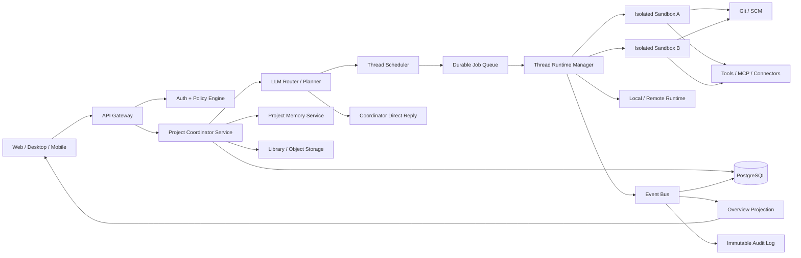
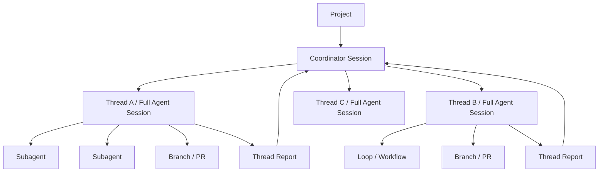
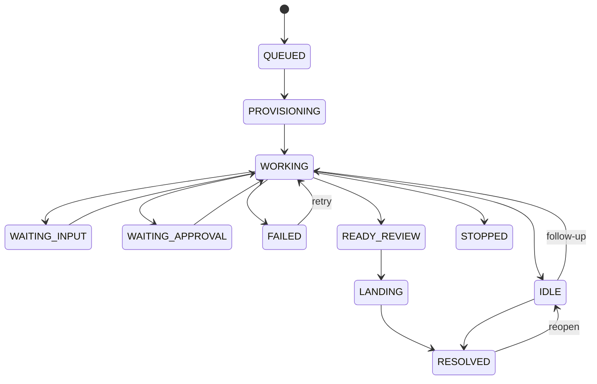
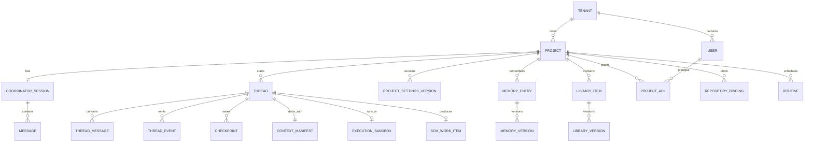
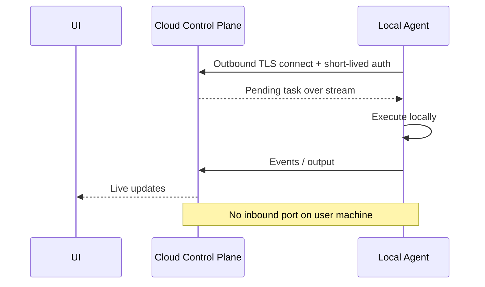

# Claude Projects 与 Thread 机制深度复刻研究报告

**研究目标：**以 Anthropic 在 2026 年重新设计的 Claude Projects 为主要对象，反向梳理其公开可观察的产品语义、Thread 执行机制、Project 设置、权限/存储/记忆/云执行等能力，并给出一套能够在自有产品中工程化复刻的架构方案。

**检索日期：2026 年 10 月 17 日，Asia/Singapore。**

**研究口径：**Anthropic 目前实际上并存两代 Projects：一代是传统的“项目 = Chat + Knowledge + Instructions 的工作区”；另一代是 2026 年推出、从 Claude Code 开始灰度的新版 **“一个 Project = 一个长期 Coordinator Conversation + 多个并行 Threads”**。新版目前面向 Pro/Max 逐步开放，Claude Code 官方文档明确写明 Team/Enterprise 尚未正式获得新版；传统 Projects 仍继续运行，并保留 Team/Enterprise 分享能力。因此，本文把新版称为 **Projects vNext**，把旧版称为 **Legacy Projects**，避免把两套权限、记忆和会话语义混为一谈。citeturn15view1turn16view0turn17view3

> **重要边界：**Anthropic 没有公开 Projects vNext 后台实现或面向普通开发者的 Project/Thread CRUD API。本文凡标注“公开事实”的内容来自官方资料；凡涉及数据库表、调度算法、锁、消息总线、内部索引等，则是根据外部行为作出的**可复刻设计**，而不是声称 Anthropic 内部必然如此实现。Anthropic 目前公开的 Projects API 主要是 Enterprise Compliance API 的读取/删除视角，而非产品控制面的创建和线程调度接口。citeturn18search2turn19search0turn19search8

## 执行摘要

新版 Claude Projects 最值得复刻的并不是“项目文件夹”，而是一套 **Project-scoped agent orchestration runtime**。它的核心抽象可以概括为：

> **Project = Coordinator + Shared Standing Context + Independent Worker Threads + Durable Memory + Library + Execution Environments + Event/Review Surface**

一个 Project 是一条长期存在的协调会话。用户不断向同一个入口提交 bug、需求、代码审查、文档分析等工作，Coordinator 判断应该自己直接回答、把任务交给既有 Thread，还是启动一个或多个新 Thread；每个云端 Thread 又是一个完整、独立上下文的 Claude Code cloud session，并拥有自己的仓库副本和 Git branch。Coordinator 并不持续读取每个 worker 的全部执行轨迹，而主要接收它们汇报的结果。citeturn16view0turn15view0

这种架构与普通“多会话聊天应用”的差别非常大：

| 能力 | 普通 Chat/传统 Project | Claude Projects vNext | 建议复刻方式 |
|---|---|---|---|
| 顶层入口 | 一个或多个独立 Chat | 一个长期 Coordinator conversation | `ProjectCoordinator` 聚合根 |
| 工作拆分 | 用户手动开 Chat | Coordinator 自动路由/拆 Thread | Router + Scheduler |
| Thread | 通常只是聊天分支 | 独立完整 Agent Session | 每 Thread 一个独立 runtime |
| 并行 | 较弱或人工协调 | 多 Thread 并发运行 | Queue + concurrency governor |
| 上下文 | 历史消息 | Project instructions + memory + repos/files | Context Manifest |
| 长期记忆 | Chat history/RAG | 文件化 Project Memory | Memory store + materialized files |
| 代码隔离 | 通常无 | 每 cloud thread 独立 clone/branch | sandbox + Git branch/worktree |
| 恢复 | 继续 Chat | Thread/session 恢复、必要时重新 sandbox | event log + checkpoints |
| 人机协同 | 对话 | approval、waiting-on-you、review | HITL state machine |
| 状态聚合 | Chat list | Overview 状态面板 | projection/read model |
| 输出 | 消息 | 消息 + 文件 + PR + artifacts | Library + ExternalResource |
| 设置生效 | 全局/当前聊天 | 多数设置只作用于新 Thread | immutable context snapshot |

Anthropic 明确把 Thread 定义为“worker”：每个 Thread 有自己的 context window，完成一件工作后向 Project conversation 汇报；新 Thread 会得到 Project repositories、files、instructions、memory，以及仓库中的 `CLAUDE.md`、skills、账户 connector 和指定 cloud environment。citeturn16view0turn17view0turn17view1

**对复刻项目最重要的五条结论是：**

第一，不要把 Thread 实现成 `messages.thread_id` 这么简单。**Thread 应是一级执行实体**，拥有运行状态、模型配置、环境、权限审批、checkpoint、Git branch、PR、token usage、生命周期和自己的消息流。

第二，不要让所有并行 Agent 共用一个可写工作目录。Claude cloud thread 的核心隔离手段是“独立 sandbox + 独立 repo copy + 独立 branch”；官方明确指出两个 Thread 修改相同代码时最终通过标准 Git merge conflict 解决，而不是让多个 Agent 同时写一份文件。citeturn15view0turn17view3

第三，要把 **Project Instructions、Project Memory、Thread transcript** 分成三个概念。Claude 的 project instructions 最多 16,000 字符并发送给 Coordinator 和每个新 Thread；Project Memory 是文件化信息，入口是 `MEMORY.md`，云端 Thread 启动时先读 index、需要时再读相关 memory files；Thread transcript 则是该 Thread 自己的工作上下文。citeturn17view0

第四，应采用 **snapshot-at-thread-start** 的配置模型。Anthropic 已公开说明 instructions、repositories、plugins、environment 的修改只影响**新 Thread**，不会突然改变已经运行中的 Thread。这个行为非常适合通过 `settings_version/context_manifest_id` 固化。citeturn17view1

第五，不建议照搬 Claude 当前的一个弱点：用户说“最多两个线程”目前只是 Claude 保存进 memory 的自然语言偏好，不是严格并发上限。你的实现最好同时存在 `preferred_parallelism` 与平台真正执行的 `hard_concurrency_limit`。citeturn16view0

**推荐总体实现栈：**



该架构复刻的是 Anthropic 公开呈现的 Coordinator→Thread、隔离云 Session、Library、Memory、Overview 和本地 Remote Control 等语义，而具体控制面和存储实现属于本文建议。citeturn16view0turn17view0turn18search5

从工程投入看，一个“UI 看起来像 Claude Projects”的原型约 6–10 周即可完成，但要真正达到**并行 Agent、恢复、Git 隔离、权限、审计、多租户、安全 sandbox 和企业级可靠性**，建议预算 **18–24 周、约 6–9 名核心工程人员、约 30–45 人月**。模型推理费用通常应独立作为最大可变项核算；不要将其隐藏在固定 SaaS 成本中。

## 研究口径与 Claude 当前机制实证

**Projects vNext 的功能定义。** Anthropic 在 2026 年将 Projects 从“folder of conversations”重新设计成“one ongoing conversation”。用户向一个长期 Project conversation 交代工作，Claude 根据任务创建或复用 Thread；不同 Thread 可以并行执行，即使用户关闭电脑，cloud thread 也继续运行。Project Overview 则将完成、阻塞、待审批、PR 等状态汇总回来。citeturn15view0turn16view0

官方给出的典型适用场景包括：跨多个 repository 的统一升级、持续输入同一服务的 bug/stack trace/review request、超出单 Session 范围的大型构建或迁移，以及围绕一批文档进行持续分析。它也可以建立 Routine，把周期性任务作为 Project Threads 执行。citeturn16view0

**旧 Projects 与新版 Projects 必须分开理解。** 截至检索日，Claude Help Center 仍把旧版定义为拥有自己 chat histories 和 knowledge base 的 self-contained workspace；所有用户都可以使用，免费用户最多五个项目。付费旧版 Projects 在知识接近 context limit 时会自动采用 RAG，官方称可将知识容量扩展至最高约 10 倍。与此同时，一部分 Pro/Max 用户已被迁移到新版；Anthropic 表示迁移会携带 instructions、files、full chat history 和 scheduled tasks。citeturn15view1

因此，复刻时最好不要只有一个 `projects` schema，而应预留：

```text
project_mode:
  LEGACY_WORKSPACE
  ORCHESTRATED_VNEXT
```

或者通过 `capabilities` 做 capability negotiation。这样未来从“聊天集合”迁往“Coordinator + Threads”时不需要破坏已有数据。

**Thread 的真实语义。** 官方明确说每一个 cloud Thread 都是一整个 Claude Code cloud session，而不是同一上下文中的轻量 sub-agent。每个 Thread 拥有自己的 context window，并向 Coordinator 汇报；Thread 内仍然可以进一步调用 subagents、loops 或 workflows。Project thread 和 subagent 因而是两个不同层级：Thread 是 project-level execution unit，subagent 是 thread/session 内部的执行单元。citeturn15view0turn17view3

可以按以下层级复刻：



**Coordinator 路由行为。** Claude 官方描述的默认决策大致是：简单问题直接在 Project conversation 回答；新的工作进入新 Thread 或交给已经处理该领域的 Thread；一条消息包含多个互不相关任务时拆成多个 Thread；Claude 有时也只提出 Suggested Threads，等用户确认后再启动。citeturn16view0

这说明你需要的 Router 至少是：

\[
route(message) \rightarrow
\{DIRECT,\ EXISTING\_THREAD(id),\ NEW\_THREADS(tasks[]),\ PROPOSE(tasks[])\}
\]

而不是简单的“每条消息创建一个线程”。

推荐让 Router 输出严格结构：

```json
{
  "decision": "NEW_THREADS",
  "reason": "The request contains three independent repository tasks",
  "direct_response": null,
  "tasks": [
    {
      "title": "Fix auth regression",
      "scope": ["repo:backend"],
      "depends_on": []
    },
    {
      "title": "Update frontend SDK",
      "scope": ["repo:web"],
      "depends_on": []
    }
  ],
  "needs_user_confirmation": false
}
```

然后由 deterministic scheduler 执行，而不是让 LLM 自己直接创建进程。这样调度限制、计费、ACL 和审计才是硬约束。

**Project 设置与 Thread 设置。** Anthropic 目前公开的主要设置如下：citeturn17view1turn17view2

| 设置 | Claude 当前行为 | 推荐复刻字段 |
|---|---|---|
| Name | Project 名称 | `name` |
| Icon | UI icon | `icon` |
| Goal | Coordinator 的单行目标 | `goal` |
| Coordinator model | 顶层协调模型 | `coordinator.model` |
| Coordinator effort | 协调推理强度 | `coordinator.effort` |
| Thread model | worker 默认模型 | `thread_defaults.model` |
| Thread effort | worker 默认 effort | `thread_defaults.effort` |
| Project instructions | 所有新 Thread + Coordinator | `instructions` |
| Memory | Project durable memory | `memory_store_id` |
| Repositories | 新云 Thread 默认 clone | `repository_bindings[]` |
| Environment | 网络、变量、secret、setup | `environment_id` |
| Plugins | 新 Thread 加载 | `plugin_bindings[]` |
| Usage | 按 Thread/model token 使用量 | Usage ledger |
| Pause | 停 Coordinator、Threads、Routines | project lifecycle |
| Archive | 隐藏并停止活跃工作 | lifecycle |
| Delete | 删除 Project/threads/memory/files | deletion workflow |

Claude 新 Project 默认使用 Opus；官方文档目前描述为 Thread 采用 high effort、Coordinator 采用 low effort，但没有在 Projects 文档中锁死某个具体 Opus 版本，因此复刻产品不应把某个模型版本写死到 schema 中。citeturn16view0

**Standing context。** Cloud Thread 启动时可获得 Project repositories/files、instructions、project memory、repository `CLAUDE.md` 与 skills、账号 connectors，以及指定 environment。Project conversation 本身和 Thread 的 tool 能力并不完全一样，例如官方明确指出 Project conversation 本身没有 connector，而 cloud Thread 可以使用 claude.ai account connectors。citeturn16view0turn17view1

这非常值得复刻成显式 `ThreadContextManifest`：

```json
{
  "manifest_id": "ctxm_01J...",
  "project_id": "proj_01J...",
  "settings_version": 42,
  "memory_version": 188,
  "instruction_version": 17,
  "repositories": [
    {
      "repository_id": "repo_backend",
      "base_ref": "main",
      "commit": "3ee4c11..."
    }
  ],
  "library_snapshot": ["lib_01", "lib_02"],
  "environment_id": "env_prodlike_03",
  "plugin_versions": {
    "jira": "2.1.4"
  },
  "created_at": "2026-10-17T08:30:22Z"
}
```

这使任何 Thread 都能够回答“**它究竟是基于什么配置启动的**”，对调试、重放、审计尤其重要。

**Project Memory。** Claude vNext 的 memory 不是无限聊天历史，而是 Claude 主动维护的文件。每个 cloud Thread 启动时会读取 `MEMORY.md` 索引，并在需要时打开相关文件；memory 用于记录 requirements、decisions、pitfalls 等长期信息，与 repository 中的 `CLAUDE.md`、本地 Claude Code auto-memory 是不同命名空间。citeturn17view0

因此推荐三层上下文：

| 层 | 生命周期 | 内容 |
|---|---|---|
| Instructions | 人工治理，低频改变 | 必须遵守的规则 |
| Durable Memory | Agent 与人共同积累 | 决策、偏好、经验、坑 |
| Thread State | 单 Thread | 消息、工具结果、临时推理状态 |

不要把“记忆”只实现成 embedding 所有旧聊天。更好的做法是：

```text
Project memory/
├── MEMORY.md
├── architecture.md
├── decisions.md
├── conventions.md
├── known-pitfalls.md
└── stakeholder-preferences.md
```

底层数据库仍保存结构化版本和 provenance，文件只是给 Agent 的 materialized view。

**文件和 Library。** Anthropic 的 Project Library 收集用户添加的资料和 Thread 生成的文件；目前官方限制还包括单次可选择最多约 100 个文件、总计 2GB，单文件最多约 480MB；文件夹导入还会受到文件数、总大小及隐藏目录等限制。citeturn4view0 这些数字没有必要原样复制，但它说明 Library 应当是独立资源模型，而不是把二进制直接塞进 messages 表。

**Git 工作模型。** Cloud Thread 默认从 repository default branch 创建自己的 branch；Thread 可以创建 PR，并能持续观察 CI 或 review comments，失败时继续修复。独立 Thread 改到相同代码时，最终仍由 Git merge conflict 显式暴露冲突。citeturn16view0turn15view0

建议：

```text
Project
   ├─ Repository binding: backend
   │
   ├─ Thread A → branch ai/thread-A → PR #831
   ├─ Thread B → branch ai/thread-B → PR #832
   └─ Thread C → branch ai/thread-C → no PR yet
```

而不要：

```text
Thread A ─┐
Thread B ─┼──> /workspace/backend  // 高危
Thread C ─┘
```

Anthropic 对本地执行也暴露了同一个问题：两个 Thread 在一个本地 folder 同时工作可能互相覆盖，因此官方建议 Git repo 使用 worktree 隔离。citeturn17view0

**Thread 状态与 UI。** Overview 当前呈现六个主要组：`Ready for review`、`Waiting on you`、`Working`、`Landing`、`Idle`、`Resolved`；Resolved 既可以由用户/Claude 设置，也可在一周无活动后自动进入。Thread card 可以直接打开其 transcript，用户可对该 Thread 单独发消息、处理 permission prompt 或 Stop。citeturn16view0

你的内部状态最好比 UI 更细：



然后投影到 UI：

```text
PROVISIONING / WORKING          -> Working
WAITING_INPUT / WAITING_APPROVAL
FAILED requiring user           -> Waiting on you
READY_REVIEW                    -> Ready for review
LANDING                         -> Landing
IDLE                            -> Idle
RESOLVED                        -> Resolved
```

这一点比直接把数据库 `status` 做成六个 UI 字符串更有扩展性。

## 数据模型、API、存储与版本一致性

下面是一套面向生产的建议实体模型。它尽量保持 Claude 的外部语义，但不是 Anthropic 未公开的内部 schema。



**核心 Project 表：**

```sql
CREATE TABLE projects (
    id                  UUID PRIMARY KEY,
    tenant_id           UUID NOT NULL,
    owner_user_id       UUID NOT NULL,
    mode                VARCHAR(32) NOT NULL,
    name                VARCHAR(255) NOT NULL,
    icon                VARCHAR(128),
    goal                TEXT,
    status              VARCHAR(32) NOT NULL,
    visibility          VARCHAR(32) NOT NULL DEFAULT 'PRIVATE',
    coordinator_session_id UUID,
    current_settings_version BIGINT NOT NULL DEFAULT 1,
    current_memory_version   BIGINT NOT NULL DEFAULT 0,
    version             BIGINT NOT NULL DEFAULT 1,
    created_at          TIMESTAMPTZ NOT NULL,
    updated_at          TIMESTAMPTZ NOT NULL,
    archived_at         TIMESTAMPTZ,
    deleted_at          TIMESTAMPTZ
);
```

Anthropic 的 Compliance API 公开的 Project schema 已经能看到 `id`、`name`、`description`、`instructions`、`is_private`、`organization_uuid`、`created_at`、`updated_at`、`deleted_at`、creator/user、`attachments_count` 和 `chats_count` 等字段，这可以作为 Project metadata 边界的重要公开证据。citeturn19search8

**Thread 表：**

```sql
CREATE TABLE threads (
    id                      UUID PRIMARY KEY,
    tenant_id               UUID NOT NULL,
    project_id              UUID NOT NULL REFERENCES projects(id),
    originating_message_id  UUID,
    title                   TEXT NOT NULL,

    status                  VARCHAR(32) NOT NULL,
    execution_target        VARCHAR(16) NOT NULL, -- CLOUD | LOCAL
    agent_session_id        VARCHAR(255),

    model                   VARCHAR(128),
    effort                  VARCHAR(32),

    context_manifest_id     UUID NOT NULL,
    settings_version        BIGINT NOT NULL,
    memory_version_at_start BIGINT NOT NULL,

    repository_id           UUID,
    base_commit_sha         VARCHAR(64),
    branch_name             TEXT,
    pull_request_url        TEXT,

    lease_owner             VARCHAR(255),
    fencing_token           BIGINT,
    attempt                 INTEGER NOT NULL DEFAULT 0,

    input_tokens            BIGINT NOT NULL DEFAULT 0,
    output_tokens           BIGINT NOT NULL DEFAULT 0,

    created_at              TIMESTAMPTZ NOT NULL,
    started_at              TIMESTAMPTZ,
    last_activity_at        TIMESTAMPTZ,
    completed_at            TIMESTAMPTZ,
    resolved_at             TIMESTAMPTZ
);
```

这里刻意保存 `settings_version` 与 `memory_version_at_start`，因为 Claude 已明确表现出配置的 snapshot 语义：instructions、repo、plugin、environment 的改动只影响新 Thread。citeturn17view1

**事件而不是“只有最终状态”。**

推荐每个 Thread 同时有 event log：

```json
{
  "event_id": "evt_01J...",
  "tenant_id": "tenant_acme",
  "project_id": "proj_01J...",
  "thread_id": "thr_01J...",
  "sequence": 173,
  "type": "tool.approval.required",
  "timestamp": "2026-10-17T08:41:32.128Z",
  "payload": {
    "tool": "shell",
    "command_hash": "sha256:...",
    "risk": "write_external_state"
  },
  "trace_id": "tr_...",
  "causation_id": "evt_..."
}
```

Current status 是 event projection，而不是 source of truth。这能自然支持 UI 实时刷新、恢复、审计和 time travel。

**公开 Anthropic API 与需要自建的 API 必须分开。**

截至检索日，Anthropic 面向 Projects 的公开 API 中最清晰的是 Compliance API，例如：

```http
GET /v1/compliance/apps/projects/{project_id}
Authorization: Bearer $ANTHROPIC_COMPLIANCE_API_KEY
anthropic-version: 2023-06-01
```

其公开响应包含类似：

```json
{
  "id": "claude_proj_abc123",
  "name": "Payments migration",
  "description": "...",
  "instructions": "...",
  "is_private": true,
  "organization_uuid": "...",
  "attachments_count": 12,
  "chats_count": 8,
  "created_at": "...",
  "updated_at": "...",
  "deleted_at": null,
  "user": {
    "id": "...",
    "email_address": "..."
  }
}
```

这是**企业合规读取接口**，不是 `POST /projects`、`POST /threads` 之类的运行时编排 API。Compliance API 还公开了 Project attachments、collaborators、Chats 和 messages 的读取面。citeturn19search0turn19search3turn19search8turn19search12turn19search18

Anthropic Developer Platform 的 Messages API 本身仍然是 stateless：应用在普通 Messages API 模式下需要自行发送完整 conversational history；这进一步说明不要误认为消费端 Projects 的服务端 statefulness 是 Messages API 自动提供的。Anthropic 另有 Managed Agents 提供 stateful、long-running agent infrastructure，但它是开发者平台中的另一层产品。citeturn19search2turn18search0

**推荐你提供以下业务 API：**

```text
POST   /v1/projects
GET    /v1/projects
GET    /v1/projects/{project_id}
PATCH  /v1/projects/{project_id}
DELETE /v1/projects/{project_id}

POST   /v1/projects/{project_id}/messages
GET    /v1/projects/{project_id}/events

GET    /v1/projects/{project_id}/threads
POST   /v1/projects/{project_id}/threads
GET    /v1/threads/{thread_id}
POST   /v1/threads/{thread_id}/messages
POST   /v1/threads/{thread_id}/actions

POST   /v1/threads/{thread_id}/approvals/{approval_id}

GET    /v1/projects/{project_id}/memory
PUT    /v1/projects/{project_id}/memory/{key}
DELETE /v1/projects/{project_id}/memory/{key}

POST   /v1/projects/{project_id}/library/uploads
GET    /v1/projects/{project_id}/library

GET    /v1/projects/{project_id}/acl
PUT    /v1/projects/{project_id}/acl/{principal_id}

GET    /v1/projects/{project_id}/usage
GET    /v1/projects/{project_id}/audit-events
```

**创建 Project 示例：**

```http
POST /v1/projects
Authorization: Bearer ey...
Idempotency-Key: 01JAX...
Content-Type: application/json
```

```json
{
  "name": "Payments latency",
  "goal": "Keep p95 API latency below 200 ms",
  "mode": "ORCHESTRATED",
  "instructions": "Run tests before marking work complete.",
  "repositories": [
    {
      "provider": "github",
      "repository_id": "org/payments-api"
    }
  ],
  "thread_defaults": {
    "model": "provider/default-agent-model",
    "effort": "high",
    "preferred_parallelism": 3
  },
  "environment_id": "env_01J..."
}
```

响应：

```json
{
  "id": "proj_01J...",
  "status": "ACTIVE",
  "coordinator_session_id": "coord_01J...",
  "settings_version": 1,
  "memory_version": 0,
  "created_at": "2026-10-17T08:00:00Z",
  "_links": {
    "events": "/v1/projects/proj_01J.../events",
    "threads": "/v1/projects/proj_01J.../threads"
  }
}
```

**向 Coordinator 提交工作：**

```http
POST /v1/projects/proj_01J.../messages
Idempotency-Key: msg-client-744
```

```json
{
  "content": [
    {
      "type": "text",
      "text": "修复登录回归，同时检查 checkout 服务有没有相同问题。"
    }
  ],
  "routing": {
    "mode": "auto"
  }
}
```

返回 `202 Accepted`：

```json
{
  "message_id": "pmsg_01J...",
  "routing_status": "COMPLETED",
  "decision": {
    "type": "spawn_threads",
    "threads": [
      {
        "id": "thr_auth",
        "title": "Fix login regression",
        "status": "QUEUED"
      },
      {
        "id": "thr_checkout",
        "title": "Audit checkout for same regression",
        "status": "QUEUED"
      }
    ]
  },
  "event_cursor": "01JAZ..."
}
```

需要支持 stream 时，不要让 `POST` 本身维持几个小时。应返回资源 ID，再通过 SSE/WebSocket：

```http
GET /v1/projects/proj_01J.../events?after=01JAZ...
Accept: text/event-stream
```

接收：

```text
event: thread.status.changed
data: {"thread_id":"thr_auth","status":"WORKING"}

event: thread.approval.required
data: {"thread_id":"thr_checkout","approval_id":"apr_77"}

event: thread.completed
data: {"thread_id":"thr_auth","summary":"..."}
```

**Thread 直接沟通与 Coordinator 消息要分开。** Claude 明确区分：用户在 Thread 自己的 message box 发消息时一定送到那个 Thread；在 Project conversation 发 follow-up，则由 Coordinator 判断是否匹配到已有 Thread。citeturn16view0

因此：

```http
POST /v1/threads/thr_auth/messages
```

应该保证强制定位到 Thread，而：

```http
POST /v1/projects/proj/messages
```

进入 Router。

**并发与一致性。** 建议采用四种不同的一致性模型：

| 数据 | 推荐一致性 |
|---|---|
| ACL / secret permission | 强一致或 fail-closed |
| Project settings 更新 | optimistic concurrency |
| Thread context | immutable snapshot |
| Overview/status | eventual consistency |
| Usage ledger | 至少一次事件 + 幂等聚合 |
| Audit log | append-only、不可覆盖 |
| Library metadata | read-after-write |
| Search/vector index | eventual |

Project patch 应使用 `ETag`：

```http
PATCH /v1/projects/proj_01
If-Match: "version-41"
```

如果另一个客户端已修改：

```http
HTTP/1.1 409 Conflict
```

```json
{
  "error": {
    "code": "PROJECT_VERSION_CONFLICT",
    "message": "Project was modified by another client.",
    "current_version": 42,
    "retryable": false
  }
}
```

**线程调度不能完全交给 LLM。** Claude 当前接受类似“最多同时两个 Threads”的自然语言要求，但文档明确说这只是 preference，并非硬 cap，而且平台另有每天最多新建 200 个 Thread 的强制上限。citeturn16view0turn17view2

你应实现：

```text
effective_concurrency =
    min(
        user_preference,
        project_hard_limit,
        tenant_hard_limit,
        provider_rate_limit_budget,
        sandbox_capacity,
        spend_budget_limit
    )
```

通过 Redis semaphore / database lease / scheduler quota 强制执行。

**执行 lease。** 一个 Thread 在任意时间只能有一个 worker 拥有执行权：

```text
lease_owner
lease_expiry
fencing_token
```

重新调度后 fencing token 增加。旧 worker 即使网络恢复，也不能再提交外部 side effect。这对 shell、Git push、PR comment 等操作非常关键。

**Checkpoint 与幂等。** Claude cloud sandbox 在 turn 间可能 pause；如果恢复失败，官方说明可能从 fresh clone 继续，此时未 commit 的修改可能丢失，并建议长任务 commit/push WIP。citeturn17view3

开源 LangGraph 的 persistence 模型提供了很好的工程参照：checkpointer 保存 Thread state，store 保存跨 Thread 的长期数据；它也明确区分 synchronous checkpoint 的更强 durability 与 asynchronous checkpoint 的较低延迟，并强调恢复后 node 可能重新执行，因此 side effect 必须幂等。citeturn22view4turn21search2turn21search14

推荐：

```text
Agent step:
  1. read checkpoint N
  2. compute intended action
  3. persist intent / checkpoint N+1
  4. execute idempotent side effect
  5. record result
```

所有外部操作带：

```text
idempotency_key =
  hash(thread_id, logical_step_id, tool_name, side_effect_identity)
```

**存储设计。**

| 数据 | 推荐存储 |
|---|---|
| Project/Thread/ACL/settings | PostgreSQL |
| Message/event metadata | PostgreSQL + partition |
| 大 transcript/event payload | Object storage，可压缩 |
| Library binaries | S3/GCS/Azure Blob 类 object store |
| Memory structured records | PostgreSQL |
| Memory materialized files | Object storage / virtual filesystem |
| Queue | Kafka / SQS / PubSub / NATS JetStream |
| Lease/cache | Redis |
| 全文搜索 | OpenSearch/PG FTS |
| Vector retrieval | pgvector/vector service |
| Git workspace | Ephemeral sandbox volume |
| Audit archive | WORM-capable object storage |

主要索引建议：

```sql
CREATE INDEX idx_projects_tenant_updated
ON projects(tenant_id, updated_at DESC)
WHERE deleted_at IS NULL;

CREATE INDEX idx_threads_project_status
ON threads(tenant_id, project_id, status, last_activity_at DESC);

CREATE UNIQUE INDEX idx_thread_events_seq
ON thread_events(thread_id, sequence_no);

CREATE INDEX idx_audit_tenant_ts
ON audit_events(tenant_id, occurred_at DESC);
```

向量检索必须把 `tenant_id`、`project_id` 作为 filter，而不是只把它们拼进 embedding metadata 后寄希望于应用层过滤。

**知识检索。** Legacy Claude Projects 会在项目知识接近 context limit 时自动启用 RAG。新版 vNext 更强调 explicit memory index + files/repositories。citeturn15view1turn17view0

你可以使用 hybrid context builder：

\[
Context =
Instructions
+ MemoryIndex
+ TopK(Memory)
+ TopK(Library)
+ RepoInstructions
+ RecentThreadSummary
+ TaskMessages
\]

不要把整个 Project transcript 永远塞进 model context。

**版本与历史记录。** 推荐所有影响 Agent 行为的数据都版本化：

```text
ProjectSettingsVersion
InstructionVersion
MemoryVersion
LibraryVersion
ContextManifest
PromptTemplateVersion
ToolPolicyVersion
EnvironmentVersion
AgentRuntimeVersion
ModelVersion
```

Anthropic Compliance 体系已经体现了对 Project/chat/artifact 历史实体的明确区分；其应用数据接口还可以读取 messages、project attachments 等合规数据。citeturn19search0turn19search3turn19search18

你的 Thread 最终应能够生成如下 provenance：

```json
{
  "thread_id": "thr_01",
  "runtime_version": "agent-runtime-3.14.2",
  "settings_version": 42,
  "instruction_version": 17,
  "memory_version": 188,
  "environment_version": 9,
  "model": "vendor/model-x",
  "model_revision": "2026-10-01",
  "repo_commits": {
    "backend": "3ee4c11"
  }
}
```

这样出现“昨天能做，今天不能做”时才能定位到底是模型、prompt、memory、repo 还是 environment 改了。

## 权限、安全、隐私、审计与多租户

这里最容易犯的错误，是把 **Legacy Projects 的 Team/Enterprise sharing** 当成新版 Projects vNext 已有能力。

截至检索日，新版 Claude Code Projects beta 明确是单用户 Project：不能把 Project 或 Thread 分享给另一个用户，也没有组织级 Project controls。citeturn17view3

与此同时，Legacy Projects 在 Team/Enterprise 中支持：

- Public：整个 organization 能发现并使用 Project；
- Private：默认仅创建者，显式邀请成员；
- `Can view`：看 project contents/knowledge/instructions，并可在项目中聊天；
- `Can edit`：修改 instructions/knowledge，并进行成员和项目内容管理；
- Enterprise 还可以通过 group 授权，group membership 改变后访问权限随之改变。citeturn15view1turn15view2

官方 Compliance API 对 collaborator 又公开了更细的 role schema，包括 `owner`、`admin`、`editor`、`viewer`，principal 可以是 user、group、organization 等类型。citeturn19search12

因此，推荐直接设计企业级 RBAC，而不是先做 `owner_id` 后期重构：

```sql
project_acl (
    id,
    tenant_id,
    project_id,
    principal_type, -- USER | GROUP | ORGANIZATION | ORG_ROLE
    principal_id,
    role,           -- OWNER | ADMIN | EDITOR | OPERATOR | VIEWER
    source,         -- DIRECT | GROUP | ORG_DEFAULT
    inherited_from,
    granted_by,
    granted_at,
    revoked_at
)
```

权限矩阵可设为：

| Action | Owner | Admin | Editor | Operator | Viewer |
|---|---:|---:|---:|---:|---:|
| 查看 Project | ✓ | ✓ | ✓ | ✓ | ✓ |
| 查看 Thread | ✓ | ✓ | ✓ | ✓ | ✓ |
| 发任务 | ✓ | ✓ | ✓ | ✓ |  |
| 修改 Instructions | ✓ | ✓ | ✓ |  |  |
| 修改 Environment | ✓ | ✓ |  |  |  |
| 管理 Secrets | ✓ | ✓* |  |  |  |
| 分享/ACL | ✓ | ✓ |  |  |  |
| 删除 Project | ✓ |  |  |  |  |
| 查看 Audit | ✓ | ✓ | 可配置 |  |  |

`Secrets` 最好另外做 capability，而不要默认 ADMIN 都能读取 secret plaintext。

**继承语义建议。**

```text
Tenant Policy
   ↓
Project ACL
   ↓
Thread ACL
   ↓
Artifact / Library ACL
```

默认 Thread 继承 Project，但可加：

```text
thread.visibility =
  PROJECT
  OWNER_ONLY
```

如果你更重视向 Legacy Claude 的团队行为兼容，则默认 chat/thread 可以保持 owner-only，因为 Anthropic Legacy Project 即使 Project public，个人 chat 默认仍是 private，除非主动分享。citeturn15view2

**权限决策必须在服务端做。**

不要：

```javascript
if (ui.user.role === "editor") ...
```

而应统一调用 Policy Decision Point：

```json
{
  "subject": {
    "tenant_id": "acme",
    "user_id": "u_42",
    "groups": ["eng"]
  },
  "action": "thread.execute",
  "resource": {
    "project_id": "proj_7",
    "thread_id": "thr_19"
  },
  "context": {
    "execution_target": "cloud",
    "tool": "github.push"
  }
}
```

返回：

```json
{
  "allow": true,
  "policy_version": 118,
  "obligations": [
    "audit",
    "require_branch_not_protected"
  ]
}
```

**Approval 与 ACL 是两层东西。** Claude Thread 在需要权限时会停在 Thread 内等待 approval；在 Project conversation 里说“go ahead”并不会自动传递给该 Thread。官方也允许 repository `.claude/settings.json` 定义工具 permission rules，不过 multi-repo + Anthropic-hosted environment 下规则继承存在特殊限制。citeturn16view0

你的权限系统应区分：

```text
Authorization:
    “这个用户/Agent 是否有资格请求执行 shell/git/API？”

Approval:
    “这个符合权限的具体高风险动作是否已获人类批准？”
```

建议 approval 实体：

```json
{
  "id": "apr_01",
  "thread_id": "thr_01",
  "action_type": "github.merge",
  "action_fingerprint": "sha256:...",
  "scope": "THIS_ACTION",
  "status": "PENDING",
  "expires_at": "...",
  "requested_by_agent": "...",
  "approved_by": null
}
```

批准时必须校验 action fingerprint，防止“用户批准的是 A，Agent 最后执行 B”。

**Sandbox 安全模型。** Anthropic 对 cloud session 的公开安全架构是每个 session 位于隔离的 Anthropic-managed VM，并限制网络访问，可关闭网络或只允许指定域名。citeturn18search3turn18search5

因此，推荐至少做到：

```text
Thread
  └─ isolated microVM/container
       ├─ unique uid/namespace
       ├─ ephemeral filesystem
       ├─ CPU/RAM/PID quota
       ├─ seccomp/AppArmor
       ├─ outbound proxy
       ├─ deny-by-default egress
       ├─ no host socket
       └─ short-lived credentials
```

对于执行陌生代码的 coding agent，Firecracker/gVisor/Kata 这一等级的隔离通常比“普通 Docker + rootless”更合适。

**Secret 管理。** Secret 不应该进入 context 或 environment dump。推荐：

```text
Agent asks for secret capability
        ↓
Tool Proxy verifies policy
        ↓
Secret Broker mints short-lived token
        ↓
Token supplied only to target process
        ↓
stdout/stderr redaction
```

数据库只存 `secret_ref`，不存 secret。

Anthropic cloud environment 同样将 network secrets、environment variables 和 network configuration 作为 environment 能力的一部分。citeturn16view0

**本地 Thread / Remote Control。** Claude 现在允许新版 Project 将某个任务放到用户自己的电脑执行；本地 Thread 可以访问机器上的 files、tools、MCP servers 和 settings，但机器必须保持在线。Remote Control 的官方安全模式是本机主动向 Anthropic 发出 HTTPS 连接、不开放 inbound port；传输经过 TLS，使用多个短期且不同用途的 scoped credential。citeturn16view0turn18search13

建议完全复制这个网络方向：



而不要让 Cloud Control Plane SSH 到用户电脑。

**数据隔离。** 所有主键访问都必须同时绑定 `tenant_id`：

```sql
SELECT *
FROM threads
WHERE tenant_id = :authenticated_tenant
  AND project_id = :project
  AND id = :thread;
```

不要只检查随机 UUID “难以猜测”。数据库层可以进一步使用 PostgreSQL RLS。

对于企业版，推荐：

```text
tenant_id
region_id
encryption_key_id
retention_policy_id
legal_hold_policy_id
```

从一开始就进入核心 schema。

Anthropic Files API 自身也提醒开发者关注 workspace 级资源隔离问题，因此在多租户 SaaS 中不能把第三方 workspace resource ID 直接当作终端用户 ACL 边界。citeturn19search1

**加密。** 推荐：

- TLS 1.3/service mTLS；
- object/database envelope encryption；
- KMS 管理 tenant DEK；
- 高规格企业客户可选 per-tenant key；
- secret 单独加密且不进入普通 backup；
- event/audit 采用独立密钥权限。

Anthropic 的 Remote Control 已公开使用 TLS；Anthropic 平台也提供 CMEK 场景，但应注意 Claude Code cloud session 当前在某些 ZDR/HIPAA/CMEK 配置下存在产品可用性限制，因此不能假定“所有合规模式都能运行 cloud agent”。citeturn18search13turn18search19

**Retention 与删除。** Claude Code 官方目前对消费用户与商业用户有不同 retention 规则，例如 Commercial Team/Enterprise/API 标准情况下为 30 天，符合资格的 Enterprise 场景可配置 Zero Data Retention；消费端是否用于模型改进也会影响保留期。citeturn18search1

不要在自己的设计里硬编码 30 天，而应：

```json
{
  "retention_policy": {
    "transcript_days": 90,
    "artifact_days": 365,
    "audit_days": 2555,
    "deleted_resource_grace_days": 30
  }
}
```

并加入 legal hold。

Claude vNext UI 的 Delete 会永久删除 Project、Threads、memory 和 files，而已经推送到 GitHub 的 branch/PR 不受影响。citeturn17view1 这意味着你的删除系统也必须明确区分：

```text
owned data
vs.
externally created side effects
```

Project 被删不应擅自删除客户 GitHub 中的 PR，除非用户另外授权。

**审计日志。** 建议每个敏感操作产生不可变 `AuditEvent`：

```json
{
  "audit_id": "aud_01J...",
  "tenant_id": "tenant_acme",
  "actor": {
    "type": "USER",
    "id": "u_42"
  },
  "action": "thread.tool.approve",
  "resource": {
    "project_id": "p_1",
    "thread_id": "t_9"
  },
  "request_id": "req_...",
  "trace_id": "trace_...",
  "source_ip": "...",
  "policy_version": 118,
  "before_hash": null,
  "after_hash": "sha256:...",
  "occurred_at": "..."
}
```

Anthropic 的 Compliance API 能按 Project、Chat、message、attachment、collaborator 等资源获取企业数据，说明企业复刻版本最好从第一天就为 eDiscovery/DLP/API export 留出结构化资源边界，而不是事后解析日志文本。citeturn19search0turn19search12turn19search18

**地域与法律。** 本报告按照用户要求假设“无特定法律区域限制”。工程上仍建议一开始加入 `data_region`、retention、legal hold、export/delete API。若实际落地新加坡、欧盟、美国受监管行业或中国大陆，应分别评估数据跨境、数据驻留、个人信息、日志保存以及外部模型调用要求，而不应把本报告视为法律意见。

## 性能、可靠性、运维、测试与成本

Anthropic 没有公开 Projects vNext 的内部延迟 SLO，因此以下数值均是**推荐验收目标，不是 Anthropic 性能数据**。

建议第一版目标：

| 指标 | 推荐 SLO |
|---|---:|
| 普通 API p95 | < 300 ms，不含 LLM |
| Coordinator message 接受 | p95 < 500 ms |
| Router 决策 | p95 < 3 s，取决于模型 |
| Thread queue→provision | p95 < 15 s |
| Event→UI 可见 | p99 < 2 s |
| Thread 状态收敛 | < 5 s |
| Control-plane availability | ≥ 99.9% |
| Audit event loss | 0 |
| 重复 side effect | 目标 0 |
| RPO，metadata | ≤ 5 min，建议趋近 0 |
| RTO，control plane | ≤ 30 min |

实际 Thread agent 工作时间不应该定义严格响应 SLO，因为任务可能持续数十分钟甚至更长；应该定义的是 **progress freshness SLO**。

例如：

```text
正在运行 Thread 每 30–60 秒必须：
  更新 heartbeat，
  或产生一个 progress event，
  或明确标记 blocked。
```

这比 UI 一直显示“Working”好得多。

Claude 本身也提醒 Thread 看似卡住时可能仍在工作，且首次 cloud session 需要 provisioning；官方因此让用户进入 Thread transcript 查看进展。citeturn17view3

**容量规划。**

真正关键的不是 Project 数，而是：

\[
ConcurrentThreads =
ActiveProjects
\times AvgRunningThreadsPerProject
\]

和：

\[
SandboxHours =
ThreadStarts
\times AvgRuntimeHours
\]

模型侧则是：

\[
TokenCost =
InputTokens / 10^6 \times P_{in}
+
OutputTokens / 10^6 \times P_{out}
+
CacheCharges
+
ToolCharges
\]

一个推荐 capacity worksheet：

```text
MAU                           10,000
DAU                            1,000
active projects/day              300
thread starts/project/day           4
thread starts/day               1,200
avg runtime/thread             12 min
sandbox hours/day                240
avg concurrent sandboxes          10
burst concurrent sandboxes       100+
```

注意 `avg concurrent` 通常不高，但 burst 很大，因此 Sandbox Fleet 必须支持队列和快速弹性。

Claude 当前没有固定 Thread 并发数，用户的自然语言 limit 只是 preference；同时存在每日 200 个新 Thread 的产品级强限制。并行 Thread 越多，plan usage 消耗越快。citeturn17view2turn15view1

这进一步说明你的 scheduler 应同时治理：

```text
thread/day
thread/minute
concurrent/project
concurrent/user
concurrent/tenant
tokens/minute
tokens/day
sandbox-hours/month
external-tool-rate
budget/month
```

**Context 成本优化。** Claude 官方透露一个非常实用的行为：Pro/Max plan 的 Thread 在 prompt cache lifetime 后重新激活时可能需要重新读取整个 conversation，文档举出的 cache lifetime 是约一小时，因此对已经很大的旧 Thread，创建一个新 Thread 有时比恢复旧 Thread 更省使用量。citeturn17view2

这值得做自动策略：

```text
if thread.context_tokens > threshold
   and idle_duration > provider_cache_ttl
   and task_is_semantically_new:
       spawn fresh thread
       inject old thread summary
else:
       reuse thread
```

而不是盲目维持“同主题永远同 Thread”。

**Context compaction。** Claude Projects 会自动管理 context，Project conversation 主要依赖 recent messages、recent threads 和 project memory，而不是无限放入全部历史；Thread 也自动 compact。citeturn16view0

推荐使用：

```text
Raw Event Log           永久/按 retention 保存
       ↓
Thread Summary          压缩
       ↓
Project Decision Memory 提炼长期事实
       ↓
Active Model Context    只包含当前需要内容
```

不要把“模型 context”和“系统事实存储”设计成同一个东西。

**错误分类。**

建议统一错误模型：

```json
{
  "error": {
    "code": "REPOSITORY_ACCESS_DENIED",
    "category": "PERMISSION",
    "message": "Repository access was denied.",
    "retryable": false,
    "user_action_required": true,
    "request_id": "req_...",
    "details": {
      "repository_id": "repo_..."
    }
  }
}
```

错误类别：

| 类别 | 示例 | 自动重试 |
|---|---|---|
| TRANSIENT_NETWORK | GitHub timeout | 是 |
| RATE_LIMIT | provider 429 | 是 |
| CAPACITY | no sandbox | 是 |
| AUTH | credential expired | 条件式 |
| PERMISSION | Git repo denied | 否 |
| VALIDATION | invalid setting | 否 |
| CONTEXT_EXHAUSTED | context full | 新 Thread/compact |
| TOOL_ERROR | test failed | Agent 决策 |
| USER_APPROVAL_REQUIRED | merge approval | 等用户 |
| CANCELLED | user stop | 否 |
| INTERNAL | runtime crash | 是 |

Claude 自己目前会对一些网络问题提示稍后 retry；当 Project/Thread 到 plan usage limit 时，会等待并在额度 reset 后自动继续，而 Routine 启动的 Thread 是一个例外，它不会一直等待。官方还分别处理 repo access、environment removed、setup script failed、context exhausted、old client version、max turns 等情况。citeturn17view4

**重试策略。**

建议：

```text
HTTP/network:
100ms, 250ms, 500ms, 1s, 2s...
full jitter
max retry budget

Provider 429:
Retry-After 优先

Sandbox provisioning:
limited exponential retry

Git push:
fetch/rebase/check branch state before retry

External side effect:
never blind retry without idempotency key
```

重试必须按 logical operation 去重，而不是按 HTTP request 去重。

**运营指标。**

最低限度应监控：

```text
project_messages_total
router_decisions_total{decision}
threads_started_total
threads_active
threads_queue_depth
thread_provision_seconds
thread_runtime_seconds
thread_blocked_seconds
thread_failures_total{reason}
thread_retries_total
approval_wait_seconds
context_tokens
input_tokens
output_tokens
cache_hit_ratio
memory_reads/writes
library_bytes
sandbox_cpu_seconds
sandbox_memory_peak
tool_calls_total{tool}
tool_failures_total
github_conflicts_total
events_lag_seconds
audit_write_failures
```

业务层还应看：

```text
task_success_rate
human_intervention_rate
thread_reopen_rate
PR_merge_rate
PR_ci_failure_rate
memory_correction_rate
user_stop_rate
cost_per_completed_task
```

**告警建议：**

```text
P1:
audit event write failure
cross-tenant authorization anomaly
sandbox escape indicator
secret leak detector hit

P2:
queue > threshold for 10 min
thread provisioning p95 regression
GitHub/MCP connector failure spike
provider 5xx spike

P3:
cost/task +30%
context growth anomaly
memory write anomaly
```

**测试策略。**

单元测试重点不是 LLM 自由文本，而是 deterministic components：

- ACL evaluator；
- state machine；
- context manifest；
- version conflict；
- idempotency；
- retry budget；
- cost accounting；
- retention/deletion graph。

集成测试必须涵盖：

```text
Project → message → router → Thread → sandbox
Thread → Git branch → commit → PR
Thread → approval → resume
Thread → memory update → later Thread reads it
Settings v1 → start Thread A
Settings v2 → Thread A remains v1 / Thread B gets v2
```

端到端验收场景至少包含：

| 场景 | 必须验证 |
|---|---|
| 两个并行 code Threads | 独立 workspace/branch |
| 同文件冲突 | 不互相覆盖，最终显式 conflict |
| Coordinator routing | quick answer 不开 Thread |
| Thread follow-up | 直接发往原 Thread |
| Project follow-up | 可被 router 重路由 |
| approval | 未批准绝不执行 |
| crash during execution | checkpoint 恢复 |
| duplicate message | 不重复 side effect |
| account removed | ACL 即时失效 |
| Project delete | 自有数据清理，GitHub PR 保留 |
| tenant isolation | 任意 IDOR 测试失败 |
| prompt injection | repo/file 内容无法越过 tool policy |

**Chaos 测试尤其重要：**

```text
kill worker after Git commit before event persisted
kill worker before Git push
duplicate queue delivery
lose event bus connection
expire OAuth mid-run
revoke repo access
delete environment
provider 429 for 20 minutes
project paused while Thread running
ACL removed while tool call queued
```

开源 LangGraph 的 checkpoint/interrupt/durable execution 文档同样强调“恢复后节点可能重新执行”，这正是 agent 系统必须进行 fault-injection 的原因。citeturn21search6turn21search14

**成本模型。**

不要只算模型 token。完整成本应是：

\[
C =
C_{LLM}
+C_{Sandbox}
+C_{DB}
+C_{ObjectStorage}
+C_{Search}
+C_{Queue}
+C_{Egress}
+C_{Observability}
+C_{Security}
\]

假设：

```text
1,200 threads/day
12 min/thread
≈ 7,200 sandbox-hours/month
```

若你的 sandbox blended internal cost 为假设性的 `S` 美元/小时：

\[
C_{sandbox}=7,200S
\]

模型使用若为：

```text
monthly input tokens  = 3,000M
monthly output tokens =   400M
```

则：

\[
C_{LLM}=3000P_{in}+400P_{out}
\]

其中 `P_in`、`P_out` 是你实际选择供应商/模型的**每百万 token 当前价格**。由于模型定价会频繁变化，生产预算应从 provider pricing API/config 注入，不建议把 2026 年某个价格常量直接写进代码。

中型生产环境的非模型基础设施，可以用如下**工程预算量级**开始评估；这些不是任何云厂商报价：

| 项目 | 每月预算量级 |
|---|---:|
| API/control plane | \$300–1,500 |
| PostgreSQL HA | \$500–2,000 |
| Redis/queue | \$200–1,000 |
| Search/vector | \$300–2,000 |
| Object storage | \$100–1,000，视数据量 |
| Sandbox compute | `sandbox_hours × S` |
| Observability | \$500–3,000+ |
| LLM inference | 由 token 量决定，通常是主要可变项 |

最大的优化空间通常依次是：

**减少不必要 Thread → 使用更小模型做 routing/coordinator → thread context summary → prompt caching → fresh Thread 替代超大冷 Thread → 限制并发 → setup image cache → 在廉价模型上做分类/摘要。**

Anthropic 自身也建议降低 model/effort、减少 Thread 数以及让 Coordinator 直接回答小问题，以降低 Project usage。citeturn17view2

## 平台对比、实施路线图与风险

下表把 Claude Projects vNext 与 OpenAI、Microsoft 及开源 LangGraph 放在相同抽象层比较。需要注意，四者并非完全同类产品。

| 维度 | Claude Projects vNext | OpenAI ChatGPT Projects / adjacent Work | Microsoft Copilot Notebooks | LangGraph |
|---|---|---|---|---|
| 核心抽象 | Coordinator + Threads | Project workspace，以 chats/files/instructions/memory 为核心 | Notebook + references + instructions | Agent graph/runtime |
| 自动任务拆分 | **核心能力** | Projects 本身不是以该机制为核心；相邻 agent/work 功能承担执行 | 不是 Notebook 核心抽象 | 开发者自行实现 |
| Thread | 完整 cloud session | Project chats/work units | Notebook chat/reference interaction | `thread_id` + graph state |
| 并行 worker | 内置 | 取决于相关 agent/work 产品 | 非 Notebook 核心 | 可以自行编排 |
| 长期 Project memory | 文件化 project memory | Project memory | Notebook/reference context | Store |
| Thread memory | Session context | Chat/work context | Chat context | Checkpointer |
| Repository branch | 每 cloud Thread 独立 | 产品不同 | 无对应核心模型 | 自行实现 |
| HITL approval | Thread 内权限提示 | agent 产品支持相邻机制 | Microsoft agent 产品另有治理 | interrupt 原生支持 |
| Library/files | 有 | 有 | References + Pages | 自行实现 |
| Sharing | vNext beta 当前单用户 | Shared Projects | Microsoft 365 sharing | 应用自行实现 |
| 企业 ACL | 尚未进入 vNext beta；Legacy 有 | Workspace/project policy | M365/SharePoint/Entra | 自行实现 |
| 审计 | Compliance APIs | OpenAI workspace governance | Purview/M365 governance | 自行实现 |
| 开源 | 否 | 否 | 否 | 是 |
| 最适合借鉴 | UX、agent orchestration | 项目协作/项目记忆 | 企业治理/数据生命周期 | durable execution |

OpenAI 当前 ChatGPT Projects 同样围绕 chats、files、instructions 和 project memory 组织上下文；共享 Project 自动采用 project-only memory，并与个人记忆隔离。它与 Claude vNext 最大的产品差异在于：Claude 把“Coordinator 自动创建完整并行 worker session”直接提升成 Project 的核心抽象。citeturn12search0turn12search9

Microsoft Copilot Notebooks 更接近“企业知识工作区”而不是 Claude 式线程调度器。微软公开资料显示 Notebook 的 custom instructions 和部分内容保存于 SharePoint Embedded container；references 仍位于原始 OneDrive/SharePoint 等源位置，而 Notebook chat conversations 本身并不存放在该 container 中。微软同时通过 Cloud Policy、Entra/M365 groups、SharePoint 和 Purview 提供成熟治理能力。citeturn22view1turn22view2

LangGraph 则是最适合复刻后台机制的开源参照之一：其 checkpointer 提供 Thread scoped state，Store 提供 cross-thread long-term memory，并原生覆盖 interrupts、time travel、failure recovery 等问题。它并不提供 Claude Projects 成品 UX，但作为 runtime substrate 很有参考价值。citeturn22view4turn21search6

因此，如果目标是“深度复刻 Claude Projects”，最佳组合实际上是：

```text
Claude Projects     → 学产品语义和 UX
LangGraph 类机制    → 学 durable runtime / checkpoint
Git worktree/branch → 做 coding isolation
Microsoft M365      → 学企业 ACL / lifecycle / audit
自有 Control Plane  → 把这些组合成产品
```

**建议实施路线图如下。**

| 阶段 | 时间 | 核心交付 | 主要人员 |
|---|---:|---|---|
| 行为规格与骨架 | 2 周 | Project/Thread state machine、API contract、UI prototype | Tech Lead、PM、Designer |
| Control Plane | 3 周 | Project、Coordinator、Router、Scheduler、event stream | Backend ×2、AI Engineer |
| Agent Runtime | 4 周 | sandbox、tools、Git branch/worktree、checkpoint | Platform ×2、Backend |
| Memory / Library | 3 周 | instructions、memory、files、search/context builder | AI Engineer、Backend |
| 权限与多租户 | 3 周 | RBAC、groups、tenant isolation、secrets、audit | Security、Backend |
| UX 与 Observability | 3 周 | Overview、Thread pane、notifications、usage、metrics | Frontend、SRE |
| Hardening / Migration | 3–6 周 | chaos、load/security tests、legacy migration、rollout | QA、SRE、Security |

这些阶段可以部分并行，建议总项目周期按 **18–24 周**规划。

理想核心团队：

```text
1 × Staff/Lead Backend / Architect
2 × Backend / Distributed Systems
1 × Agent/LLM Engineer
1 × Platform/Sandbox/SRE
1 × Frontend
1 × QA/SDET
0.5 × Security Engineer
0.5 × Product Designer
0.5 × PM
```

如果需要 Enterprise 多租户、SSO/SCIM、DLP、SIEM、regional deployment，Security/SRE 工作量应增加。

**阶段性的 MVP 不应该把所有功能同时做完。**

第一版建议只实现：

```text
Project
Coordinator
Parallel Threads
Thread transcript
Project instructions
Project memory
File Library
isolated Git workspaces
Overview
Stop / approval
usage accounting
```

暂缓：

```text
Routines
local Remote Control
group sharing
third-party MCP marketplace
automatic PR watching
enterprise Compliance API
regional residency
```

否则首版范围会迅速失控。

**上线验收标准。**

功能方面必须做到：

```text
Coordinator 能稳定区分 direct-answer 与 new-thread；
同一任务可路由回原 Thread；
两 Thread 可真实并行；
worker filesystem 强隔离；
Project memory 能跨新 Thread 生效；
running Thread 不被后来的设置更新悄然污染；
Stop / Pause / Resume 正确；
approval fail-closed；
Library produced files 可追溯到来源 Thread；
每次 side effect 可审计。
```

可靠性方面：

```text
duplicate queue event 不产生重复 PR；
runtime crash 能恢复；
event projection 可重建；
DB failover 后没有跨 tenant 泄漏；
失去 GitHub token 后 Thread 进入 WAITING/FAILED 而不是乱猜；
delete/retention job 可重跑；
所有 external side effects 有 idempotency / reconciliation。
```

安全方面：

```text
IDOR 0
cross-tenant retrieval 0
unapproved high-risk tool execution 0
secret plaintext in transcript 0
sandbox host escape 0 accepted critical findings
```

**主要风险与缓解：**

| 风险 | 严重度 | 说明 | 缓解 |
|---|---|---|---|
| Claude beta 行为变化 | 高 | vNext 正在快速 rollout | capability/version abstraction |
| 误把公开行为当内部架构 | 中 | 无法知道 Anthropic 真正 DB/queue | 只复刻 contract，不复制猜测实现 |
| Parallel Git conflicts | 高 | 多 Threads 改重叠区域 | branch/worktree isolation + conflict detection |
| Memory pollution | 高 | Agent 可能记录错误长期事实 | provenance、review、version/rollback |
| Runaway token cost | 高 | Coordinator + 多 worker 同时消耗 | hard budget + concurrency governor |
| Prompt injection | 高 | repo/files/connectors 都是不可信输入 | tool policy、egress control、taint model |
| Excessive permissions | 高 | agent 能操作 Git/API | short-lived credential + approval |
| Duplicate side effects | 高 | retry/crash 会重放 step | idempotency + fencing token |
| Stale settings | 中 | 用户不清楚 Thread 用哪个设置 | context manifest UI |
| Eventual ACL propagation | 高 | 撤权延迟可能泄漏 | authorization path 强一致/fail closed |
| Sandbox loss | 中 | ephemeral VM 可消失 | checkpoints + Git WIP commit |
| Migration | 中 | Legacy Chat 与 Thread 模型不一致 | immutable legacy import |
| Vendor lock-in | 中 | Model/tool semantics 变化 | provider abstraction |
| Patent/IP | 中 | 存在 Anthropic agent runtime 相关专利 | FTO 法律审查，不直接复制 patented claims |

**迁移设计。** Anthropic 自己已经面对了同一个问题：从老式 Projects 迁到新版时保留 instructions、files、full chat history 和 scheduled tasks。citeturn15view1

你可以采用：

```text
Legacy Project
 ├── old chat A ─┐
 ├── old chat B ─┼─> imported read-only historical conversations
 ├── files       ───> Library
 ├── instructions --> Project Instructions v1
 └── summaries   ───> initial Project Memory

New Coordinator starts here →
New Threads only use vNext execution model
```

不要尝试把过去每个 Chat 强行“恢复成正在运行的 Thread”。将其作为 historical context/legacy transcript 更安全。

**兼容 API。** 所有 Project/Thread API 都建议返回：

```text
schema_version
capabilities[]
```

例如：

```json
{
  "id": "proj_1",
  "schema_version": 3,
  "capabilities": [
    "threads",
    "parallel_execution",
    "project_memory",
    "library",
    "git_branches",
    "approvals"
  ]
}
```

这样客户端不会依赖“所有 Project 都拥有同一组能力”。

**专利风险。** 检索发现 Anthropic PBC 已有一系列与“自动化 multimodal interface task workflows 的 AI agent”相关的专利族，包括 agent runtime architecture、agent configuration、agentic trajectory 等。2026 年 7 月公开的 US20260195524A1 还描述了向用户请求确认步骤、接收 correction 再细化后续步骤等机制。citeturn22view3

但这些专利资料**不能证明 Claude Projects vNext 使用了某项具体 claim，也不能据此反推出 Projects 后台实现**。它们只能说明 Anthropic 在 agent runtime/HITL 领域存在相关知识产权布局。商业化复刻时应让专利律师进行 Freedom-to-Operate 分析，重点关注独立权利要求，而不是简单认为“UI 相似就侵权”或“换个实现就一定没问题”。

## 参考资料与结论来源映射

以下按优先级排序。主报告中的架构建议主要建立在前两类官方资料上；第三方文章仅用于交叉验证产品发布时间和外部观察，不作为内部机制的主要证据。

| 优先级 | 来源 | 支撑结论 |
|---|---|---|
| A | Anthropic Claude Code — Projects | 新 Project 定义、Coordinator、Threads、routing、settings、memory、Git、Overview、限制、usage |
| A | Anthropic Help — What are projects? | Legacy/vNext 双版本、rollout、迁移、旧版 RAG |
| A | Anthropic 官方文章 — Projects redesigned | 设计意图、完整 cloud session、branch、shared memory |
| A | Anthropic Help — Project sharing | Legacy Team/Enterprise ACL、public/private/group sharing |
| A | Anthropic Claude Platform — Compliance API | Project/schema/chat/attachments/collaborators |
| A | Anthropic Claude Code — Security | VM isolation、network controls |
| A | Anthropic Claude Code — Data Usage | retention/ZDR |
| A | Anthropic Remote Control | outbound-only、TLS、短期 credential |
| A | Anthropic Managed Agents | 长时运行 agent infrastructure 对照 |
| A | Anthropic Messages API | 普通 Messages API 为 stateless |
| B | LangGraph official docs | checkpointer、store、interrupt、durable execution |
| B | Microsoft Learn | Copilot Notebook storage、policy、governance |
| B | OpenAI Help Center | ChatGPT Projects/project-only memory 对照 |
| C | Google Patents / Anthropic assignee | agent runtime/HITL 相关专利 |
| C | PANews / The Verge 等 | 发布事件和行业观察的二次验证 |

**Anthropic Projects vNext 核心文档：**

[Let Claude coordinate ongoing work with Projects — Claude Code Docs](https://code.claude.com/docs/en/claude-projects) — 本报告最重要的事实来源，涵盖 Project/Thread 架构、context、memory、models、routing、Overview、Git、local thread、settings、usage、limitations 和 troubleshooting。citeturn16view0turn17view0turn17view1turn17view2turn17view3turn17view4

[Projects redesigned: from folder to conversation — Claude](https://claude.com/resources/articles/projects-redesigned) — Anthropic 对新版产品设计的官方解释；明确 Thread 是各自独立 repo copy/branch 的 Claude Code cloud session，并由 Coordinator 管理。citeturn15view0

[What are projects? — Claude Help Center](https://support.claude.com/en/articles/9517075-what-are-projects) — 解释旧版与新版并存、Pro/Max rollout、旧 Project 迁移和旧版 Project RAG。citeturn15view1

[Manage project visibility and sharing — Claude Help Center](https://support.claude.com/en/articles/9519189-manage-project-visibility-and-sharing) — Legacy Team/Enterprise Projects 的 private/public、viewer/editor、group sharing 和 chat privacy。citeturn15view2

[Organize your tasks with projects in Claude Cowork](https://support.claude.com/en/articles/14116274-organize-your-tasks-with-projects-in-claude-cowork) — Cowork Project instructions/context/memory、account memory separation、sharing 和本地迁移行为。citeturn15view3

**Anthropic 开发平台与 API：**

[Claude API overview](https://platform.claude.com/docs/en/api/overview) — 当前公开开发者 API 的总体边界。citeturn18search2

[Using the Messages API](https://platform.claude.com/docs/en/build-with-claude/working-with-messages) — Messages API stateless，需要调用方提供 conversation history。citeturn19search2

[Claude Managed Agents overview](https://platform.claude.com/docs/en/managed-agents/overview) — Anthropic 面向开发者提供的 managed long-running agent substrate。citeturn18search0

[Files API](https://platform.claude.com/docs/en/build-with-claude/files) — reusable file IDs / 文件管理。citeturn19search1

[Compliance API](https://platform.claude.com/docs/en/api/compliance) — Claude Apps 的 Project/chat/file 合规读取入口。citeturn19search0

[List Projects](https://platform.claude.com/docs/en/api/compliance/apps/projects/list) — Project metadata 列表。citeturn19search14

[Get Project Details](https://platform.claude.com/docs/en/api/compliance/apps/projects/retrieve) — Project 实体公开字段。citeturn19search8

[List Project Attachments](https://platform.claude.com/docs/en/api/compliance/apps/projects/attachments/list) — Project file/document attachment 模型。citeturn19search3

[List Project Collaborators](https://platform.claude.com/docs/en/api/compliance/apps/projects/collaborators/list) — user/group/org principal 与 owner/admin/editor/viewer role schema。citeturn19search12

[Get Chat Messages](https://platform.claude.com/docs/en/api/compliance/apps/chats/messages/list) — 企业合规层的 message/file metadata。citeturn19search18

**安全、执行和数据治理：**

[Security — Claude Code](https://code.claude.com/docs/en/security) — cloud session isolated VM 与 network access control。citeturn18search3

[Use Claude Code in the cloud](https://code.claude.com/docs/en/claude-code-on-the-web) — cloud environments、session persistence、platform limitations、安全隔离。citeturn18search5

[Data usage — Claude Code](https://code.claude.com/docs/en/data-usage) — Claude Code retention、commercial/consumer distinctions、ZDR 等。citeturn18search1

[Remote Control](https://code.claude.com/docs/en/remote-control) — 本地 agent outbound connection、TLS、short-lived credentials 和同步 transcript 的机制。citeturn18search13

[API and data retention](https://platform.claude.com/docs/en/manage-claude/api-and-data-retention) — API retention/ZDR 架构背景。citeturn18search4

**开源与可复刻 runtime 参照：**

[LangGraph Persistence](https://docs.langchain.com/oss/python/langgraph/persistence) — Thread checkpoint 与 cross-thread store 分离。citeturn22view4

[LangGraph Checkpointers](https://docs.langchain.com/oss/python/langgraph/checkpointers) — synchronous/asynchronous persistence durability trade-off。citeturn21search2

[LangGraph Interrupts](https://docs.langchain.com/oss/python/langgraph/interrupts) — durable human-in-the-loop approval。citeturn21search6

[LangGraph Graph API](https://docs.langchain.com/oss/python/langgraph/graph-api) — checkpoint/re-execution/idempotency 设计注意事项。citeturn21search14

**竞品企业工作区：**

[Projects in ChatGPT — OpenAI Help Center](https://help.openai.com/) — ChatGPT Project chats/files/instructions/project memory 和 shared-project memory 边界。citeturn20search0turn12search0turn12search9

[Grant access to Copilot Pages, Copilot Notebooks, and Loop containers — Microsoft Learn](https://learn.microsoft.com/en-us/microsoft-365/loop/grant-access?view=o365-worldwide) — Notebook instructions、references、chat 与 SharePoint Embedded 的数据生命周期。citeturn22view1

[Admin policies for Copilot Pages and Copilot Notebooks — Microsoft Learn](https://learn.microsoft.com/en-us/microsoft-365/loop/cpcn-admin-configuration?view=o365-worldwide) — Cloud Policy、SharePoint Embedded、groups、Purview 与组织治理。citeturn22view2

**专利及二级资料：**

[US20260195524A1 — Artificial Intelligence Agents to Automate Multimodal Interface Task Workflows](https://patents.google.com/patent/US20260195524A1/en) — Anthropic PBC，优先权 2024-03-20，2026-07-09 公开；涉及 agent task workflow、人类确认/纠正等相关机制。它是相关 IP 背景，而不是 Projects 实现证据。citeturn22view3

[Anthropic 统一 Claude 聊天与 Cowork，并推出新版多线程 Projects — PANews](https://es.tradingview.com/news/panews%3A5fc96857bacdf%3A0/) — 中文二级报道，对 2026 年新版 Projects 发布与多线程设计作交叉验证。citeturn14search8

[Claude Code relaunches Projects to manage multiple AI agents in the cloud — The Verge](https://www.theverge.com/ai-artificial-intelligence/997134/anthropic-claude-code-projects) — 第三方报道，同样观察到 Coordinator、parallel threads、独立 branches/PR 的产品模型。citeturn14news20

综合这些公开证据，**最接近 Claude Projects vNext 的复刻并不是“给聊天加一个 project_id”，而是建立一个 durable、multi-session、event-driven 的 Agent Control Plane**：Project Coordinator 负责长期目标与任务路由；Thread 是真正独立的 stateful execution session；Project Memory 是跨 Thread 的持久知识；Context Manifest 将每个 Thread 的启动环境冻结；Scheduler 和 Policy Engine 将 LLM 的建议转化成受预算、并发和权限硬约束的执行；Overview 则只是这个事件系统的实时 read model。这个抽象既最符合 Anthropic 当前公开行为，也最容易进一步扩展到 Team sharing、Routines、local runtime、企业审计和多模型供应商。citeturn16view0turn17view0turn18search0turn22view4