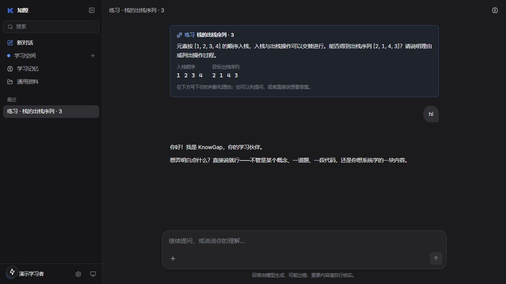

# 练习背景抢占聊天：排查与修复

日期：2026-10-16。代码位于 main，保留此前未提交改动；测试使用独立数据库。

## 报告与复测边界

队员截图显示「练习 · 栈的出栈序列 · 3」会话中，用户发送 `hi`，助手却给出完整解答。队员确认使用 DeepSeek，尚无当时的完整请求日志或精确模型版本。

截图中 `[2, 1, 4, 3]` 可以通过给出的八步操作得到；主要异常是答非所问、主动泄露练习答案，并非这道题的最终结论算错。

当前本机配置为 `deepseek-flash`，服务地址主机为 `api.deepseek.com`。修改前使用相同模型做独立会话对比：普通新对话的 `hi` 正常；带第三道栈题的两次 `hi` 和一次 `你好`，均主动复述旧题并引导继续作答。未稳定复现截图中直接输出完整长解答，不能把这次部分复现冒充对历史请求的完整重放。

## 已确认的应用侧诱因

1. `ChatService._run` 会无条件选取历史里最后一道练习。
2. `chat_messages` 每轮将题目的完整 `reference`（合法性、逐步 push/pop、判据）放进 system 上下文，即使用户只是在打招呼。
3. 界面上的练习卡会被转成助手历史消息里的题目，没有明确说明这只是背景。
4. 每轮检索记忆时，查询都会加上旧题标题和 `topic_key`，使无关的新消息也会召回旧题记忆。

本地复测的请求检查确认，最后一条 user 消息仍然是 `hi`，不是前端将它替换成了题目。旧提示虽有“打招呼时简短回答”的要求，其他上下文却在持续强化做题。这是应用侧的诱导风险；模型输出具有随机性，单凭截图无法证明历史事件的全部因果链。

## 修改

- 显式提供 `latest_user_message`，要求以本轮原文决定响应；打招呼不复述旧题、不催作答，不自行开始解题。
- 将练习卡明确标成界面背景。初始上下文只保留题目，不预注入标准答案；可用题库只保留 id 与标题。
- 增加只读 `exercise_reference` 工具，相关教学轮次按需查询当前题的程序参考；没有题目时不提供，不接受跨题查询参数。
- 学情分析和已有的错误判定校验继续保留程序参考。
- 记忆召回只使用本轮用户原文，不强加旧题的标题和话题键。偏好记忆的原有分层规则保持。
- 内部参考查询不额外展示技术卡片。

该修复没有用 `hi` 关键词硬编码固定回复，也没有清空或删除用户的题目与历史。

## 验证

- 新增 5 项确定性回归：背景与最新请求分离、问候不强召回旧题记忆、合法/非法两类题的程序参考查询、无题目不提供查询、不能指定别的题号。
- 工作区后端全量测试 178 项通过（含此前未提交的 4 项记忆治理测试）；将本次提交内容单独导出验证，174 项通过，不依赖其余未提交文件。
- 真实 DeepSeek 的完整链路评估脚本：`backend/checks/evaluate_live_chat_intent.py`。场景包括普通问候、带题目问候、换话题、只要提示、明确要答案、解答后再问候、非法出栈序列解答；检查生成、工具使用、误判作答和不当学习记录。
- 首轮真实评估还遇到 3 次上游等待超过 45 秒的 504，均保存为失败状态，没有伪造成功回复；这是另外观察到的可用性问题。复测结果保存在 `logs/chat-intent-live-result.json`，首轮记录在 `logs/chat-intent-live-first.json`。
- 修正评估中“换话题时合法的简短回答偏好也被当成不当记录”的检查后复测：9/9 个聊天意图场景通过。复测中一轮解题后的学情分析因连接失败被跳过，聊天答案已正常交付；不能将这轮算成学情分析成功。脚本会另外记录分析跳过情况，便于后续区分。
- 浏览器按截图操作「新对话 → 带入第三道题 → 发送 hi」，实际 DeepSeek 正常打招呼，不主动给答案。

