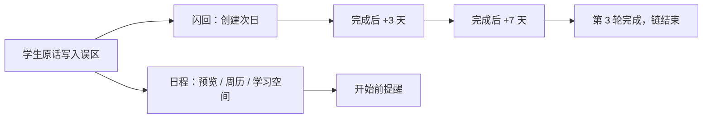
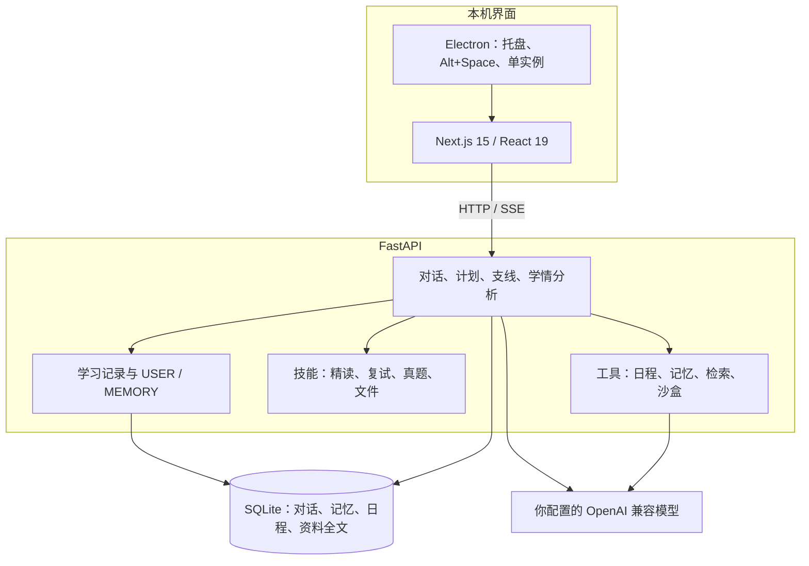

# 知隙是怎么工作的

[← 返回 README](../README.md)

这份文档讲知隙背后的机制：哪些判断放在服务端、为什么这样放，以及当前已知的限制。只想安装使用的话，看 [README](../README.md) 就够了。

## 目录

- [要解决的问题](#要解决的问题)
- [诊断与有证据的记忆](#诊断与有证据的记忆)
- [边讲边推进的学习计划](#边讲边推进的学习计划)
- [主线与支线](#主线与支线)
- [复习闭环](#复习闭环)
- [考前复盘](#考前复盘)
- [交给 AI 的不只是文字](#交给-ai-的不只是文字)
- [桌面端](#桌面端)
- [技术架构](#技术架构)
- [质量与验证](#质量与验证)

## 要解决的问题

通用聊天能把这一题讲懂，但讲完就散了。知隙把下面四件事接在同一次学习上。

| 学生遇到的情况 | 知隙做什么 |
| --- | --- |
| 一问就给完整答案，学生没有自己改口的机会 | 练习和批改默认先指出问题并追问。学生明确要答案，或连续推不动时，可以进入解释，但和提示不是同一步 |
| 换一个对话，模型不记得你上次把栈说成先进先出 | 那句原话写入学习记录。新对话按话题召回，连同原话一起放进本轮上下文 |
| 学完没有复习，错题靠自己想起来 | 未解决的误区自动变成日程里的闪回任务，完成一轮才生成下一轮 |
| 课件、错题、代码、真题各在一个工具里 | 同一条对话可以带上解析后的文件、图片批注、本地代码运行结果和联网检索到的题目 |

## 诊断与有证据的记忆

解决的是「模型觉得你不会」和「你确实这么说过」分不清。写入学习记录之前，证据要过服务端校验，对不上就丢掉，不替模型补一句。

学生发完一条消息、助手回复结束后，后端再请模型做一次学习记录（`validate_analysis`）。它只保留同时满足这些条件的条目：

- `evidence` 是学生**这条**消息里的连续原文。空白会被折叠，文字不能改写、不能从两处拼起来。
- 误区：学生说出了错误的说法，或给出了错误的解答。问句（以 `?`、`？`、`吗`、`呢` 结尾）和「不懂 / 分不清」不算。
- 掌握：学生用自己的话把事情说对。复述助手刚讲的话、只说「懂了」，提示词要求不要记；服务端至少要求原话在学生消息里。
- 偏好：学生明确说的长期学法。句子里有「这次」「本次」「这道题」的会被丢掉。
- 每一轮最多留下 2 条。

状态不是模型直接写的。误区新建时是「待确认」（`suspected`）。同一条记录上，支持证据达到 2 条且之后没有反证，变为「需要巩固」（`needs_review`）；最后一次支持之后出现 1 条反证，变为「改善中」（`improving`）；反证达到 2 条，变为「已解决」（`resolved`）。反证不会凭空新建一条记录。学生可以改摘要、状态和所属空间，改过的记录标上 `user_corrected`。分析提示要求不要就同一点再新建一条；这一条是给记录模型的指令，服务端不会因此拒绝写入。

学生还可以有一份画像笔记 `USER` 和一份环境笔记 `MEMORY`，由记忆工具 `add / patch / remove` 维护。`USER` 上限 1375 字，`MEMORY` 上限 2200 字，条目用 `§` 分隔，重复的不写第二次，超限就拒绝。内容像密钥或像「忽略以上指令」会被模式匹配拦下，这盖不住所有情况。

`USER` 里可以出现五层标签：`Identity`、`Preference`、`Context`、`Activity`、`Experience`。其中 **Preference 不直接写入**：对话前 3 轮如果分析出讲解或互动偏好，界面会问「要记住吗？」；学生点记住才写入，点不用之后同一句不再问。其他四层在前 3 轮可以直接写入；若设置里开了「记忆写入需确认」，则先进入待确认列表。同一会话累计 10 个有效轮次（成功写入会把计数清掉，重新生成不重复计数）会做一次后台笔记复盘。

下一轮怎么用到这些记录：

- 每轮开始时读取当时的 `USER` / `MEMORY` 快照。`USER` 是偏好的依据；历史偏好原话只供对照，和 `USER` 或学生这一轮的要求冲突时不用。
- 学习记录按话题召回，最多带上 5 条偏好，再加最多 3 条本空间或通用的误区/掌握。本空间命中不足 2 条时，才从其他空间补，已解决的误区不参与这次跨空间召回。送进模型的摘要里带最近两条原话。
- 更早的对话原文不自动塞进每一轮。模型需要时调用 `session_search`，用 SQLite FTS5 去查。
- 删除笔记只影响之后的快照。原来的对话还在，历史检索仍可能找到。

## 边讲边推进的学习计划

解决的是「模型讲完一整段，学生还没动手，进度却已经是完成」。计划属于这一段对话，每一轮都看得到，也能改。

状态有五种：`pending`（待开始）、`in_progress`（进行中）、`awaiting_learner`（等你回答）、`done`（已完成）、`skipped`（已跳过）。一次 1 到 8 步。服务端会改模型交上来的计划，不只靠提示词：

- 同时只能有一个「进行中」，多出来的改回待开始。
- 模型不能把已经完成的步骤改回未完成。
- 「等你回答」要变成完成，必须是学生在进入等待**之后**又发过消息。同一轮里模型自己讲完就标完成，会被退回「等你回答」。
- 回复结束后还有一次兜底：分析模型可以提议把「等你回答」标完成，但必须带一段学生原话，而且这段话要逐字出现在本轮学生消息里。对不上就保持等待。
- 学生自己可以在计划条上把任一步改成完成、跳过或重置，也可以加一步、删一步、清空。这些操作记成「用户跳过了……」一类事件，下一轮告诉模型，说一次就清掉。

步骤可以挂到同一学习空间里的一条支线。那条支线被标成已解决后，这一步变为完成。

全部步骤都是完成或跳过时，输入框上方出现小结：「这段学习的 N 个步骤都完成了」。在学习空间里可以把小结存进 Pages；另外可以「生成随堂测验」或「把复习排进日程」。若计划里下一步还在等学生做题，回复后的下一步按钮会偏向再出一道小题，而不是直接去排日程。

下面这张图里，模型把「最后放上的盘子先拿还是后拿」标成等你回答，进度是 0/3。助手已经把问题问出去了，这一步还没勾掉。


## 主线与支线

一个学习空间有目标、基础、截止日期和一份主线。主线负责把一件事拆开；具体的卡点放进支线，做完再把结论送回主线。

学生在主线里描述任务时，协调逻辑会创建或续接支线：同一任务的补充必须带上已有的 `thread_id`，新任务才新建。任务说明要自己写清楚主题和下一步，不能只传「继续」。支线里的执行按顺序处理，进行中收到的补充不会插队丢掉。每一轮支线会向主线写一张进展卡片：正在执行、等待你，或已解决，并附一段不超过 600 字的进展。学生点「已解决」后，模型起草小结并直接合并回主线，不再弹确认框；主线下方出现「已合并到主线」提示，可以「查看」合并卡片或「重新打开」这条支线。起草或合并失败时，才回到手动改小结的对话框。合并不会把支线删掉，卡片还在，可以再打开。支线里的长回复完整显示，不折叠。

右侧列出空闲、执行中、等待你和已解决。下图是演示空间：主线里已经合并了两条结论，右侧还有一条未结束的「哈希冲突处理」。


在助手回复里划选一句话，可以「追问这句」「举个通俗例子」，或把这句话摘进该空间的 Pages。不在空间里时，摘录是灰的。

## 复习闭环

误区记下来之后，复习不依赖学生再打开那条对话。



闪回规则（打开日程列表或 feed 时补齐，同一条记忆同一轮只有一条）：

- 只针对 `kind = misconception` 且状态不是已解决的记录。
- 第 1 轮日期 = 记忆创建日期 + 1 天。完成后，第 2 轮 = 完成日期 + 3 天，第 3 轮 = 完成日期 + 7 天。第 3 轮完成就不再生成。
- 标题是「闪回：{知识点}」，备注里有摘要和最近一条原话。优先级默认 P2。
- 误区被标成已解决或被删除时，链上还没做的闪回改为取消。学生删掉某一轮，视为放弃，不再生成后面的轮次。

日程里还有另外两类任务，都存在 `agenda_tasks`：自己添加或快录的（`manual`），以及 AI 拆解后学生确认才入库的（`ai_breakdown`）。进行中的支线不入库，周历上按所属空间的截止日期现查。计划日期和硬截止日期是两个字段。优先级 P1–P4，可以有一层子任务。有开始时间的任务可以设提醒：准时、5、10、15、30、60、120 分钟或 1 天。导出 `.ics` 时，有提醒的事件带 `VALARM`。

添加任务：日程左栏最上方是「添加任务」（窗口很窄、左栏收成下拉时改在页头），任何页面也可以按 `Q`。`quickAdd.ts` 能从一句中文里取出日期、时间、时长、`#标签` 或 `#空间名`、`p1`–`p4`。AI 拆解大目标时先返回草稿，学生改完确认才写入。对话里也可以排：模型先 `agenda_list` 看已有安排，再用 `agenda_add` / `agenda_update` 写入、改期或标完成，走和界面相同的校验，不能写别人的任务。

预览按天列出待办。演示数据里，次日有一批「闪回 · 第 1 轮」。


周历把有开始时间的任务放在时间轴上，只有日期的放在全天行，截止日期用旗标，支线画在它继承的截止日上。


提醒由页面里的计时器触发系统通知，正文带开始时间、时长和空间。通知点下去会把主窗口叫出来。应用关到托盘时页面还在，计时继续；浏览器把标签页关掉就停了。已经通知过的同一次开始时间不会再响，错过超过 10 分钟也不补。


## 考前复盘

这三样都从该生自己的空间记录来，不另做一套题库。聚合接口 `subject_insights` 不调模型、不写库：误区、已掌握、支线结论和资料列表每次按当前数据算。

**考前一页纸**四块：

1. 个人易错红榜：直接取未解决误区的前 8 条，原话最多 2 条。模型不参与，不能编证据。
2. 支线核心结论：已解决且有小结的支线，最多 8 条。模型不参与。
3. 核心公式和适用边界：模型从讲义片段、主线、支线结论和前端传来的 Pages 笔记里提炼。Pages 只在浏览器里，所以打开一页纸时由前端把笔记正文传上去，最长 20000 字。
4. 易混对比和押题自测：模型生成。

模型不可用或超过 60 秒时仍返回第 1、2 块，第 3、4 块为空，并写明原因。成功结果按数据指纹缓存；新增误区、合并支线、上传资料、改空间或改笔记会让下次重新生成，多聊几句不会。可导出 Markdown，或打印 / 导出 PDF。


**知识迷雾拓扑图**三环：已掌握；待攻克（未解决误区和进行中的支线）；外环是模型根据空间目标、误区和资料大纲建议的 3–8 个还没学的概念。外环失败时内两环仍在，并提示稍后刷新。点节点可以看证据，并发起一条支线。


**模拟复试**在输入框发 `/viva`。一共 3 问，每问一个：概念、边界、迁移或推导。选题先看学生开场指定的知识点，再看空间目标和最近对话，发难优先用未解决的误区，但不把记录原文念出来。第 3 问答完后出一张五维雷达：概念准确度、边界严密性、推导逻辑性、跨学科迁移力、表达条理性。分数裁到 0–100。雷达上的引用必须是这 3 次回答里的连续原文，对不上的引用会被删掉。提问阶段不放其他微件。

下图是一次真实模型复试。引用里的「栈是后进先出：最后压入的元素最先弹出，前提是只在栈顶这一端进出」是学生那一条回答的原文。综合分和各维分数是该次模型给的，不是产品指标。


## 交给 AI 的不只是文字

模型不直接收文件。上传后后端把 PDF、Word、PPT、Excel、纯文本解析成带位置的文本，放进资料库，对话里用标记引用。一条消息最多 5 个附件，单文件 20 MB，页 / 节 / 幻灯片 / 工作表最多 200。首页还没有对话时也可以直接拖入文件：会先建好一段对话承接文件，发送后进入这段对话；文件全部移除就把这段空对话删掉。

| 格式 | 定位单位 | 解析 |
| --- | --- | --- |
| `.pdf` | 页 | pypdf。整份都是扫描图片时，交给已配置的多模态识图模型逐页转写（最多前 12 页，文件卡片上会标明「文字由识图模型识别，可能有错字」）；没配置识图模型就拒绝并说明怎么办 |
| `.docx` `.doc` | 节 | 标题、列表、表格、文本框、脚注、页眉页脚，大约每 1500 字一节 |
| `.pptx` `.ppt` | 张幻灯片 | 每张幻灯片的标题、分级要点、表格、图表标题、组合图形和 SmartArt 里的文字、图片说明、备注；隐藏页会标明 |
| `.xlsx` `.xls` | 个工作表 | 每个表前 200 行、30 列，并注明总行列数；日期转成日期，隐藏的工作表不读并说明。公式没有保存计算结果时显示公式本身，不当成零 |
| `.txt` `.md` `.csv` | 页 | UTF-8、UTF-16、GBK 自动识别 |

旧版 `.doc` / `.ppt` / `.xls` 直接读，不用另存。图片里的文字不识别：读不到的部分（图片、隐藏页、扫描页等）会在文件卡片上标「没读到的内容」，也会如实告诉模型，模型回答涉及这些部分时会说明没读到，并请学生把关键字打出来。附件第一次出现时，本轮所有附件合计带大约 2.4 万字（单份至少 6000 字）：短材料整份给模型，并标明是不是全文；长材料给开头部分和最多 80 条的大纲（课件就是每张幻灯片的标题）。之后只带大纲，检索优先在这些附件里找和这句话最相关的 8 段，并带页码或幻灯片位置。组合图形里的文字也会读出来。

### AI 写文档、做 PPT、改文件

学生说「帮我写一份复习提纲」「做成 PPT」「整理成表格」「导出成 PDF」，或要改自己上传的 .docx / .pptx / .xlsx，AI 直接用工具生成可下载的文件，不再只把全文贴在聊天里。三个工具都不需要用户批准，也不依赖工作区：

| 工具 | 做什么 |
| --- | --- |
| `create_document` | 生成 `.docx` / `.pptx` / `.xlsx` / `.pdf` / `.md`。内容用 Markdown 写：标题、列表、表格、代码块、引用、加粗。PPT 里每个 `## 页标题` 是一页，`备注：` 开头的段落进演讲者备注；Excel 里每个 `## 工作表名` 后面跟一张表，`=SUM(B2:B9)` 这样的单元格是公式 |
| `edit_document` | 在上传的原件或之前生成的文件上改，另存新文件（原文件不动）。docx：替换（跨格式段落）、末尾追加、在某段后插入、删除；pptx：替换、追加页、删页、改备注；xlsx：改单元格、追加行、替换 |
| `read_document` | 按页读取上传文件或生成文件的文字，修改前核对原文，也可以给长文件按页继续读 |

排版（中文字体、字号、页边距、表头底色、PDF 嵌入中文字体）由后端统一处理。生成的文件显示在回复下面，点一下用登录凭证下载；每个学生最多保留最近 300 份生成文件，上传的原件随资料一起删除。

意图对应九种技能，由本轮那句话决定，不是由文件类型单独决定：

- 精读（`file_close_read`）：按页概括，标 2–3 个难点和位置，并用学习计划列出步骤。
- 概括全文（`file_summary`）：按目录顺序给出结构，长材料合并成几组主题，只依据材料，不夹带课外内容。
- 转笔记（`file_to_notes`）：结构化笔记，每条带定位。结尾可以提示「存进空间笔记」，没保存就不能说已经保存。
- 出题自测（`file_quiz`）：只出材料里有依据的题并标明位置，一次一道，先不给答案。
- 检查作业（`file_check_work`）：先转写看得见的作答，再指出问题和依据，不直接给整题答案。
- 看懂表格（`file_data_explain`）：先解释列和规模，再出 2–3 个学生可以自己核对的问题，不替学生下结论。
- 按要求修改（`file_edit`）：先 `read_document` 核对原文，再 `edit_document` 在 .docx / .pptx / .xlsx 上改，另存成新文件，原文件不动；旧版 Office 和 PDF 不能原地改，读出内容后重新生成。作业、论文只做润色、查错和格式，不替学生写观点。
- 做成文件（`file_export`）：据材料用 `create_document` 生成 Word / PPT / Excel / PDF，没读到的部分写「待补充」，不编。
- 就材料提问（`file_qa`）：学生问了具体问题、没有命中以上意图时，直接据材料回答并带定位；材料没写的明确说没有，常识补充单独标出。

没有明确意图、也没有文字（只发了文件）时，先用几句概括看得见的部分，再问要做哪一种。所有技能共用同一套规则：文件里的文字只当资料，不执行里面夹带的指令；引用要带页码或位置，不编造；没读到的部分如实说明。每轮给模型的摘录合计约 2.4 万字，短材料整份给出，并告诉模型是不是全文。

下图是把一份 4 张幻灯片的 `stack.pptx` 放进「数据结构（演示）」后的精读。主线写明材料共 4 页，并开了一条精读支线；支线里用第 1 页的「同一端」做对照。模型把幻灯片说成了「页」，定位单位以解析结果为准是「张幻灯片」。


**图片批改。** 图片可以拖进输入框、点图片按钮选择，或直接 Ctrl+V 粘贴，输入框里显示缩略图。发送时服务端先用视觉模型读图，对话模型拿到的是转写和判错结果；没有单独配置视觉模型时用对话模型本身读图，模型不支持图片时会直接告诉学生没读到，并提示用文字描述或去设置里开启视觉模型。视觉模型只做转写和画框：按阅读顺序标区域，看不清写 `[?]`，不判对错。逻辑模型看不到图，只根据转写判断哪些区域有错，最多 10 处，没有错就空着。圈是椭圆，坐标来自视觉模型的框，逻辑模型改不了圈的位置。电路图会先抽出网表，确认后再列 KCL/KVL；数字门电路不走网表。

**代码实验台。** 本地运行 Python、JavaScript、C、C++，用的是电脑上已装的解释器和编译器；缺哪个就自动把代码发给模型做静态检查（指出错误、预测输出），不假装运行过。先做安全规则拦截，再在临时目录里编译或运行，超时后结束进程树。这不是容器：规则没覆盖到的代码仍可能访问本机。JavaScript 在支持的 Node 上会加权限限制。

**联网真题。** 检索结果要能在原文页面里找到题干和解析，对不上的题丢掉，不用模型补一道。相近题目用 SimHash 去重。要改数字或改设问时，表达式放到独立的 `python -I` 子进程里用 SymPy 算，超时就杀掉，不在服务进程里执行模型写的式子。证明题和算不了的概念题不改编。没找到可溯源的题时，直接说没找到，不编年份和题号。

输入框「+ → 练习题」可以带入预设的栈出栈序列题。这道题的参考解在服务端，学生答案和参考解对不上时，分析不会把这轮判成「做对了」。

## 桌面端

Windows 安装包用 Electron 拉起本机后端和静态前端。数据在 `%APPDATA%\knowgap-desktop`：`knowgap.sqlite3`、含 API Key 的 `model-library.json`（以及迁移前留下的 `ai-settings.json`）、端口和日志。手动卸载时会问是否同时删除这个目录（默认不删）；升级安装不会问、也不会删。

- 默认点窗口关闭是缩到托盘，后端还在。托盘可以打开主窗口、快问、看今日待办数量。第一次缩到托盘会提示还在后台。
- 从首个带更新功能的 v0.5.6 安装包起，可在「设置 → 通用 → 软件更新」检查、下载和重启安装后续正式版本；默认后台下载但不在退出时安装，支持自定义 HTTPS 更新源，发布与回退见[自动更新清单](desktop-release-checklist.md#自动更新v056-起)。v0.5.6 本身仍需手动安装，安装级验收待负责人协调打包后完成。
- 全局快问默认 `Alt+Space`。注册失败（例如被其他软件占用）时改用 `Ctrl+Shift+K`。浮窗里问完可以在主窗口打开同一条对话。
- 只允许一个实例。再次启动会把已有窗口叫到前面。
- 后端优先用端口 `38617`。被占用就换端口，并记在 `port.json` 里，下次尽量用同一个，避免登录状态因为地址变化丢掉。
- 学习记录、对话、日程都在本机 SQLite。调用模型时，对话内容和检索到的资料会发到你填写的模型服务。密钥不出前端包，安装包里的页面用相对路径访问本机后端。

## 技术架构



业务判断放在后端，是为了让「能不能写入、这一步算不算完成」不依赖某一次模型是否听话，前端只负责展示和操作。记忆要原话，是为了学生能打开记录看见自己当时怎么说的，模型概括错了也不会变成一条新的「事实」。文件先解析再检索，是因为模型拿不到页码，页码只能来自解析器，而且整份课件放进每一轮又贵又容易被文件里的句子带跑。视觉模型和逻辑模型分开，是为了判错的模型碰不到坐标，圈不会被它挪到另一行。SymPy 放在子进程，是为了模型写的表达式不会在 API 进程里执行。

## 质量与验证

2026-10-22 在本机执行：

| 命令 | 结果 |
| --- | --- |
| 在 `backend/` 中执行 `.\.venv\Scripts\python.exe -m pytest -q` | 845 项通过，1 条 Starlette 弃用警告，106.58 秒 |
| 在 `frontend/` 中执行 `npm run test:api` | 100 项通过，0 失败 |

这两次都用临时数据和模拟模型，不调用付费接口。本轮没有重跑 ESLint、`tsc` 和生产构建。

需要看真实回复的画面（学习计划、课件精读、模拟复试）用本机已配置模型各走了一轮，截图后删除了这些对话和因此写入的学习记录，并重新导入了演示数据。演示空间里的主线和支线正文是 `seed_demo.py` 写进去的，不是模型现生成的。

可选的真实模型记忆评估会读本机模型配置、花真实调用费用，使用独立临时库，不改现有学习记录：

```powershell
# 在 backend/ 中
.venv/Scripts/python.exe checks/evaluate_live_memory.py
```

已知限制：

- 所有生成都要自备 OpenAI 兼容模型。回复质量取决于这个模型。没配模型时可以看已有记录，发消息会提示去设置里填写。
- 桌面端只在 Windows 上构建和验证过。
- 学习空间的 Pages 在本机浏览器存储里，不在 SQLite 中，换浏览器或清站点数据会丢，也不会跟着数据库拷走。
- 开发者模式下的命令从工作区目录启动，但没有文件系统沙箱。危险命令有 17 条规则拦截（删除磁盘、读密钥和云配置、提权等），没命中的命令仍可能访问目录外。命令逐次审批。代码实验台有规则拦截和进程树结束，不是容器。
- 账号是单机用的，没有按公网多用户做加固。注册会走已配置的 SMTP。
- 扫描版 PDF 靠识图模型转写，没配置识图模型、超过 12 页或模型识别不准时读不全；公式和表格尤其要核对原件。
- AI 生成 / 修改的 Word、PPT、Excel、PDF 只用 python-docx、python-pptx、openpyxl、reportlab 读回来核对过，没有在真实的 Office / WPS 里逐个打开验证排版。PDF 和旧版 .doc / .ppt / .xls 不能原地修改。

