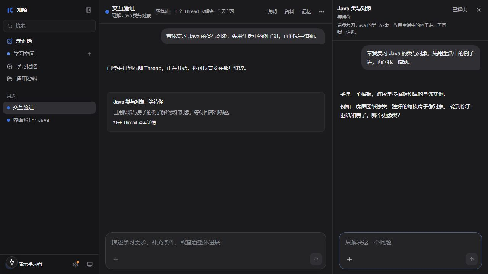

# 主线协调，支线执行

> 后续实现已增加空间并发上限、确认式建议卡片、用量统计和安全断点恢复。最新接口、边界与验收步骤见 [支线改进任务](thread-improvements.md)。以下保留初版实现记录。

更新：2026-10-16。实现于 main；修改前已 fetch，HEAD 与 origin/main 均为 `2366915`，ahead/behind 为 0/0。工作区此前已有 README、截图与记忆测试等未提交改动，原样保留并在现有 README 上更新相关交互说明。

## 用户流程

1. 用户在空间主线描述学习需求。简单问题可以当场回答；具体教学、练习和资料研究交给支线。
2. 协调 AI 根据空间内已有任务选择新建或续接，立即交办并启动。用户无需点击新建或重新描述需求。
3. 新分派事件展开右侧对应支线。用户可以直接在它的输入框里深入交互，也可以回到主线继续补充。
4. 主线的关联卡片持续更新该轮的状态、进展和结果。点击卡片可以再次打开支线。
5. 侧栏分组：等待你（含失败）、正在执行（含排队）、空闲、已解决。本轮回复完成与整个问题已解决分别表示。
6. 原有“已解决 → 编辑小结 → 合并回主线”保留，用于正式结束某个问题。

## 服务端

- `dispatch_thread(title, task, thread_id?)` 只提供给主线；不传 id 时创建，传入本空间支线 id 时续接。
- `report_progress(summary, needs_user?)` 只提供给支线。提示要求重要进展和本轮结束前回报；回复后的学情分析也会提取本轮结果与是否等待用户。若二者均未返回有效回报（例如分析服务不可用），使用实际回复节选作为兜底，并明确标注节选。
- 协调主线只获得分派、历史搜索和长期笔记工具；文件与命令工具由执行支线使用。工具执行时也校验当前角色允许的工具。
- `thread_dispatches` 在同一事务中保存分派记录、子会话和转交消息。同一用户消息的同一标题或目标支线不重复交办。
- 转交消息保留用户原话；模型的任务说明独立存为 `delegated_task`，不会冒充用户的学习证据。已分派的主线轮次不重复提取学习证据。
- 一个支线同时只生成一条回复。忙碌时的补充持久化排队，依次启动；每轮只读取截至该用户消息的历史，避免提前处理后来的补充。
- AI 分派的生成任务由服务端独立持有，浏览器切换、关闭或刷新不会取消它；用户可以在侧栏显式停止。停止也取消该支线尚未执行的排队补充。
- 自动执行期间分段保存文本和工具结果，右侧可以读取最新内容。审批信息持久化到回复，刷新后仍能在支线内处理；审批通过后从持有该请求的任务继续。
- 每个工作轮次对应主线的一张 `thread_update` 卡片，按工作中、等待、完成、失败或停止更新，详细文本留在支线。直接在侧栏发送的轮次也回报。
- 服务退出取消运行任务。重启时把中断状态同步到主线；尚未开始的排队消息恢复执行。已有失败回复不会自动重放，避免重复文件操作。
- 原有 `POST /api/subjects/{id}/threads` 暂保留兼容性，产品界面移除手动创建入口。

## 前端与接口

- 消息增加 `thread_update`、`pending_approval`，会话摘要增加 `execution_status`；原有 `thread_status=open/resolved` 保留。
- 主线流增加 `thread_dispatched {thread_id}` 事件，用于显示执行支线。
- 页面打开期间每 1.5 秒刷新空间任务和服务端生成的消息；本页面直接发起的流式回复不被轮询覆盖，页面隐藏时暂停轮询。
- 主线练习入口交给 AI 分派，侧栏保留直接练习与输入能力。
- 创建与续接的语义选择由模型决定，服务端验证空间归属、参数与重复分派；语义判断仍可能需要用户纠正。
- 当前后台任务在本地后端进程中执行，并非云任务。关闭浏览器可继续；退出后端或电脑休眠会中断，不能承诺关机后继续。

## 验证

自动回归覆盖创建后自动执行、结果回报、已有支线续接、重放去重、忙碌时顺序处理、断开观察连接、审批可恢复显示、显式停止、跨空间拒绝、模型失败、简单问题原地回答，以及侧栏回复回报。测试数据使用独立数据库。

- 后端全量测试：173 项通过；前端接口测试：15 项通过；TypeScript、ESLint 和生产构建均通过。
- 配置中的真实模型验证：主动创建并执行、回报结果、续接同一支线、侧栏直接交互后再次回报，4 项均通过。
- 浏览器使用独立测试数据库和确定性模型验证自动展开、执行中状态、等待用户、侧栏发送、主线续接、卡片更新和分组。以下截图为界面验收数据，不是真实学习记录。

## 设计依据

参考 Claude 新版 Projects 的产品结构，并按学习场景实现；以下为官方公开文档，不代表本项目直接使用 Claude 的产品接口：

- [Projects redesigned: from folder to conversation](https://claude.com/resources/articles/projects-redesigned)
- [Let Claude coordinate ongoing work with Projects](https://code.claude.com/docs/en/claude-projects)
- [What are projects?](https://support.claude.com/en/articles/9517075-what-are-projects)
