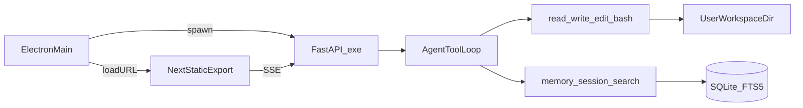

# KnowGap：桌面客户端 + Agent 工具 + 记忆

## 现状要点
- 前端：Next.js 15，单页（只有 [frontend/src/app/page.tsx](KnowGap/frontend/src/app/page.tsx)），通过 `NEXT_PUBLIC_API_BASE_URL` 调后端，可直接静态导出。
- 后端：FastAPI + SQLite。对话主流程在 [backend/app/chat/service.py](KnowGap/backend/app/chat/service.py) 的 `_run`：只做一次 `model.stream()`，以 SSE 推送 `delta/done/analysis`，**没有 tool calling**。
- 模型适配层在 [backend/app/agents/llm.py](KnowGap/backend/app/agents/llm.py) 的 `ChatCompletionsChat.stream`（OpenAI 兼容），只解析 `delta.content`。
- 记忆在 [backend/app/chat/store.py](KnowGap/backend/app/chat/store.py) 的 `learner_memories`：由分析模型抽取、必须附用户原话作证据，按关键词召回（`relevant_memories`）。Agent 本身不能主动写记忆，也不能检索历史会话。

## 一、Agent 工具（仿 Pi：read / write / edit / bash）
1. `llm.py`：`stream(messages, tools=None)` 支持传入 `tools`，并按 index 累积 `delta.tool_calls`；当 `finish_reason == "tool_calls"` 时产出 `("tool_calls", [...])`。
2. 新增 `backend/app/agent_tools/`：
   - `read`：参数 `path, offset, limit`；返回带行号的内容，按 Pi 的做法截断到 2000 行或 50KB。
   - `write`：整文件覆盖写入，父目录不存在时自动创建。
   - `edit`：`old_text -> new_text` 精确替换，要求 `old_text` 在文件里只出现一次，返回 diff。
   - `bash`：在 Windows 上用 PowerShell 执行，`cwd` 设为工作区，带超时，输出截断；停止和超时均终止进程树。工作区只是起始目录，不能限制命令访问工作区外的文件。
   - `guard.py`：文件工具的所有路径都 resolve 后必须落在工作区根目录之内。
3. 改 `service._run` 为循环，最多 N 轮：流式输出文本，遇到 tool_calls 就执行工具，把 assistant 的 tool_calls 和 tool 结果追加进 messages，然后继续请求模型。SSE 新增 `tool_start` / `tool_end` 两种事件；工具卡片写进 `meta_json["tool_calls"]`，成组的 assistant/tool 上下文写进 `meta_json["tool_messages"]`，下一轮一起恢复；截断不拆开调用与结果，旧卡片记录也支持恢复。达到循环上限时标记失败并保留记录。
4. 审批：`bash` 和写操作先推送 `tool_approval` 事件，前端回调 `POST /api/chat/tool-approvals/{id}` 决定放行或拒绝；自动批准默认关闭；开关只适用于文件写入，`bash` 始终逐次审批。
5. 工作区路径存到现有的 [backend/app/services/ai_settings.py](KnowGap/backend/app/services/ai_settings.py)；`CHAT_PROMPT`（[backend/app/chat/agent.py](KnowGap/backend/app/chat/agent.py)）里补充工具使用说明。
6. 前端：在 [frontend/src/lib/chat/types.ts](KnowGap/frontend/src/lib/chat/types.ts) 和 [frontend/src/hooks/useChat.ts](KnowGap/frontend/src/hooks/useChat.ts) 处理新增的 SSE 事件；在 [frontend/src/components/chat/MessageList.tsx](KnowGap/frontend/src/components/chat/MessageList.tsx) 里渲染可折叠的工具调用卡片和审批按钮；在设置对话框里加工作区选择。

## 二、记忆（参考 Hermes，调研结论出来后再定细节）
Hermes 的核心做法：两块有字数上限、由 Agent 自己维护的记忆（MEMORY.md 记 Agent 笔记，USER.md 记用户画像），会话开始时注入 system prompt；配一个 `memory` 工具（add / replace / remove）；再加一个基于 SQLite FTS5 的 `session_search`，用来检索历史会话。
1. 新增 `backend/app/memory/curated.py`：表 `agent_memory(student_id, target IN ('memory','user'), content)`，设字数上限，超出时要求 Agent 先合并或删减。
2. 新增 `memory` 工具，接入第一部分的工具循环；`chat_messages()` 在构造上下文时注入这两块记忆。
3. 给 `conversation_messages` 建 FTS5 虚表和同步触发器，新增 `session_search` 工具，返回命中片段（可选：再用模型做一次摘要）。
4. 现有的证据型 `learner_memories` 保留不动，与新记忆并存：前者负责学情诊断，后者负责 Agent 的长期上下文。
5. 前端在 [frontend/src/components/chat/MemoryDrawer.tsx](KnowGap/frontend/src/components/chat/MemoryDrawer.tsx) 里增加 USER / MEMORY 两块的查看和编辑。

## 三、Electron 客户端
1. 前端：[frontend/next.config.ts](KnowGap/frontend/next.config.ts) 加 `output: "export"` 和 `images.unoptimized`；API base 留空时走同源请求（改 [frontend/src/lib/config.ts](KnowGap/frontend/src/lib/config.ts)）。
2. 后端：新增 `backend/desktop_entry.py`，从命令行参数读取端口、从环境变量 `KNOWGAP_DATA_DIR` 读取数据目录（落到 Electron 的 userData 下）；FastAPI 用 `StaticFiles` 挂载前端导出的 `out/`，这样同源、不需要 CORS。用 PyInstaller 以 onedir 方式打包。无控制台入口关闭 Uvicorn 默认日志配置，将日志写入数据目录的 `logs/backend.log` 并轮转。
3. 新增 `desktop/`：`main.js` 负责找空闲端口、启动后端 exe、轮询 `/health` 就绪后打开 `BrowserWindow`，退出时结束子进程；`preload.js` 暴露 `selectFolder`，供工作区选择使用。
4. 用 electron-builder 打 NSIS 安装包；`scripts/build-desktop.ps1` 依次执行：前端 build、PyInstaller 打包、electron-builder 出包。

## 顺序
第三部分（客户端）和第一部分（Agent 工具）互不依赖，可以并行；第二部分（记忆）依赖第一部分的工具循环，并且要等 Hermes 调研的结论。
