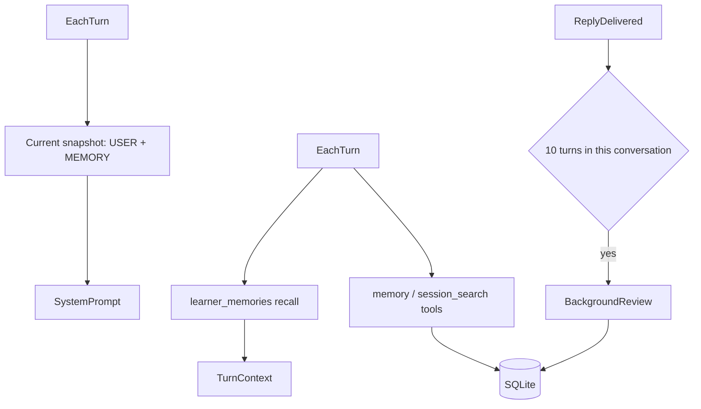

# KnowGap 记忆治理优化（参照 Hermes）

## 对应关系与取舍
- 第一层，精选笔记：已有 `agent_memory` 的 user / memory 两块，但现在是一整块文本、上限 4000 字、每轮重新注入。要改成按条目存、分别设上限、每轮开始时刷新快照。
- 第二层，会话检索：已有 `session_search`（FTS5 trigram），但返回的是摘录片段。要改成返回原文，包括当前会话的较早消息，只查已完成的消息。
- 第三层，外部记忆：现有的证据型 `learner_memories` 本身就相当于 Hermes 的 prefetch 层，按话题召回后插进当轮上下文，不改系统提示。保留不动，不另外接 Honcho 这类外部插件。
- 技能（过程记忆）：这次不做。KnowGap 是学习产品，“这类任务以后怎么做”大部分已经由学习空间的 instructions 承担。
- 分工规则（借鉴 Hermes 的“一条事实只进一个文件”）：
  - USER：用户是谁、沟通方式、长期目标；
  - MEMORY：环境事实，比如工作区路径、文件约定、资料位置、工具坑；
  - 知识点层面的误区、掌握、学习偏好，只进 `learner_memories`，`memory` 工具不得写这类内容。

## 改动
1. **条目化与上限**（[backend/app/memory/curated.py](KnowGap/backend/app/memory/curated.py)）
   - 条目之间用 `\n§\n` 分隔；`LIMITS = {"user": 1375, "memory": 2200}`。
   - 动作改为 `add / patch / remove`：`patch` 按 `old_text` 唯一匹配一条条目再替换。完全相同的条目直接丢弃，返回“已存在”。
   - 写入后如果超限，直接报错，提示模型在同一轮里先 remove 再写，不做自动压缩。
   - 新增 `scan(text)`：拦截注入类内容（如“忽略以上”“ignore previous”“system prompt”），以及疑似密钥的内容（`sk-`、`Bearer `、长串 base64）。
   - 同步更新 [backend/app/agent_tools/__init__.py](KnowGap/backend/app/agent_tools/__init__.py) 里 `memory` 工具的 schema 和描述，写明上述分工。
2. **按轮刷新快照**
   - `conversations` 表加 `notes_snapshot` 列（沿用现有的 `ensure_column` 迁移方式）。每轮生成开始时读取最新笔记并更新快照，主线也遵循此规则。
   - [backend/app/chat/agent.py](KnowGap/backend/app/chat/agent.py) 里，`chat_messages()` 把快照拼到第一条 system 消息末尾，并从每轮变化的 JSON context 里移除 `agent_notes`。笔记未变化时提示保持稳定；笔记变化时优先保证后续轮次读到最新内容。
   - 本轮已保存或批准的修改在下一轮进入提示，抽屉显示“下一轮对话生效”。
3. **会话检索返回原文**
   - `search()` 改为返回整条消息原文（截断到 600 字），附带角色、日期和会话标题。
   - 加过滤条件 `m.status = 'complete'`，允许搜索当前会话较早的消息；始终按学生隔离。
4. **后台复盘**（[backend/app/chat/service.py](KnowGap/backend/app/chat/service.py)）
   - 新表 `conversation_note_state(student_id, conversation_id, turns_since_note)`。在 `_run` 正常完成后按会话计数，同一用户消息重新生成不重复计数；只有 `memory` 实际更新笔记才清零，待审批或失败的写入不会清零。
   - 计数到 10 时，`asyncio.create_task` 启动一次复盘：用 `complete_json` 把本会话最近 10 个已计数用户轮次及对应回复、当前笔记交给模型；复盘不沿用聊天上下文的字符截断，返回 `{"ops":[{action,target,content,old_text}]}`，逐条经过 `scan` 后再 apply。
   - 复盘只写库，不往当前的 SSE 流推任何事件。复盘的提示词照搬 Hermes 的分工规则，禁止写成一次性的叙事。
5. **写入审批（可选开关）**
   - 在 `ai_settings` 加 `memory_write_approval`。开启后，`memory` 工具和后台复盘的写入先进 `agent_memory_pending` 表，工具返回“已提交待确认”。
   - [backend/app/chat/router.py](KnowGap/backend/app/chat/router.py) 新增 `GET /api/agent-memory/pending` 和 `POST /api/agent-memory/pending/{id}`，后者接收 `{allow}`。
6. **前端**
   - [frontend/src/components/chat/MemoryDrawer.tsx](KnowGap/frontend/src/components/chat/MemoryDrawer.tsx)：USER / MEMORY 按条目列表展示，每条可删除；显示字数和上限，例如 `812/1375`；增加待确认区，可以批准或拒绝。
   - 设置里的工作区卡片增加“记忆写入需确认”开关。

## 验证
- 补充 pytest：条目去重；超限报错；扫描拦截；主线内新增、修改、删除笔记在下一轮生效；搜索包括当前会话并隔离用户；按会话第 10 轮触发复盘，包含长消息，实际更新 `memory` 时计数清零；审批开关开启时写入进入待确认。
